# UC-07A Plot generation: Time Profiles

## Summary

This scenario validates representative time-profile variant families for mean models and exports the generated workflow outputs.

## Assertions

- Scenarios configured: Set1, Set1_Reference, Set2_OD
- UC07A_TimeProfiles contains one representative row for each variant family.
- All family-specific runPlot(nameOfplotFunction = 'plotTimeProfiles') calls completed without hard errors.
- Generated plot files: 30
- UC07A_TimeProfiles.qmd generated and rendered: UC07A_TimeProfiles.qmd (manual extraction)

## Family Coverage

| Family | Representative Plot Name | Status | Returned Objects |
|---|---|---|---:|
| single-without-data | singlePlot_withoutData | PASS | 2 |
| single-with-data | singlePlot_withData | PASS | 12 |
| single-with-reference | singlePlot_withReference | PASS | 2 |
| single-with-offset | singlePlot_withOffset | PASS | 2 |
| single-with-limits | singlePlot_withLimits | PASS | 2 |
| multidose-time-ranges | multiDosePlot | PASS | 6 |
| many-panel-fixed | manyPanelPlot | PASS | 2 |
| many-panel-free-col3 | manyPanelPlot_col3 | PASS | 2 |
| single-without-data | manyPanelPlot_col3 | PASS | 2 |

## 
Time Profile Report

The following content is from the auto-generated Timeprofile.qmd with all figures, captions, and headings as defined in the TimeProfiles configuration sheet:

 
```{r}
#| include: false
knitr::opts_chunk$set(echo = FALSE, warning = FALSE, results = "asis", error = FALSE, message = FALSE)
```
 
  
```{r}
#| label: fig-singlePlot_withoutData-TP-linear-total
#| fig-cap: "Concentration-time profiles for Aciclovir_PVB disp for Set1 on a linear y-scale."
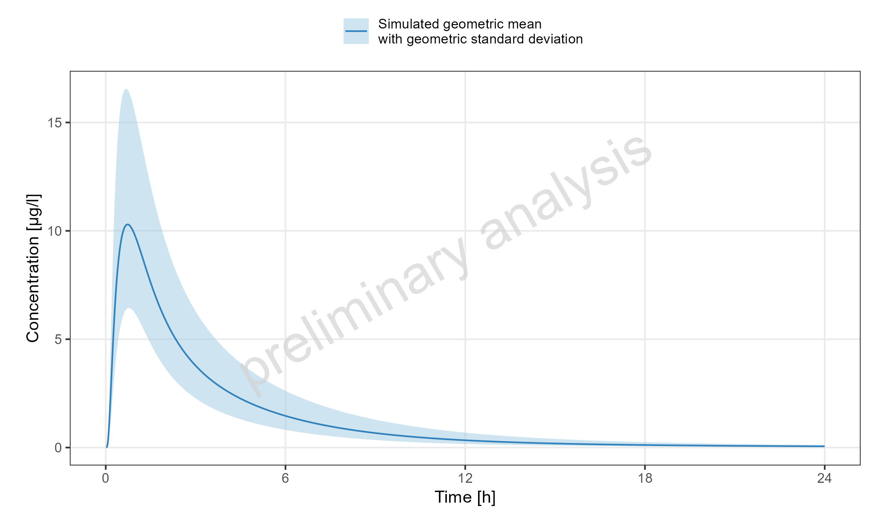
```
```{r}
#| output: asis
ospsuite.reportingframework::mdFootNote(subfolder = "UC07A_TimeProfiles", footNoteFile = "singlePlot_withoutData-TP-linear-total.footnote", footNoteCustomStyle = params$customStyles$FigureFootnote)
```
\newpage
  
```{r}
#| label: fig-singlePlot_withoutData-TP-log-total
#| fig-cap: "Concentration-time profiles for Aciclovir_PVB disp for Set1 on a logarithmic y-scale."
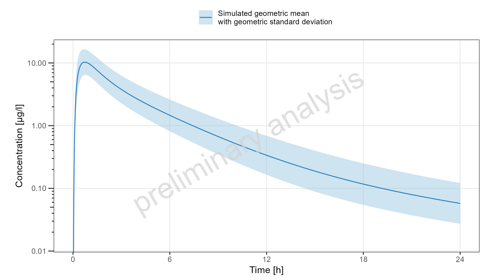
```
```{r}
#| output: asis
ospsuite.reportingframework::mdFootNote(subfolder = "UC07A_TimeProfiles", footNoteFile = "singlePlot_withoutData-TP-log-total.footnote", footNoteCustomStyle = params$customStyles$FigureFootnote)
```
\newpage
  
```{r}
#| label: fig-singlePlot_withData-TP-linear-total
#| fig-cap: "Concentration-time profiles for Aciclovir_PVB disp for Set1 on a linear y-scale."
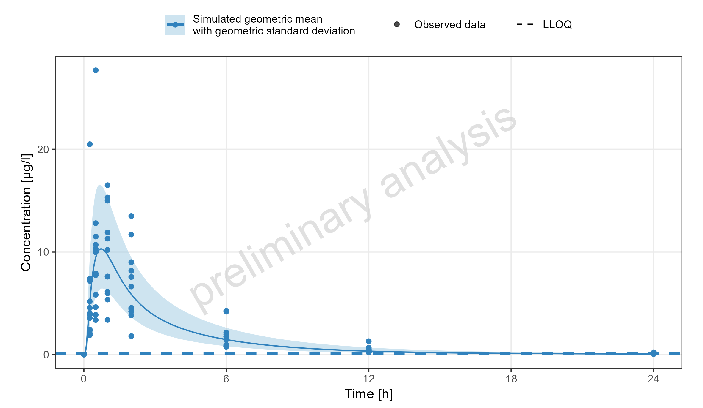
```
```{r}
#| output: asis
ospsuite.reportingframework::mdFootNote(subfolder = "UC07A_TimeProfiles", footNoteFile = "singlePlot_withData-TP-linear-total.footnote", footNoteCustomStyle = params$customStyles$FigureFootnote)
```
\newpage
  
```{r}
#| label: fig-singlePlot_withData-TP-log-total
#| fig-cap: "Concentration-time profiles for Aciclovir_PVB disp for Set1 on a logarithmic y-scale."
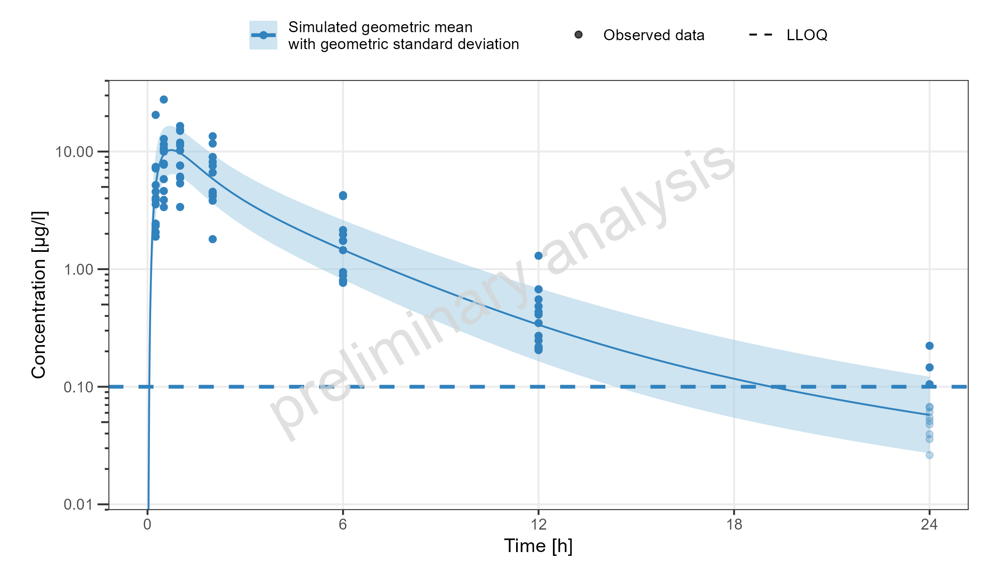
```
```{r}
#| output: asis
ospsuite.reportingframework::mdFootNote(subfolder = "UC07A_TimeProfiles", footNoteFile = "singlePlot_withData-TP-log-total.footnote", footNoteCustomStyle = params$customStyles$FigureFootnote)
```
\newpage
  
```{r}
#| label: fig-singlePlot_withData-PvO-linear-total
#| fig-cap: "Predicted vs Observed for Aciclovir_PVB disp for Set1 on a linear x and y-scale."
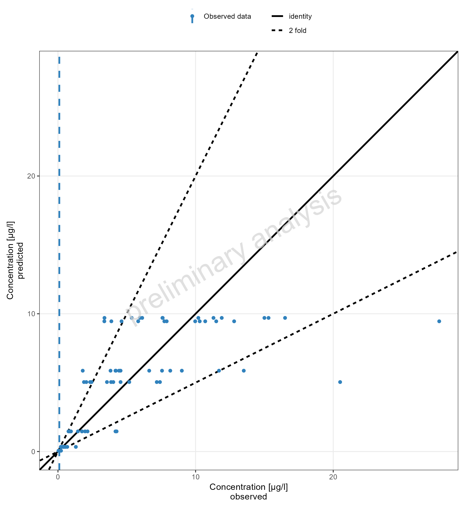
```
```{r}
#| output: asis
ospsuite.reportingframework::mdFootNote(subfolder = "UC07A_TimeProfiles", footNoteFile = "singlePlot_withData-PvO-linear-total.footnote", footNoteCustomStyle = params$customStyles$FigureFootnote)
```
\newpage
  
```{r}
#| label: fig-singlePlot_withData-PvO-log-total
#| fig-cap: "Predicted vs Observed for Aciclovir_PVB disp for Set1 on a logarithmic x and y-scale."
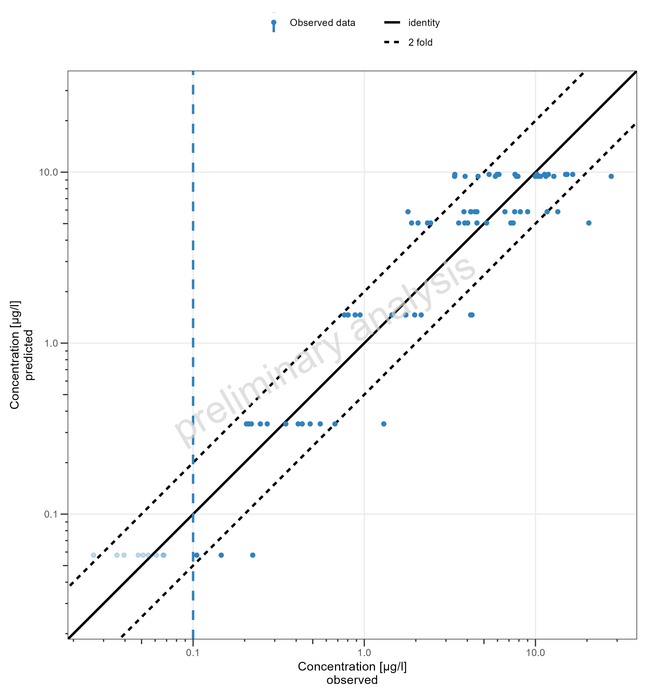
```
```{r}
#| output: asis
ospsuite.reportingframework::mdFootNote(subfolder = "UC07A_TimeProfiles", footNoteFile = "singlePlot_withData-PvO-log-total.footnote", footNoteCustomStyle = params$customStyles$FigureFootnote)
```
\newpage
  
```{r}
#| label: fig-singlePlot_withData-ResvT-linear-total
#| fig-cap: "Residuals vs time values for Aciclovir_PVB disp for Set1."
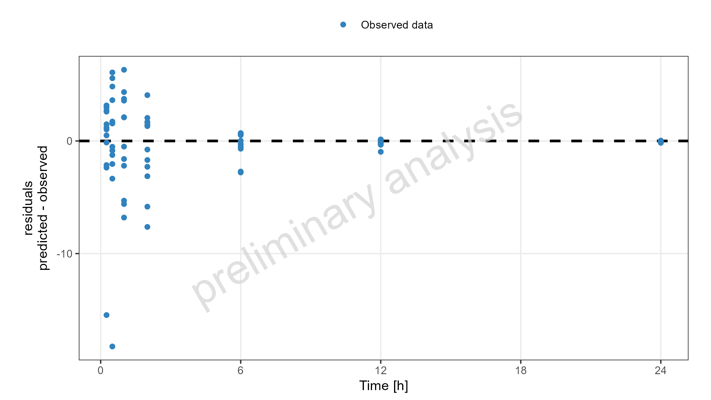
```
```{r}
#| output: asis
ospsuite.reportingframework::mdFootNote(subfolder = "UC07A_TimeProfiles", footNoteFile = "singlePlot_withData-ResvT-linear-total.footnote", footNoteCustomStyle = params$customStyles$FigureFootnote)
```
\newpage
  
```{r}
#| label: fig-singlePlot_withData-ResvT-log-total
#| fig-cap: "Residuals vs time values for Aciclovir_PVB disp for Set1."
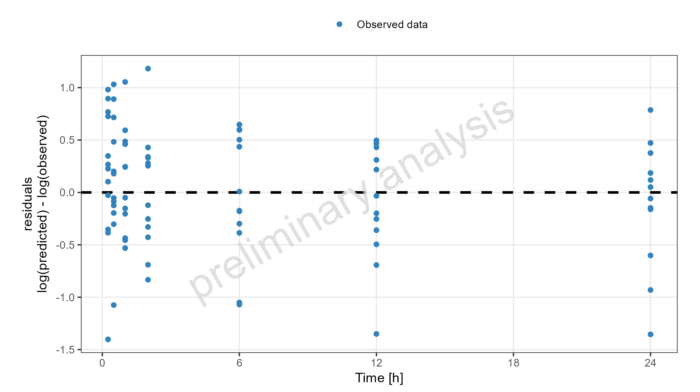
```
```{r}
#| output: asis
ospsuite.reportingframework::mdFootNote(subfolder = "UC07A_TimeProfiles", footNoteFile = "singlePlot_withData-ResvT-log-total.footnote", footNoteCustomStyle = params$customStyles$FigureFootnote)
```
\newpage
  
```{r}
#| label: fig-singlePlot_withData-ResvO-linear-total
#| fig-cap: "Residuals vs observed values for Aciclovir_PVB disp for Set1."
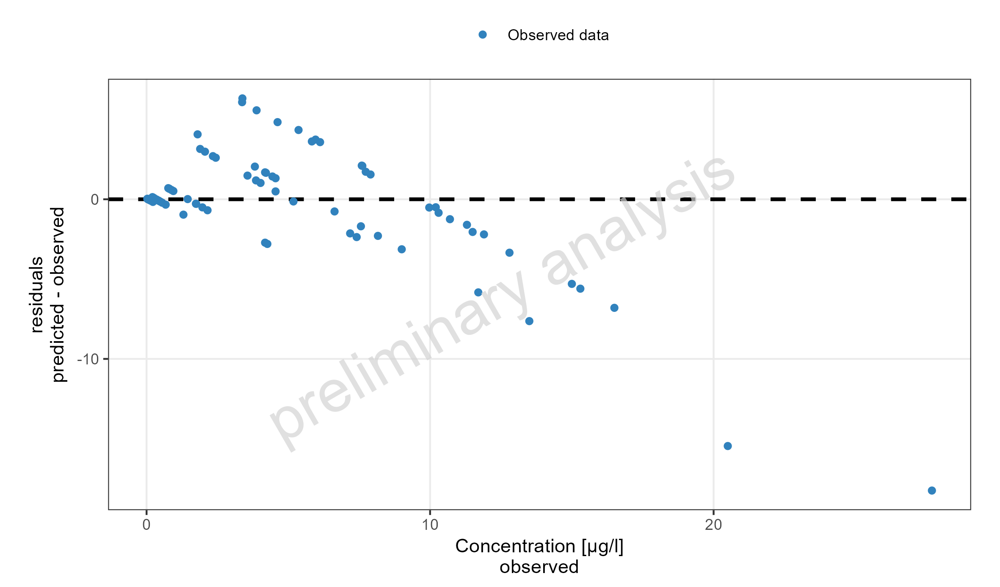
```
```{r}
#| output: asis
ospsuite.reportingframework::mdFootNote(subfolder = "UC07A_TimeProfiles", footNoteFile = "singlePlot_withData-ResvO-linear-total.footnote", footNoteCustomStyle = params$customStyles$FigureFootnote)
```
\newpage
  
```{r}
#| label: fig-singlePlot_withData-ResvO-log-total
#| fig-cap: "Residuals vs observed values for Aciclovir_PVB disp for Set1."
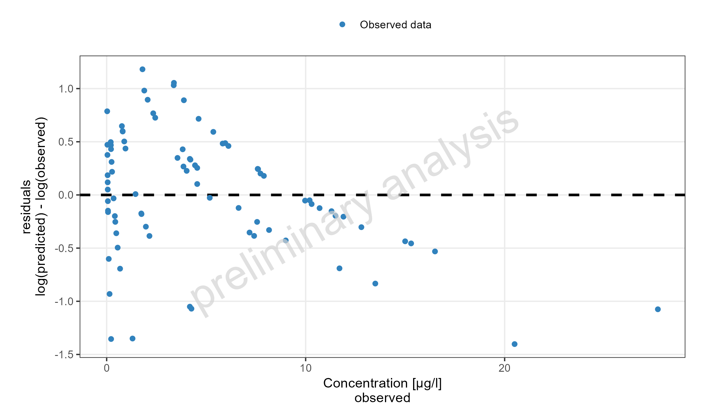
```
```{r}
#| output: asis
ospsuite.reportingframework::mdFootNote(subfolder = "UC07A_TimeProfiles", footNoteFile = "singlePlot_withData-ResvO-log-total.footnote", footNoteCustomStyle = params$customStyles$FigureFootnote)
```
\newpage
  
```{r}
#| label: fig-singlePlot_withData-ResH-linear-total
#| fig-cap: "Residuals distribution for Aciclovir_PVB disp for Set1."
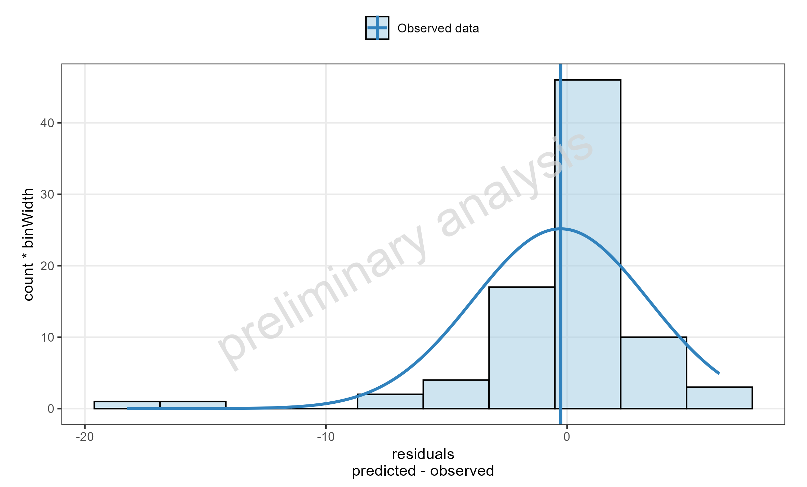
```
```{r}
#| output: asis
ospsuite.reportingframework::mdFootNote(subfolder = "UC07A_TimeProfiles", footNoteFile = "singlePlot_withData-ResH-linear-total.footnote", footNoteCustomStyle = params$customStyles$FigureFootnote)
```
\newpage
  
```{r}
#| label: fig-singlePlot_withData-ResH-log-total
#| fig-cap: "Residuals distribution for Aciclovir_PVB disp for Set1."
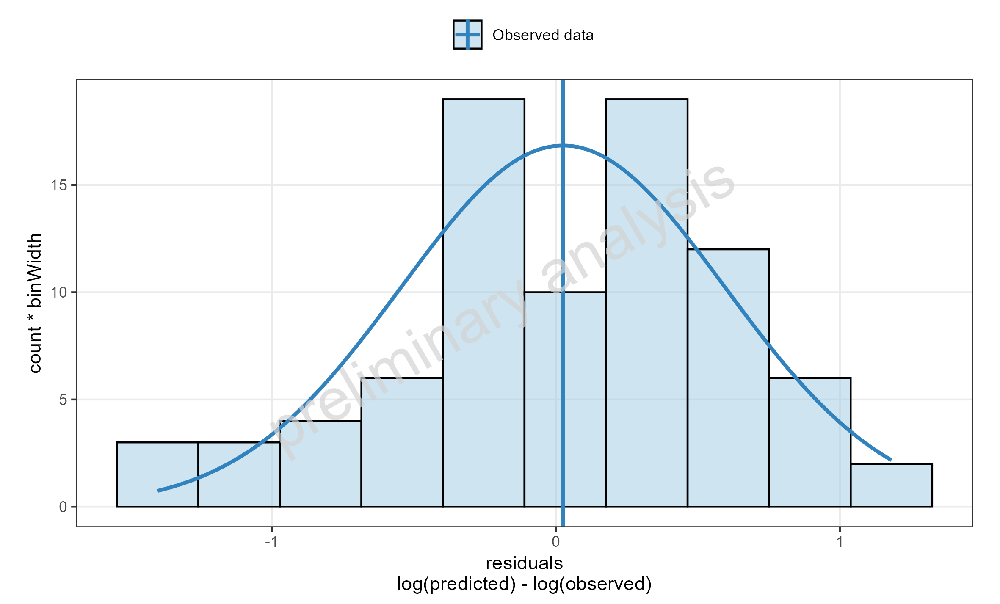
```
```{r}
#| output: asis
ospsuite.reportingframework::mdFootNote(subfolder = "UC07A_TimeProfiles", footNoteFile = "singlePlot_withData-ResH-log-total.footnote", footNoteCustomStyle = params$customStyles$FigureFootnote)
```
\newpage
  
```{r}
#| label: fig-singlePlot_withData-QQ-linear-total
#| fig-cap: "Residuals as quantile-quantile plot for Aciclovir_PVB disp for Set1."
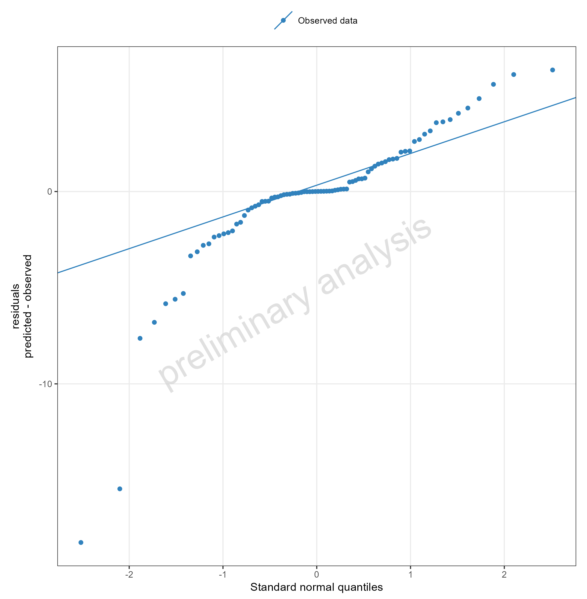
```
```{r}
#| output: asis
ospsuite.reportingframework::mdFootNote(subfolder = "UC07A_TimeProfiles", footNoteFile = "singlePlot_withData-QQ-linear-total.footnote", footNoteCustomStyle = params$customStyles$FigureFootnote)
```
\newpage
  
```{r}
#| label: fig-singlePlot_withData-QQ-log-total
#| fig-cap: "Residuals as quantile-quantile plot for Aciclovir_PVB disp for Set1."
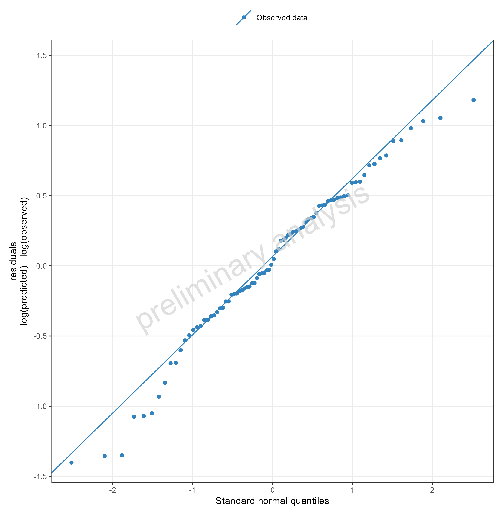
```
```{r}
#| output: asis
ospsuite.reportingframework::mdFootNote(subfolder = "UC07A_TimeProfiles", footNoteFile = "singlePlot_withData-QQ-log-total.footnote", footNoteCustomStyle = params$customStyles$FigureFootnote)
```
\newpage
  
```{r}
#| label: fig-singlePlot_withReference-TP-linear-total
#| fig-cap: "Concentration-time profiles for Aciclovir_PVB disp for Set1 on a linear y-scale."
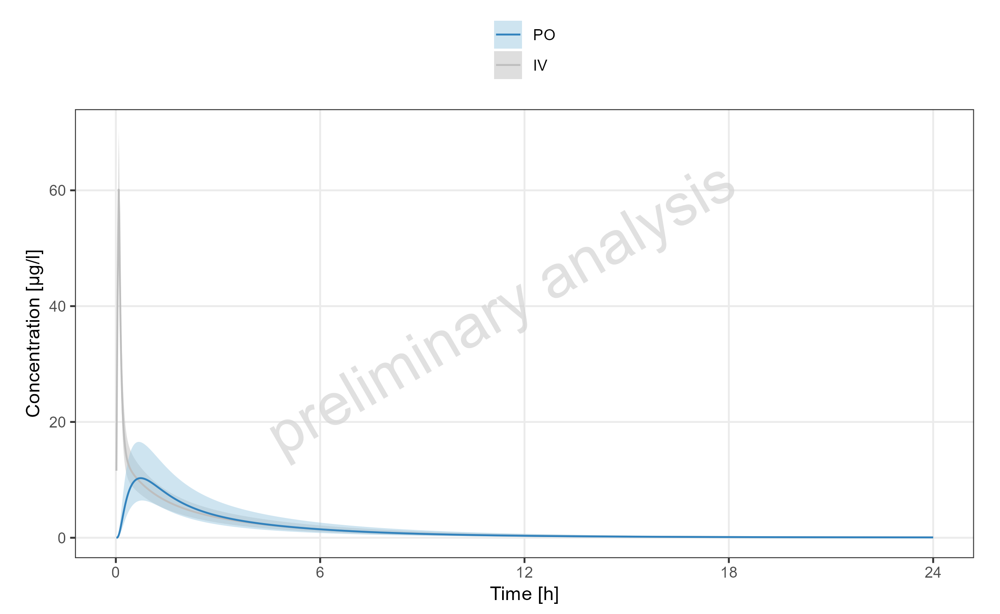
```
```{r}
#| output: asis
ospsuite.reportingframework::mdFootNote(subfolder = "UC07A_TimeProfiles", footNoteFile = "singlePlot_withReference-TP-linear-total.footnote", footNoteCustomStyle = params$customStyles$FigureFootnote)
```
\newpage
  
```{r}
#| label: fig-singlePlot_withReference-TP-log-total
#| fig-cap: "Concentration-time profiles for Aciclovir_PVB disp for Set1 on a logarithmic y-scale."
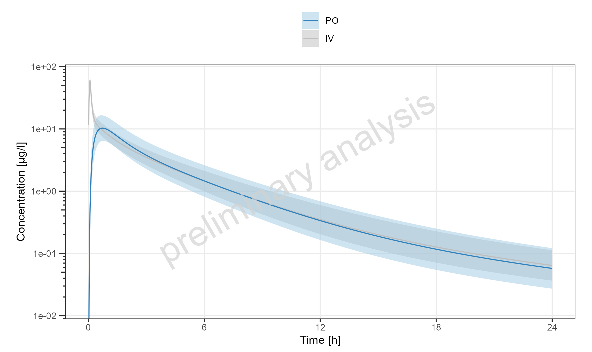
```
```{r}
#| output: asis
ospsuite.reportingframework::mdFootNote(subfolder = "UC07A_TimeProfiles", footNoteFile = "singlePlot_withReference-TP-log-total.footnote", footNoteCustomStyle = params$customStyles$FigureFootnote)
```
\newpage
  
```{r}
#| label: fig-singlePlot_withOffset-TP-linear-total
#| fig-cap: "Concentration-time profiles for Aciclovir_PVB disp for Set1 on a linear y-scale."
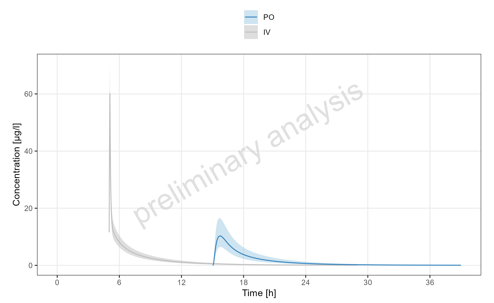
```
```{r}
#| output: asis
ospsuite.reportingframework::mdFootNote(subfolder = "UC07A_TimeProfiles", footNoteFile = "singlePlot_withOffset-TP-linear-total.footnote", footNoteCustomStyle = params$customStyles$FigureFootnote)
```
\newpage
  
```{r}
#| label: fig-singlePlot_withOffset-TP-log-total
#| fig-cap: "Concentration-time profiles for Aciclovir_PVB disp for Set1 on a logarithmic y-scale."
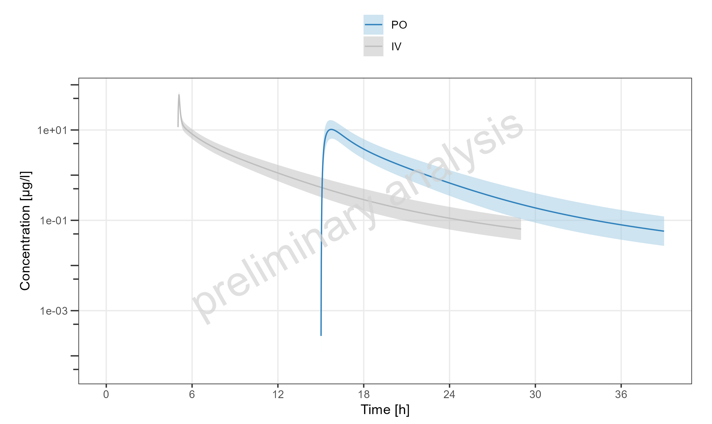
```
```{r}
#| output: asis
ospsuite.reportingframework::mdFootNote(subfolder = "UC07A_TimeProfiles", footNoteFile = "singlePlot_withOffset-TP-log-total.footnote", footNoteCustomStyle = params$customStyles$FigureFootnote)
```
\newpage
  
```{r}
#| label: fig-singlePlot_withLimits-TP-linear-total
#| fig-cap: "Concentration-time profiles for Aciclovir_PVB disp for Set1 on a linear y-scale."
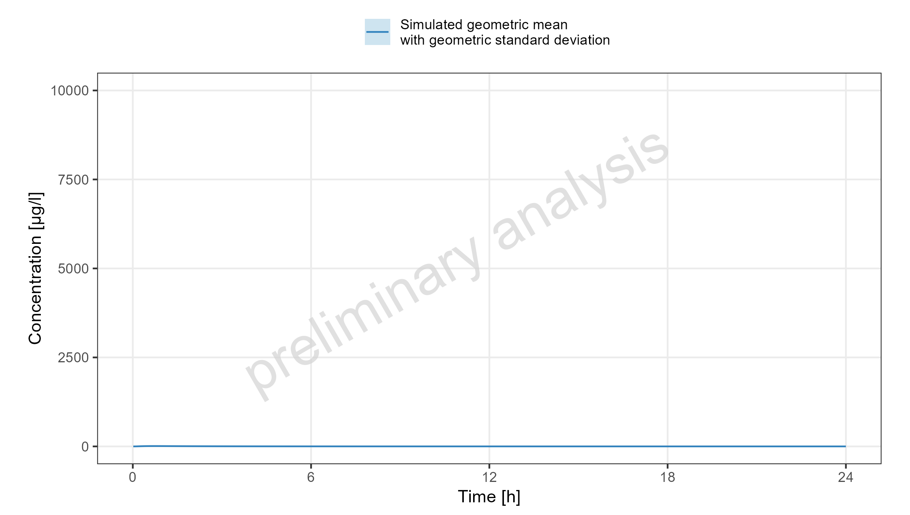
```
```{r}
#| output: asis
ospsuite.reportingframework::mdFootNote(subfolder = "UC07A_TimeProfiles", footNoteFile = "singlePlot_withLimits-TP-linear-total.footnote", footNoteCustomStyle = params$customStyles$FigureFootnote)
```
\newpage
  
```{r}
#| label: fig-singlePlot_withLimits-TP-log-total
#| fig-cap: "Concentration-time profiles for Aciclovir_PVB disp for Set1 on a logarithmic y-scale."
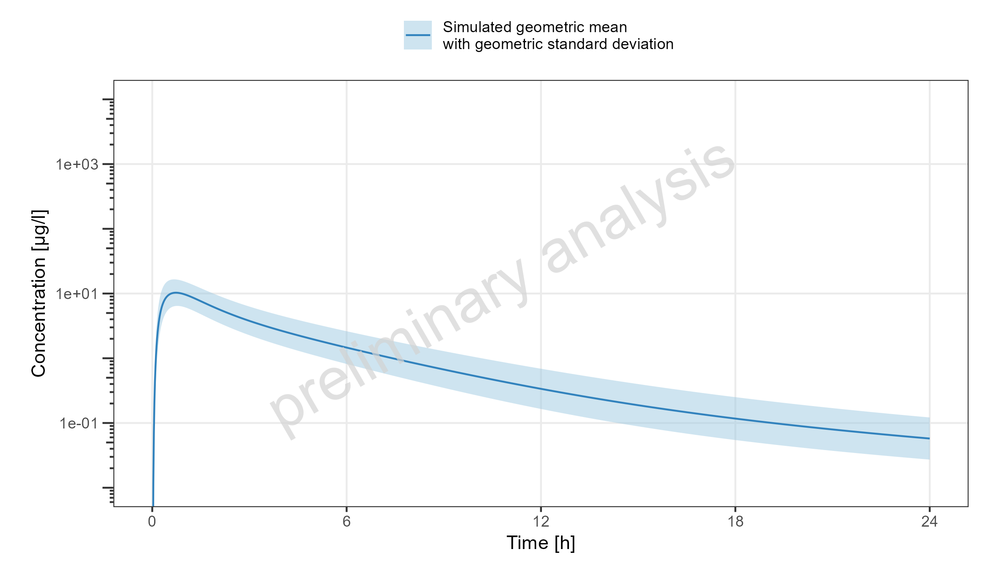
```
```{r}
#| output: asis
ospsuite.reportingframework::mdFootNote(subfolder = "UC07A_TimeProfiles", footNoteFile = "singlePlot_withLimits-TP-log-total.footnote", footNoteCustomStyle = params$customStyles$FigureFootnote)
```
\newpage
  
```{r}
#| label: fig-multiDosePlot-TP-linear-total
#| fig-cap: "Concentration-time profiles for Aciclovir_PVB disp for Set2 OD on a linear y-scale."
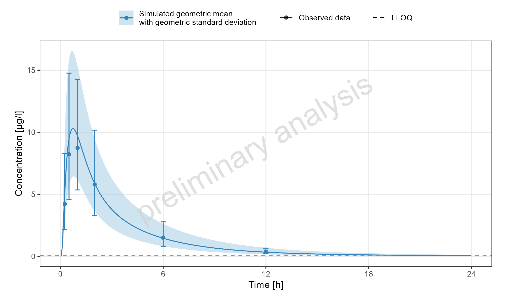
```
```{r}
#| output: asis
ospsuite.reportingframework::mdFootNote(subfolder = "UC07A_TimeProfiles", footNoteFile = "multiDosePlot-TP-linear-total.footnote", footNoteCustomStyle = params$customStyles$FigureFootnote)
```
\newpage
  
```{r}
#| label: fig-multiDosePlot-TP-log-total
#| fig-cap: "Concentration-time profiles for Aciclovir_PVB disp for Set2 OD on a logarithmic y-scale."
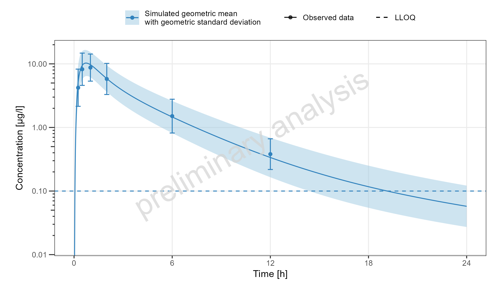
```
```{r}
#| output: asis
ospsuite.reportingframework::mdFootNote(subfolder = "UC07A_TimeProfiles", footNoteFile = "multiDosePlot-TP-log-total.footnote", footNoteCustomStyle = params$customStyles$FigureFootnote)
```
\newpage
  
```{r}
#| label: fig-multiDosePlot-TP-linear-firstApplication
#| fig-cap: "Concentration-time profiles for Aciclovir_PVB disp for Set2 OD on a linear y-scale. Zoom on the first dose."
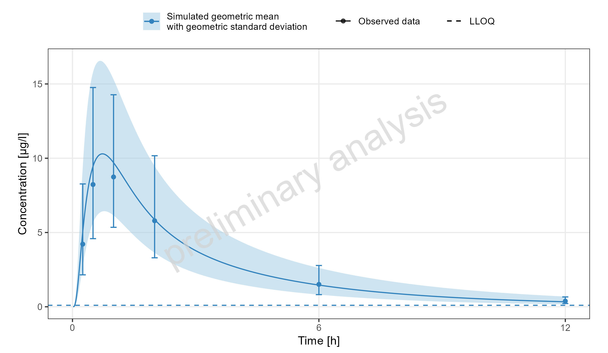
```
```{r}
#| output: asis
ospsuite.reportingframework::mdFootNote(subfolder = "UC07A_TimeProfiles", footNoteFile = "multiDosePlot-TP-linear-firstApplication.footnote", footNoteCustomStyle = params$customStyles$FigureFootnote)
```
\newpage
  
```{r}
#| label: fig-multiDosePlot-TP-log-firstApplication
#| fig-cap: "Concentration-time profiles for Aciclovir_PVB disp for Set2 OD on a logarithmic y-scale. Zoom on the first dose."
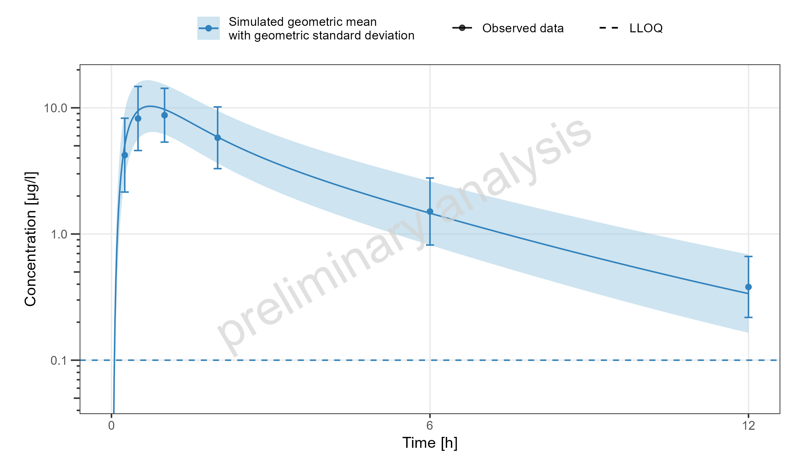
```
```{r}
#| output: asis
ospsuite.reportingframework::mdFootNote(subfolder = "UC07A_TimeProfiles", footNoteFile = "multiDosePlot-TP-log-firstApplication.footnote", footNoteCustomStyle = params$customStyles$FigureFootnote)
```
\newpage
  
```{r}
#| label: fig-multiDosePlot-TP-linear-lastApplication
#| fig-cap: "Concentration-time profiles for Aciclovir_PVB disp for Set2 OD on a linear y-scale. Zoom on steady state dose."
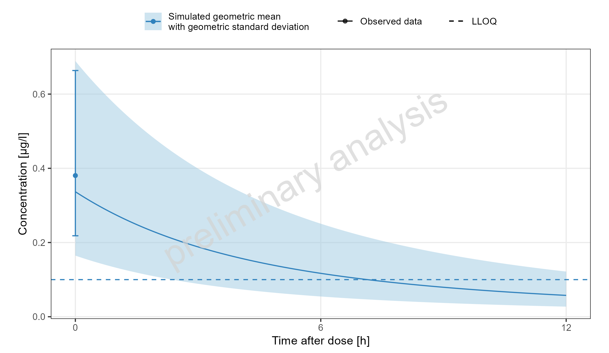
```
```{r}
#| output: asis
ospsuite.reportingframework::mdFootNote(subfolder = "UC07A_TimeProfiles", footNoteFile = "multiDosePlot-TP-linear-lastApplication.footnote", footNoteCustomStyle = params$customStyles$FigureFootnote)
```
\newpage
  
```{r}
#| label: fig-multiDosePlot-TP-log-lastApplication
#| fig-cap: "Concentration-time profiles for Aciclovir_PVB disp for Set2 OD on a logarithmic y-scale. Zoom on steady state dose."
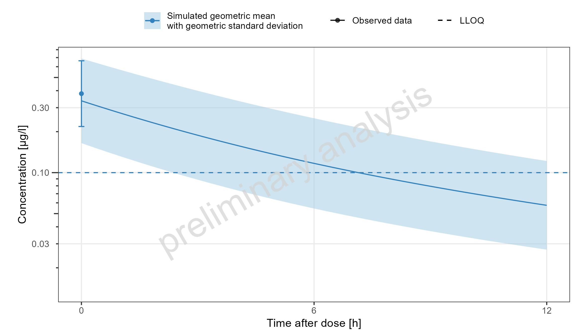
```
```{r}
#| output: asis
ospsuite.reportingframework::mdFootNote(subfolder = "UC07A_TimeProfiles", footNoteFile = "multiDosePlot-TP-log-lastApplication.footnote", footNoteCustomStyle = params$customStyles$FigureFootnote)
```
\newpage
  
```{r}
#| label: fig-manyPanelPlot-TP-linear-total
#| fig-cap: "Concentration-time profiles for Aciclovir_PVB disp (A) and Aciclovir_fat_cell disp (B) for Set1 on a linear y-scale."
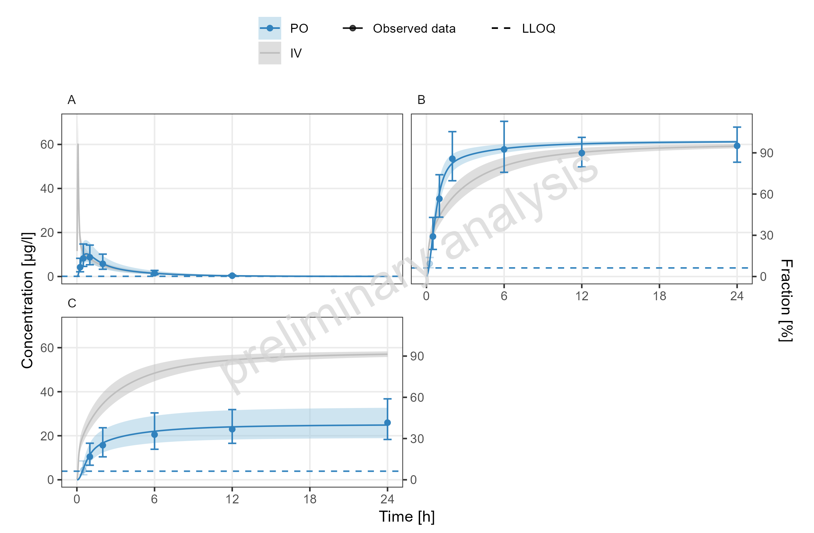
```
```{r}
#| output: asis
ospsuite.reportingframework::mdFootNote(subfolder = "UC07A_TimeProfiles", footNoteFile = "manyPanelPlot-TP-linear-total.footnote", footNoteCustomStyle = params$customStyles$FigureFootnote)
```
\newpage
  
```{r}
#| label: fig-manyPanelPlot-TP-log-total
#| fig-cap: "Concentration-time profiles for Aciclovir_PVB disp (A) and Aciclovir_fat_cell disp (B) for Set1 on a logarithmic y-scale."
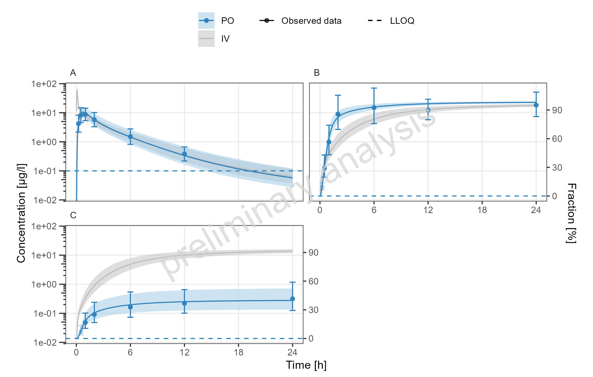
```
```{r}
#| output: asis
ospsuite.reportingframework::mdFootNote(subfolder = "UC07A_TimeProfiles", footNoteFile = "manyPanelPlot-TP-log-total.footnote", footNoteCustomStyle = params$customStyles$FigureFootnote)
```
\newpage
  
```{r}
#| label: fig-manyPanelPlot_col3-TP-linear-total
#| fig-cap: "Concentration-time profiles for Aciclovir_PVB disp (A, C) and Aciclovir_fat_cell disp (B, D) for Set1 (A, B) and Set1 Reference (C, D) on a linear y-scale."
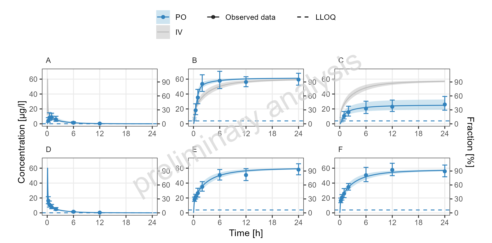
```
```{r}
#| output: asis
ospsuite.reportingframework::mdFootNote(subfolder = "UC07A_TimeProfiles", footNoteFile = "manyPanelPlot_col3-TP-linear-total.footnote", footNoteCustomStyle = params$customStyles$FigureFootnote)
```
\newpage
  
```{r}
#| label: fig-manyPanelPlot_col3-TP-log-total
#| fig-cap: "Concentration-time profiles for Aciclovir_PVB disp (A, C) and Aciclovir_fat_cell disp (B, D) for Set1 (A, B) and Set1 Reference (C, D) on a logarithmic y-scale."
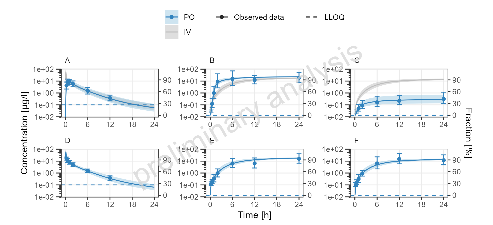
```
```{r}
#| output: asis
ospsuite.reportingframework::mdFootNote(subfolder = "UC07A_TimeProfiles", footNoteFile = "manyPanelPlot_col3-TP-log-total.footnote", footNoteCustomStyle = params$customStyles$FigureFootnote)
```
\newpage
  

