 
```{r}
#| include: false
knitr::opts_chunk$set(echo = FALSE, warning = FALSE, results = "asis", error = FALSE, message = FALSE)
```
 
  
  
  
# Timeprofiles  
  
  
```{r}
#| label: fig-singlePlot_withoutData-TP-linear-total
#| fig-cap: "Simulated Concentration-time profiles for DrugX for 5mg po simulation on a linear y-scale."
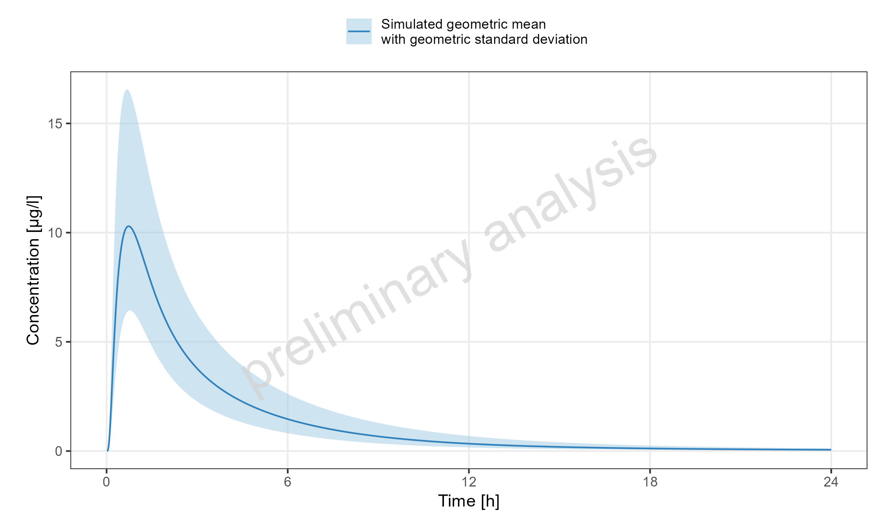
```
```{r}
#| output: asis
ospsuite.reportingframework::mdFootNote(subfolder = "UC07A_TimeProfiles", footNoteFile = "singlePlot_withoutData-TP-linear-total.footnote", footNoteCustomStyle = params$customStyles$FigureFootnote)
```
\newpage
  
```{r}
#| label: fig-singlePlot_withoutData-TP-log-total
#| fig-cap: "Simulated Concentration-time profiles for DrugX for 5mg po simulation on a logarithmic y-scale."
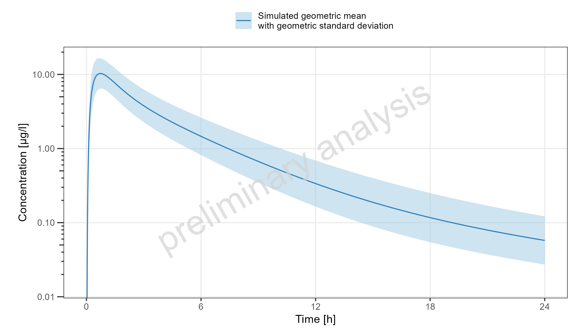
```
```{r}
#| output: asis
ospsuite.reportingframework::mdFootNote(subfolder = "UC07A_TimeProfiles", footNoteFile = "singlePlot_withoutData-TP-log-total.footnote", footNoteCustomStyle = params$customStyles$FigureFootnote)
```
\newpage
  
```{r}
#| label: fig-singlePlot_withData-TP-linear-total
#| fig-cap: "Simulated Concentration-time profiles for DrugX for 5mg po simulation on a linear y-scale. IV 1mg, PO 5mg."
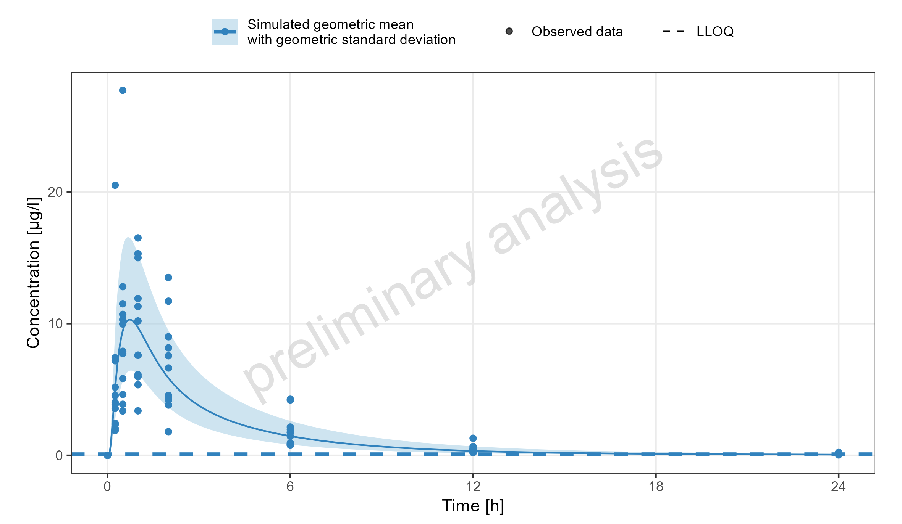
```
```{r}
#| output: asis
ospsuite.reportingframework::mdFootNote(subfolder = "UC07A_TimeProfiles", footNoteFile = "singlePlot_withData-TP-linear-total.footnote", footNoteCustomStyle = params$customStyles$FigureFootnote)
```
\newpage
  
```{r}
#| label: fig-singlePlot_withData-TP-log-total
#| fig-cap: "Simulated Concentration-time profiles for DrugX for 5mg po simulation on a logarithmic y-scale. IV 1mg, PO 5mg."
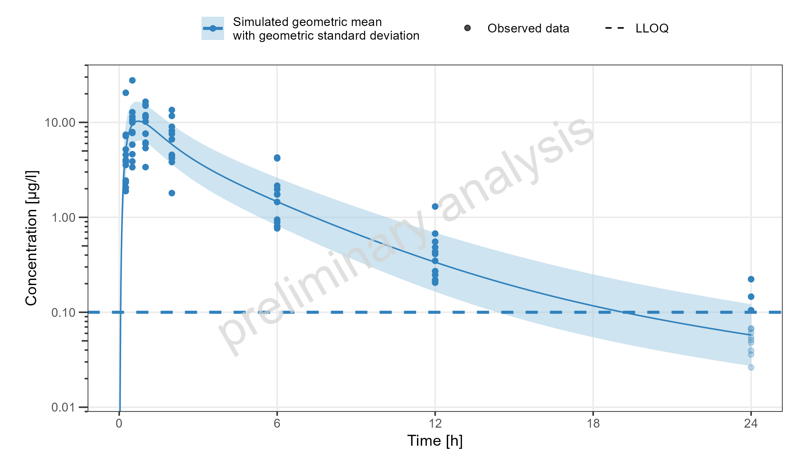
```
```{r}
#| output: asis
ospsuite.reportingframework::mdFootNote(subfolder = "UC07A_TimeProfiles", footNoteFile = "singlePlot_withData-TP-log-total.footnote", footNoteCustomStyle = params$customStyles$FigureFootnote)
```
\newpage
  
```{r}
#| label: fig-singlePlot_withData-PvO-linear-total
#| fig-cap: "Simulated Predicted vs Observed for DrugX for 5mg po simulation on a linear x and y-scale. IV 1mg, PO 5mg."
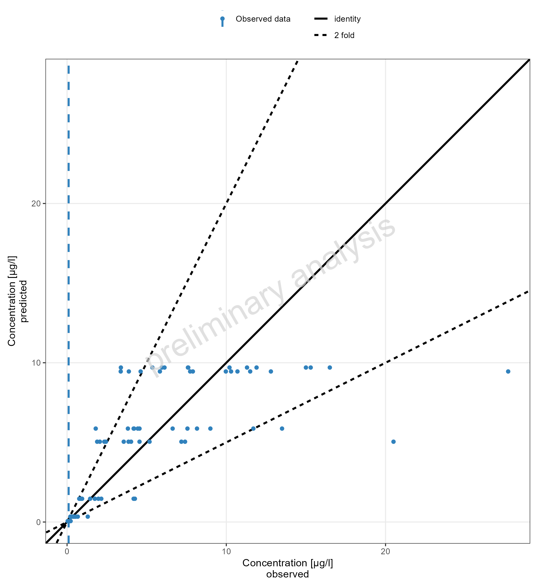
```
```{r}
#| output: asis
ospsuite.reportingframework::mdFootNote(subfolder = "UC07A_TimeProfiles", footNoteFile = "singlePlot_withData-PvO-linear-total.footnote", footNoteCustomStyle = params$customStyles$FigureFootnote)
```
\newpage
  
```{r}
#| label: fig-singlePlot_withData-PvO-log-total
#| fig-cap: "Simulated Predicted vs Observed for DrugX for 5mg po simulation on a logarithmic x and y-scale. IV 1mg, PO 5mg."
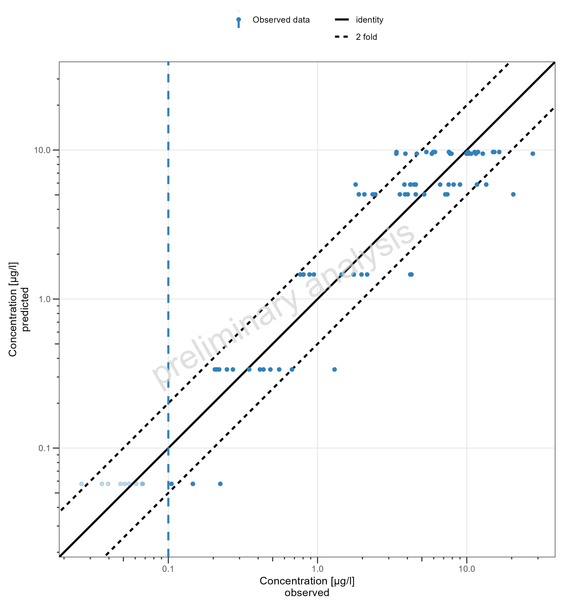
```
```{r}
#| output: asis
ospsuite.reportingframework::mdFootNote(subfolder = "UC07A_TimeProfiles", footNoteFile = "singlePlot_withData-PvO-log-total.footnote", footNoteCustomStyle = params$customStyles$FigureFootnote)
```
\newpage
  
```{r}
#| label: fig-singlePlot_withData-ResvT-linear-total
#| fig-cap: "Simulated Residuals vs time values for DrugX for 5mg po simulation. IV 1mg, PO 5mg."
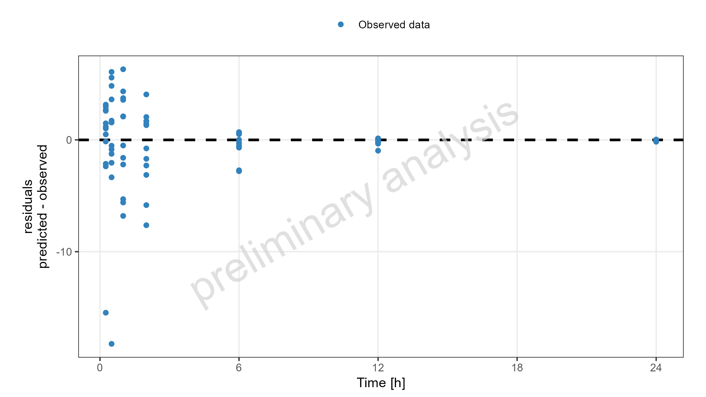
```
```{r}
#| output: asis
ospsuite.reportingframework::mdFootNote(subfolder = "UC07A_TimeProfiles", footNoteFile = "singlePlot_withData-ResvT-linear-total.footnote", footNoteCustomStyle = params$customStyles$FigureFootnote)
```
\newpage
  
```{r}
#| label: fig-singlePlot_withData-ResvT-log-total
#| fig-cap: "Simulated Residuals vs time values for DrugX for 5mg po simulation. IV 1mg, PO 5mg."
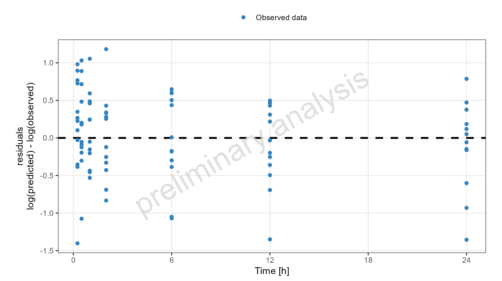
```
```{r}
#| output: asis
ospsuite.reportingframework::mdFootNote(subfolder = "UC07A_TimeProfiles", footNoteFile = "singlePlot_withData-ResvT-log-total.footnote", footNoteCustomStyle = params$customStyles$FigureFootnote)
```
\newpage
  
```{r}
#| label: fig-singlePlot_withData-ResvO-linear-total
#| fig-cap: "Simulated Residuals vs observed values for DrugX for 5mg po simulation. IV 1mg, PO 5mg."
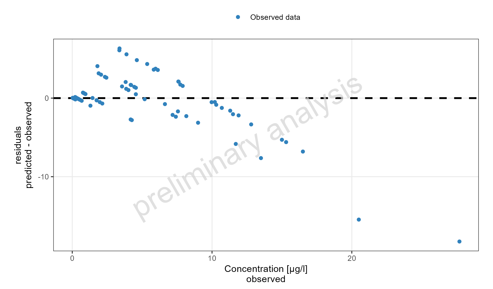
```
```{r}
#| output: asis
ospsuite.reportingframework::mdFootNote(subfolder = "UC07A_TimeProfiles", footNoteFile = "singlePlot_withData-ResvO-linear-total.footnote", footNoteCustomStyle = params$customStyles$FigureFootnote)
```
\newpage
  
```{r}
#| label: fig-singlePlot_withData-ResvO-log-total
#| fig-cap: "Simulated Residuals vs observed values for DrugX for 5mg po simulation. IV 1mg, PO 5mg."
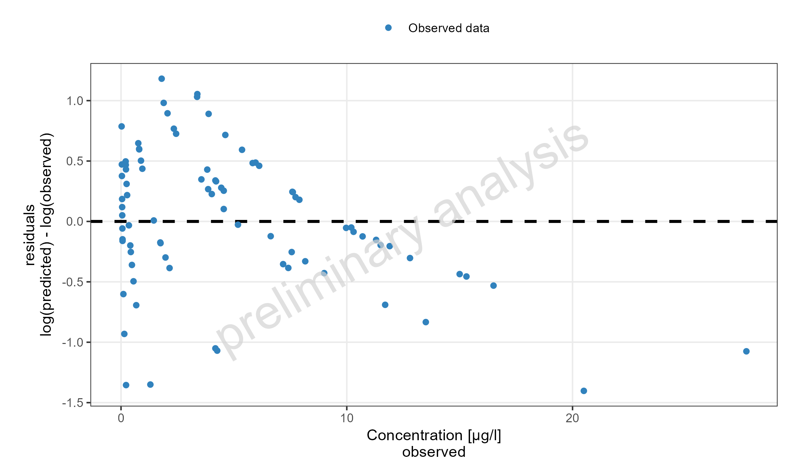
```
```{r}
#| output: asis
ospsuite.reportingframework::mdFootNote(subfolder = "UC07A_TimeProfiles", footNoteFile = "singlePlot_withData-ResvO-log-total.footnote", footNoteCustomStyle = params$customStyles$FigureFootnote)
```
\newpage
  
```{r}
#| label: fig-singlePlot_withData-ResH-linear-total
#| fig-cap: "Simulated Residuals distribution for DrugX for 5mg po simulation. IV 1mg, PO 5mg."
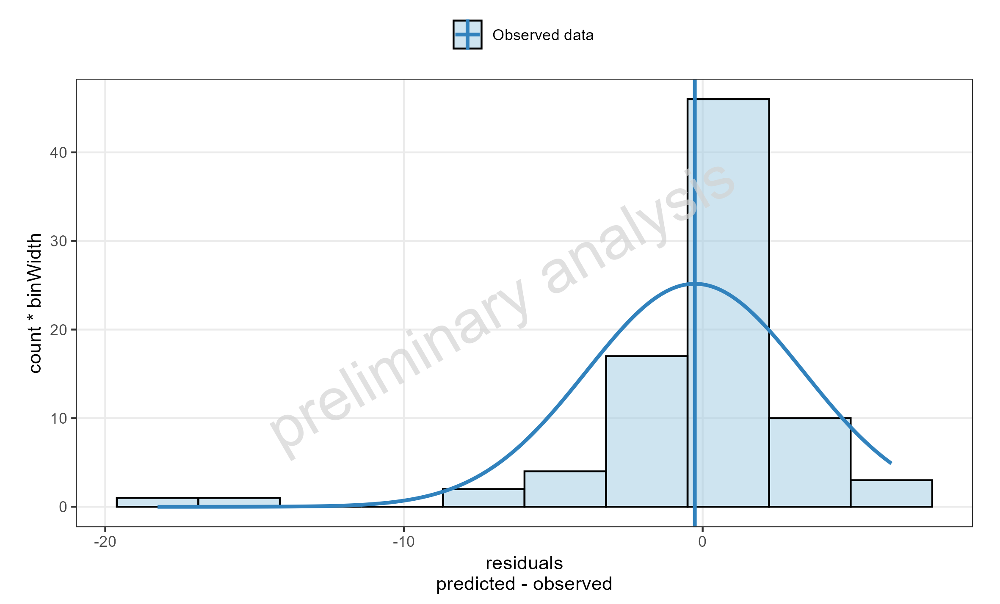
```
```{r}
#| output: asis
ospsuite.reportingframework::mdFootNote(subfolder = "UC07A_TimeProfiles", footNoteFile = "singlePlot_withData-ResH-linear-total.footnote", footNoteCustomStyle = params$customStyles$FigureFootnote)
```
\newpage
  
```{r}
#| label: fig-singlePlot_withData-ResH-log-total
#| fig-cap: "Simulated Residuals distribution for DrugX for 5mg po simulation. IV 1mg, PO 5mg."
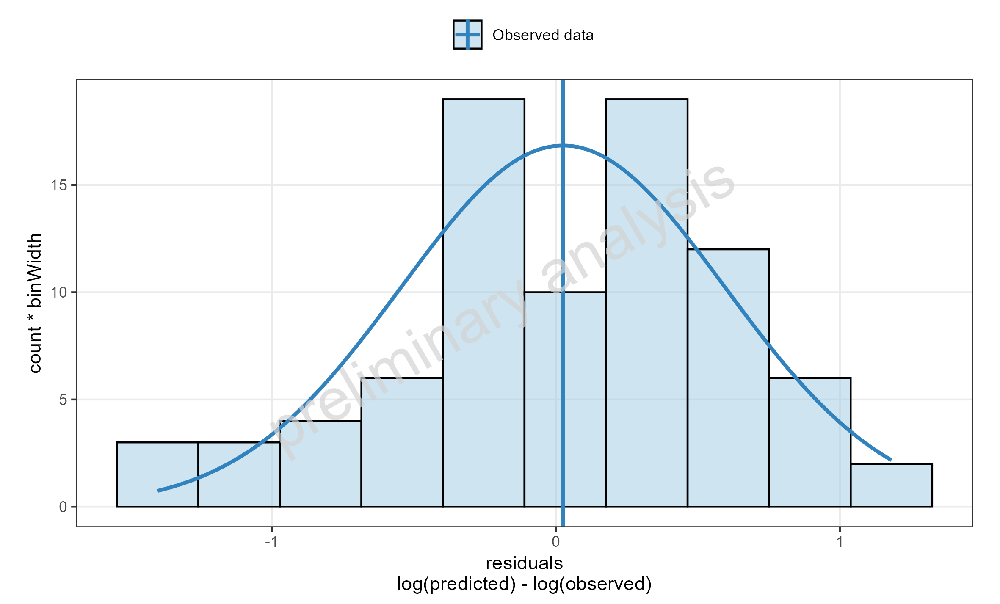
```
```{r}
#| output: asis
ospsuite.reportingframework::mdFootNote(subfolder = "UC07A_TimeProfiles", footNoteFile = "singlePlot_withData-ResH-log-total.footnote", footNoteCustomStyle = params$customStyles$FigureFootnote)
```
\newpage
  
```{r}
#| label: fig-singlePlot_withData-QQ-linear-total
#| fig-cap: "Simulated Residuals as quantile-quantile plot for DrugX for 5mg po simulation. IV 1mg, PO 5mg."
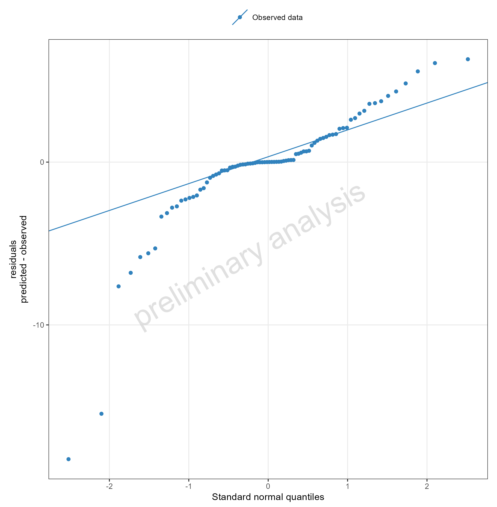
```
```{r}
#| output: asis
ospsuite.reportingframework::mdFootNote(subfolder = "UC07A_TimeProfiles", footNoteFile = "singlePlot_withData-QQ-linear-total.footnote", footNoteCustomStyle = params$customStyles$FigureFootnote)
```
\newpage
  
```{r}
#| label: fig-singlePlot_withData-QQ-log-total
#| fig-cap: "Simulated Residuals as quantile-quantile plot for DrugX for 5mg po simulation. IV 1mg, PO 5mg."
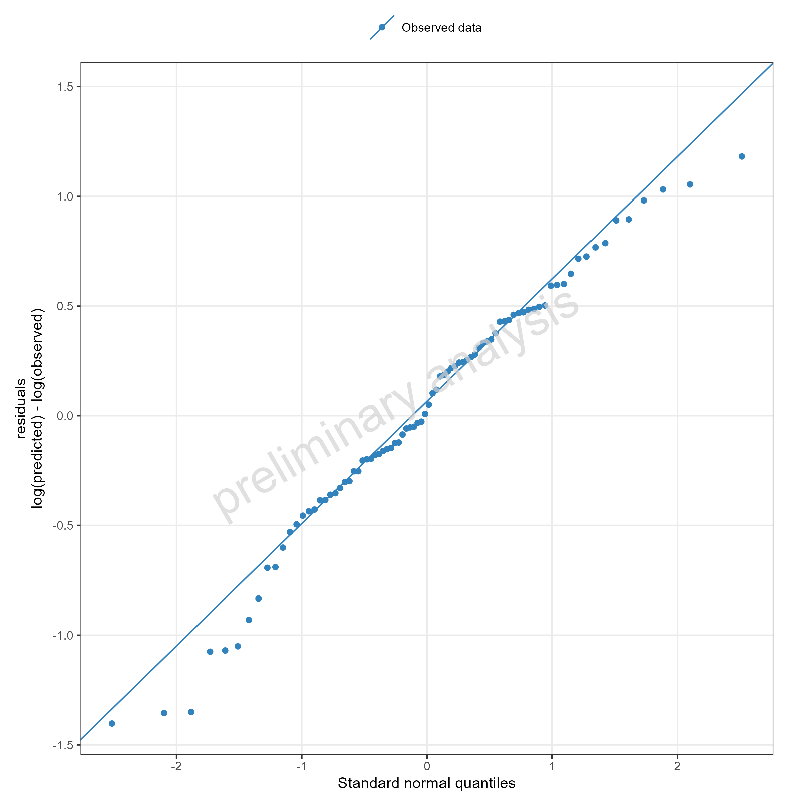
```
```{r}
#| output: asis
ospsuite.reportingframework::mdFootNote(subfolder = "UC07A_TimeProfiles", footNoteFile = "singlePlot_withData-QQ-log-total.footnote", footNoteCustomStyle = params$customStyles$FigureFootnote)
```
\newpage
  
```{r}
#| label: fig-singlePlot_withReference-TP-linear-total
#| fig-cap: "Simulated Concentration-time profiles for DrugX for 5mg po simulation on a linear y-scale."
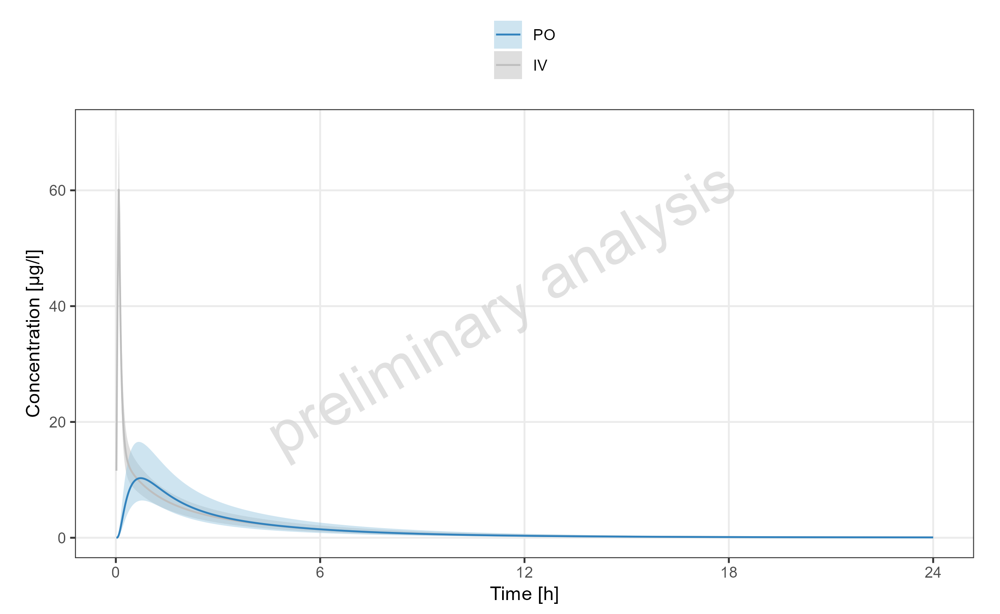
```
```{r}
#| output: asis
ospsuite.reportingframework::mdFootNote(subfolder = "UC07A_TimeProfiles", footNoteFile = "singlePlot_withReference-TP-linear-total.footnote", footNoteCustomStyle = params$customStyles$FigureFootnote)
```
\newpage
  
```{r}
#| label: fig-singlePlot_withReference-TP-log-total
#| fig-cap: "Simulated Concentration-time profiles for DrugX for 5mg po simulation on a logarithmic y-scale."
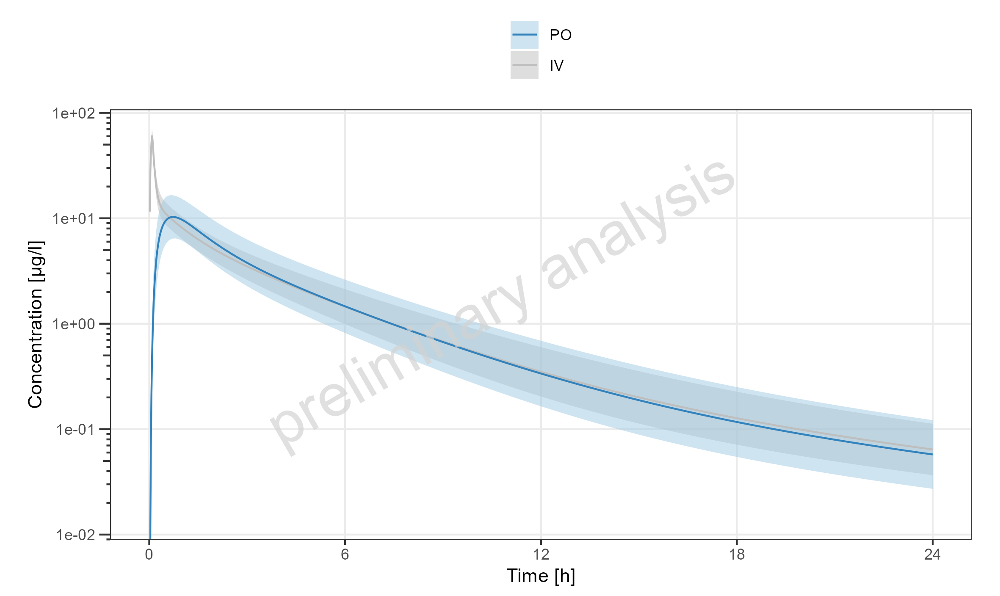
```
```{r}
#| output: asis
ospsuite.reportingframework::mdFootNote(subfolder = "UC07A_TimeProfiles", footNoteFile = "singlePlot_withReference-TP-log-total.footnote", footNoteCustomStyle = params$customStyles$FigureFootnote)
```
\newpage
  
```{r}
#| label: fig-singlePlot_withOffset-TP-linear-total
#| fig-cap: "Simulated Concentration-time profiles for DrugX for 5mg po simulation on a linear y-scale."
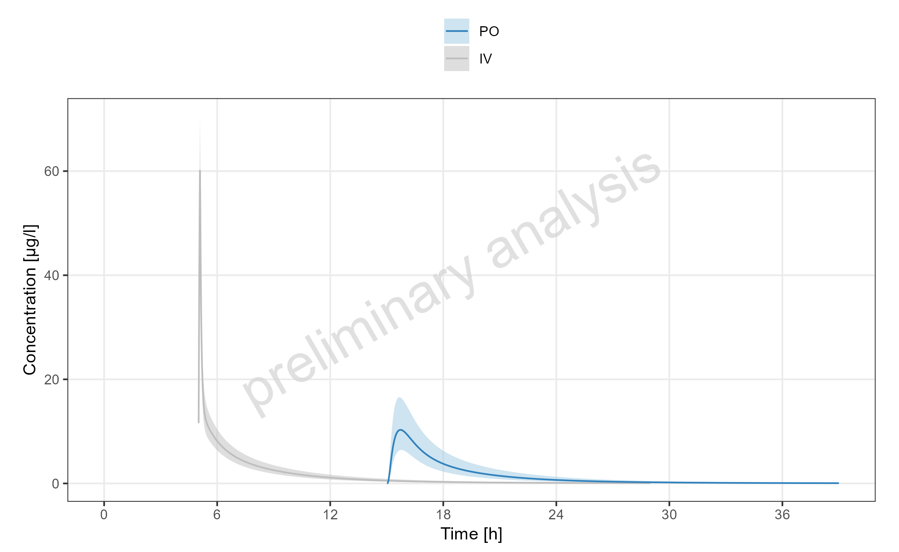
```
```{r}
#| output: asis
ospsuite.reportingframework::mdFootNote(subfolder = "UC07A_TimeProfiles", footNoteFile = "singlePlot_withOffset-TP-linear-total.footnote", footNoteCustomStyle = params$customStyles$FigureFootnote)
```
\newpage
  
```{r}
#| label: fig-singlePlot_withOffset-TP-log-total
#| fig-cap: "Simulated Concentration-time profiles for DrugX for 5mg po simulation on a logarithmic y-scale."
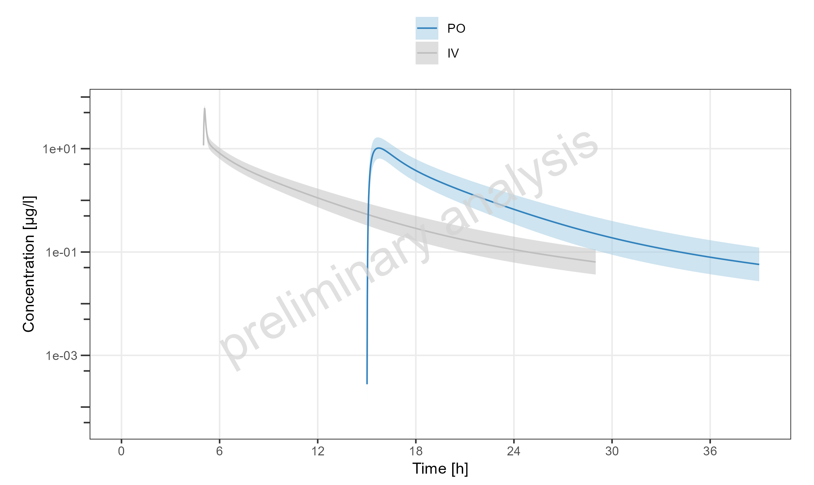
```
```{r}
#| output: asis
ospsuite.reportingframework::mdFootNote(subfolder = "UC07A_TimeProfiles", footNoteFile = "singlePlot_withOffset-TP-log-total.footnote", footNoteCustomStyle = params$customStyles$FigureFootnote)
```
\newpage
  
```{r}
#| label: fig-singlePlot_withLimits-TP-linear-total
#| fig-cap: "Simulated Concentration-time profiles for DrugX for 5mg po simulation on a linear y-scale."
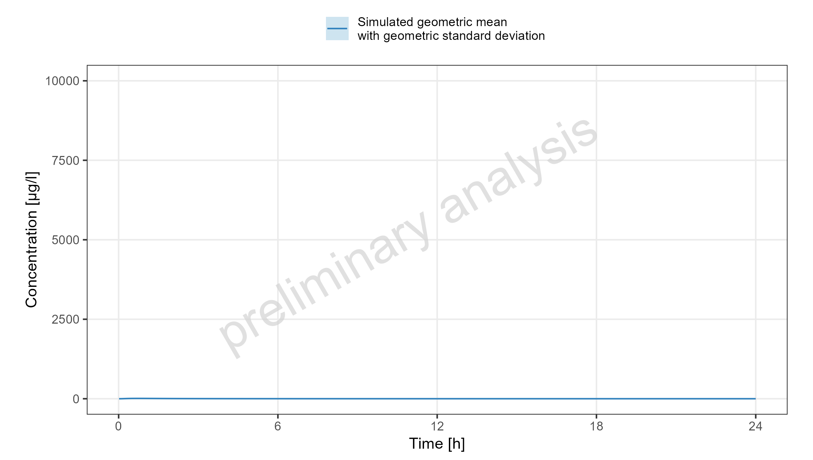
```
```{r}
#| output: asis
ospsuite.reportingframework::mdFootNote(subfolder = "UC07A_TimeProfiles", footNoteFile = "singlePlot_withLimits-TP-linear-total.footnote", footNoteCustomStyle = params$customStyles$FigureFootnote)
```
\newpage
  
```{r}
#| label: fig-singlePlot_withLimits-TP-log-total
#| fig-cap: "Simulated Concentration-time profiles for DrugX for 5mg po simulation on a logarithmic y-scale."
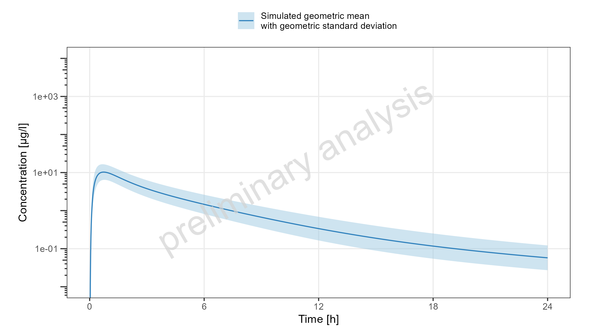
```
```{r}
#| output: asis
ospsuite.reportingframework::mdFootNote(subfolder = "UC07A_TimeProfiles", footNoteFile = "singlePlot_withLimits-TP-log-total.footnote", footNoteCustomStyle = params$customStyles$FigureFootnote)
```
\newpage
  
```{r}
#| label: fig-multiDosePlot-TP-linear-total
#| fig-cap: "Simulated Concentration-time profiles for DrugX for 5mg po simulation on a linear y-scale."
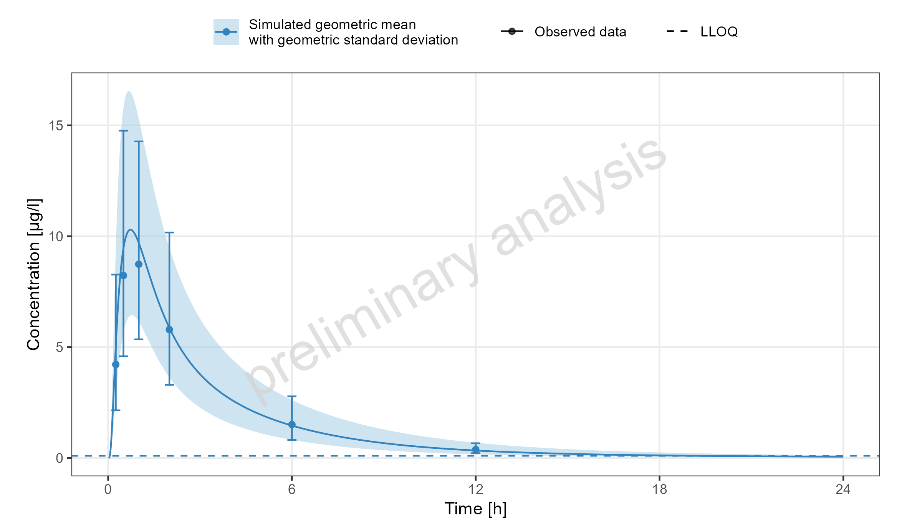
```
```{r}
#| output: asis
ospsuite.reportingframework::mdFootNote(subfolder = "UC07A_TimeProfiles", footNoteFile = "multiDosePlot-TP-linear-total.footnote", footNoteCustomStyle = params$customStyles$FigureFootnote)
```
\newpage
  
```{r}
#| label: fig-multiDosePlot-TP-log-total
#| fig-cap: "Simulated Concentration-time profiles for DrugX for 5mg po simulation on a logarithmic y-scale."
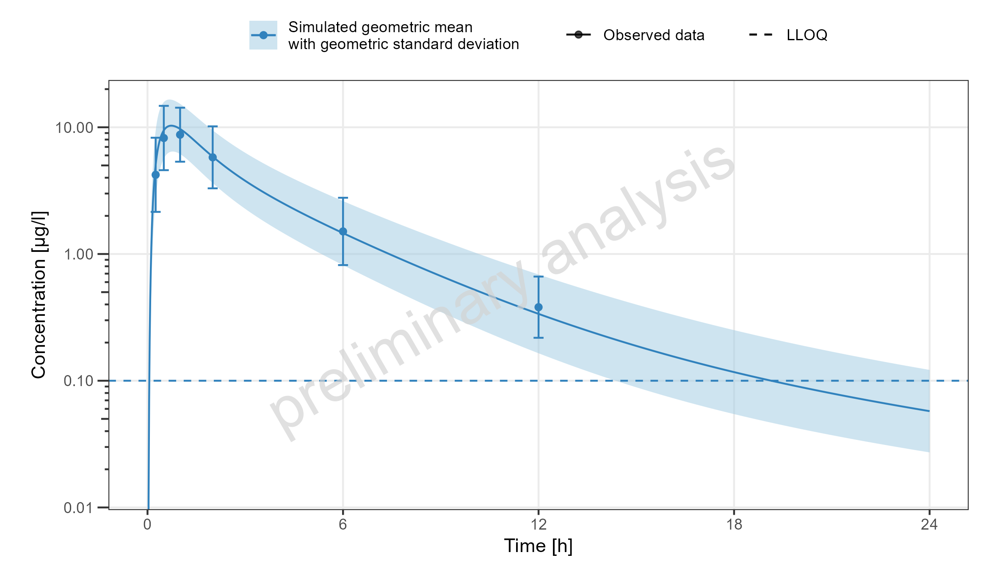
```
```{r}
#| output: asis
ospsuite.reportingframework::mdFootNote(subfolder = "UC07A_TimeProfiles", footNoteFile = "multiDosePlot-TP-log-total.footnote", footNoteCustomStyle = params$customStyles$FigureFootnote)
```
\newpage
  
```{r}
#| label: fig-multiDosePlot-TP-linear-firstApplication
#| fig-cap: "Simulated Concentration-time profiles for DrugX for 5mg po simulation on a linear y-scale Zoom on the first dose."
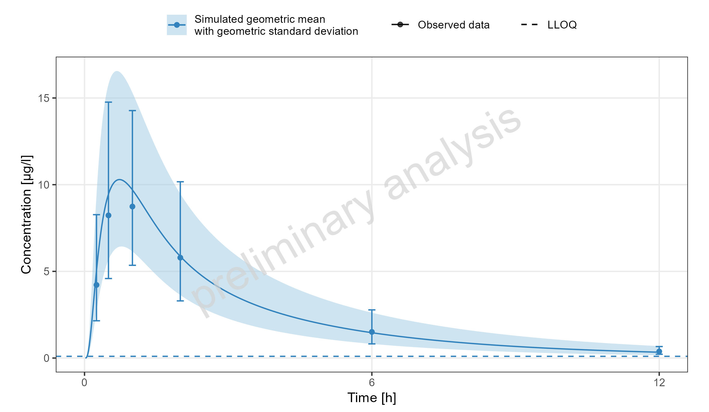
```
```{r}
#| output: asis
ospsuite.reportingframework::mdFootNote(subfolder = "UC07A_TimeProfiles", footNoteFile = "multiDosePlot-TP-linear-firstApplication.footnote", footNoteCustomStyle = params$customStyles$FigureFootnote)
```
\newpage
  
```{r}
#| label: fig-multiDosePlot-TP-log-firstApplication
#| fig-cap: "Simulated Concentration-time profiles for DrugX for 5mg po simulation on a logarithmic y-scale Zoom on the first dose."
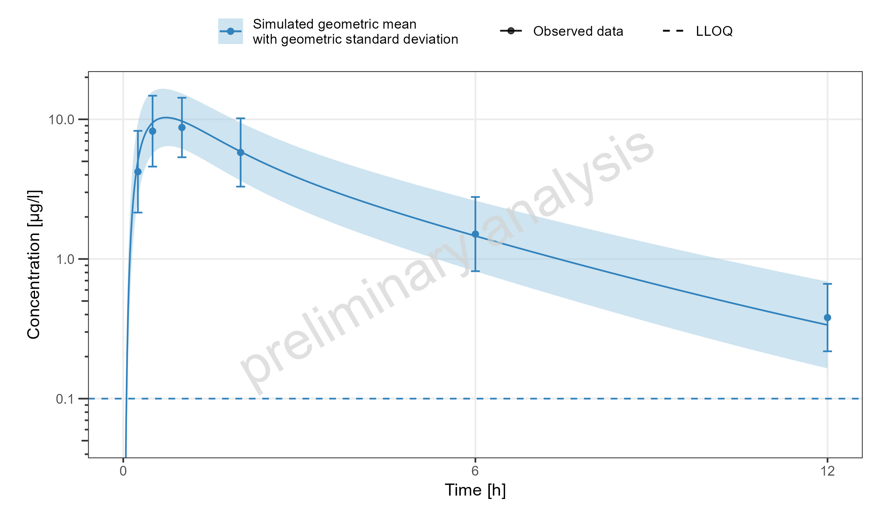
```
```{r}
#| output: asis
ospsuite.reportingframework::mdFootNote(subfolder = "UC07A_TimeProfiles", footNoteFile = "multiDosePlot-TP-log-firstApplication.footnote", footNoteCustomStyle = params$customStyles$FigureFootnote)
```
\newpage
  
```{r}
#| label: fig-multiDosePlot-TP-linear-lastApplication
#| fig-cap: "Simulated Concentration-time profiles for DrugX for 5mg po simulation on a linear y-scale Zoom on steady state dose."
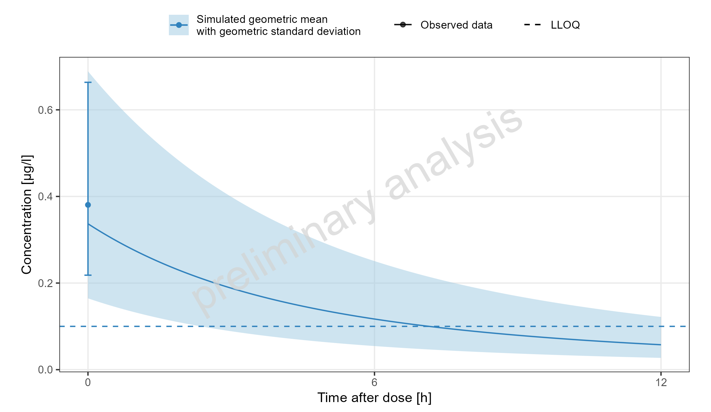
```
```{r}
#| output: asis
ospsuite.reportingframework::mdFootNote(subfolder = "UC07A_TimeProfiles", footNoteFile = "multiDosePlot-TP-linear-lastApplication.footnote", footNoteCustomStyle = params$customStyles$FigureFootnote)
```
\newpage
  
```{r}
#| label: fig-multiDosePlot-TP-log-lastApplication
#| fig-cap: "Simulated Concentration-time profiles for DrugX for 5mg po simulation on a logarithmic y-scale Zoom on steady state dose."
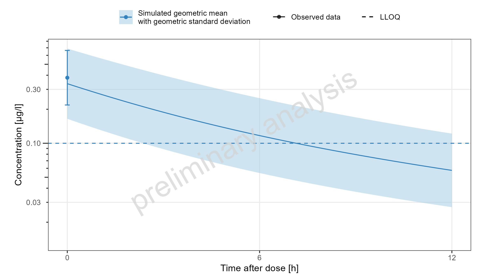
```
```{r}
#| output: asis
ospsuite.reportingframework::mdFootNote(subfolder = "UC07A_TimeProfiles", footNoteFile = "multiDosePlot-TP-log-lastApplication.footnote", footNoteCustomStyle = params$customStyles$FigureFootnote)
```
\newpage
  
```{r}
#| label: fig-manyPanelPlot-TP-linear-total
#| fig-cap: "Simulated Concentration-time profiles for DrugX (A), Fraction metabolized by CYP3A4 (B) and Fraction metabolized by CYP3A4 (Liver) (C) for 5mg po simulation on a linear y-scale."
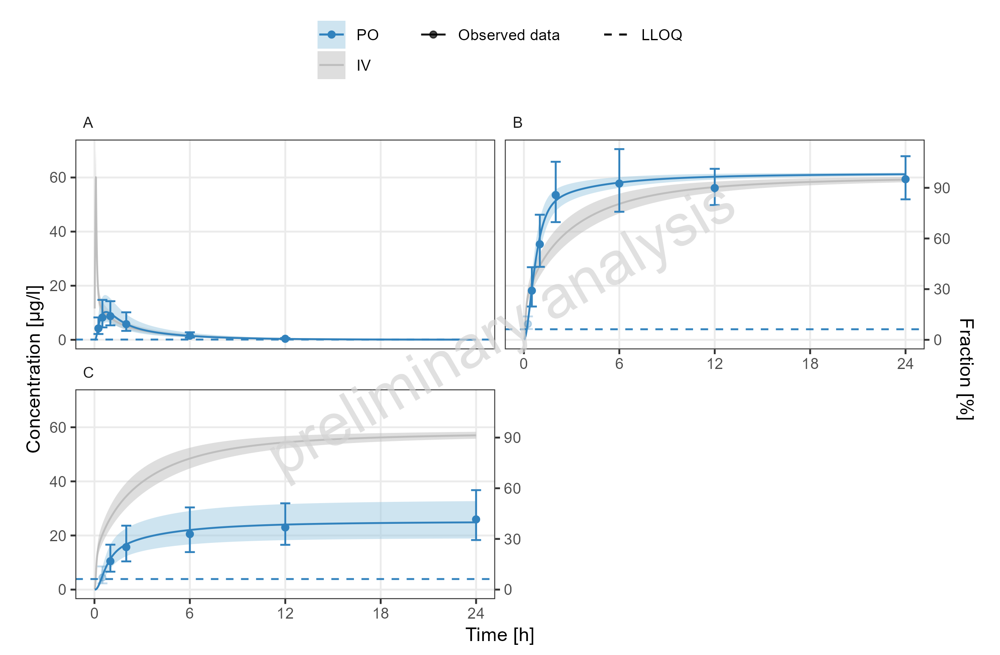
```
```{r}
#| output: asis
ospsuite.reportingframework::mdFootNote(subfolder = "UC07A_TimeProfiles", footNoteFile = "manyPanelPlot-TP-linear-total.footnote", footNoteCustomStyle = params$customStyles$FigureFootnote)
```
\newpage
  
```{r}
#| label: fig-manyPanelPlot-TP-log-total
#| fig-cap: "Simulated Concentration-time profiles for DrugX (A), Fraction metabolized by CYP3A4 (B) and Fraction metabolized by CYP3A4 (Liver) (C) for 5mg po simulation on a logarithmic y-scale."
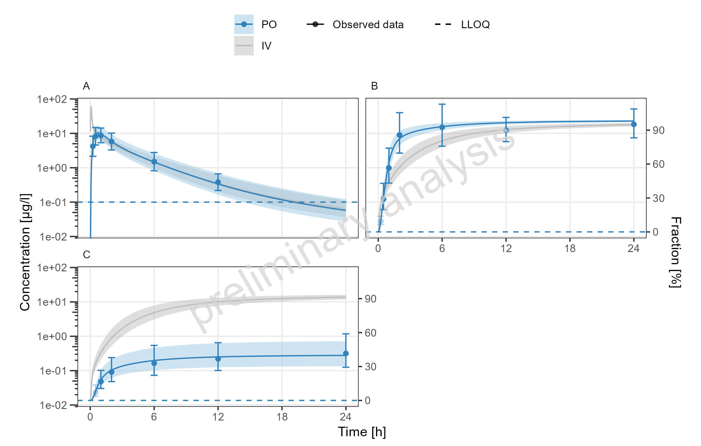
```
```{r}
#| output: asis
ospsuite.reportingframework::mdFootNote(subfolder = "UC07A_TimeProfiles", footNoteFile = "manyPanelPlot-TP-log-total.footnote", footNoteCustomStyle = params$customStyles$FigureFootnote)
```
\newpage
  
```{r}
#| label: fig-manyPanelPlot_col3-TP-linear-total
#| fig-cap: "Simulated Concentration-time profiles for DrugX (A, D), Fraction metabolized by CYP3A4 (B, E) and Fraction metabolized by CYP3A4 (Liver) (C, F) for 1mg iv simulation (D, E, F) and 5mg po simulation (A, B, C) on a linear y-scale."
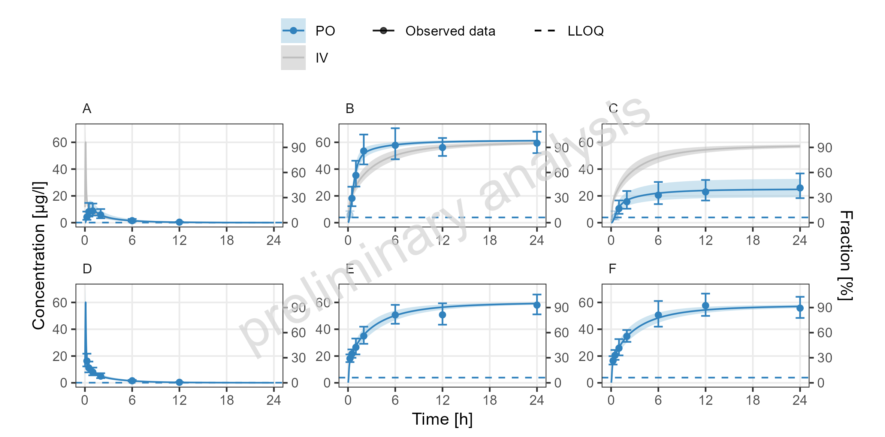
```
```{r}
#| output: asis
ospsuite.reportingframework::mdFootNote(subfolder = "UC07A_TimeProfiles", footNoteFile = "manyPanelPlot_col3-TP-linear-total.footnote", footNoteCustomStyle = params$customStyles$FigureFootnote)
```
\newpage
  
```{r}
#| label: fig-manyPanelPlot_col3-TP-log-total
#| fig-cap: "Simulated Concentration-time profiles for DrugX (A, D), Fraction metabolized by CYP3A4 (B, E) and Fraction metabolized by CYP3A4 (Liver) (C, F) for 1mg iv simulation (D, E, F) and 5mg po simulation (A, B, C) on a logarithmic y-scale."
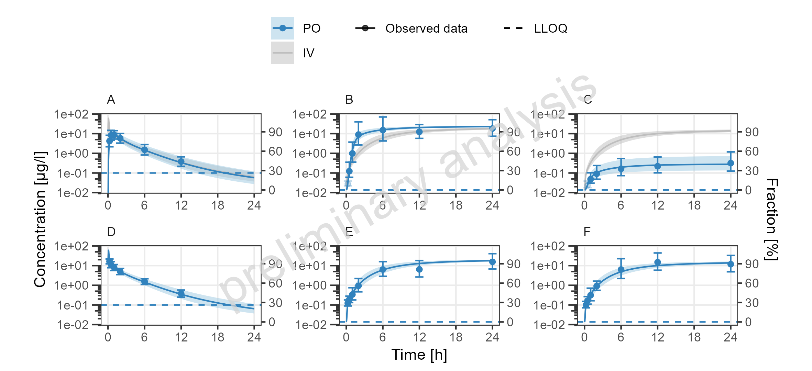
```
```{r}
#| output: asis
ospsuite.reportingframework::mdFootNote(subfolder = "UC07A_TimeProfiles", footNoteFile = "manyPanelPlot_col3-TP-log-total.footnote", footNoteCustomStyle = params$customStyles$FigureFootnote)
```
\newpage
  
