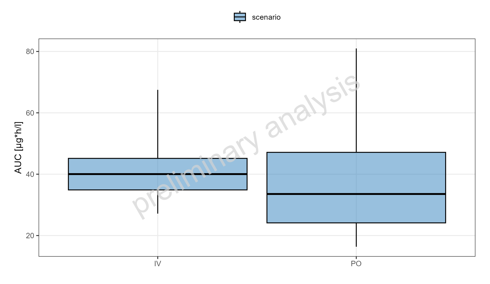
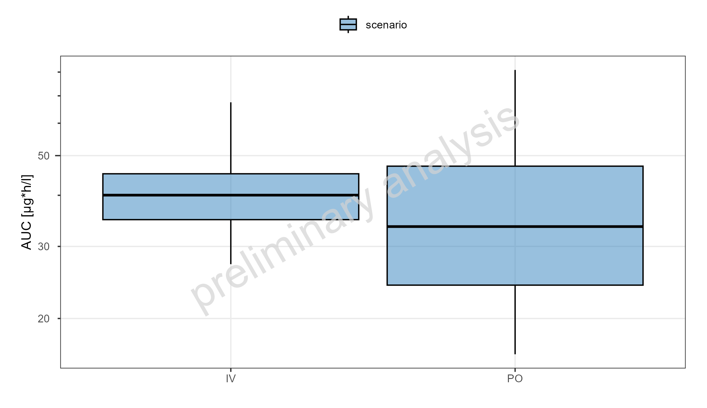
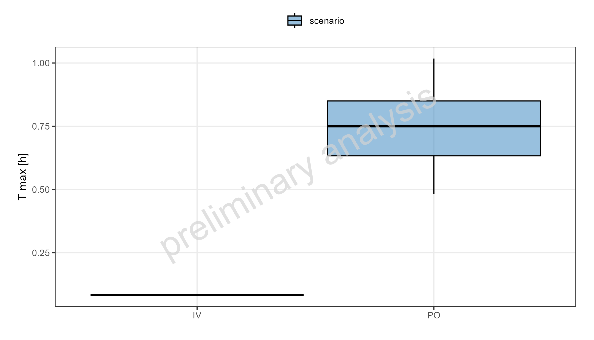
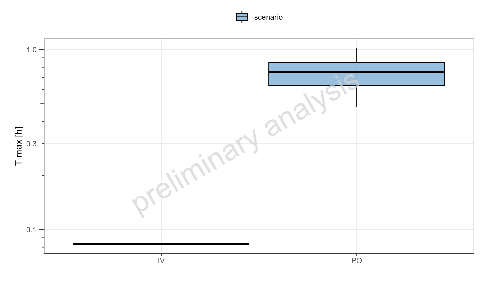
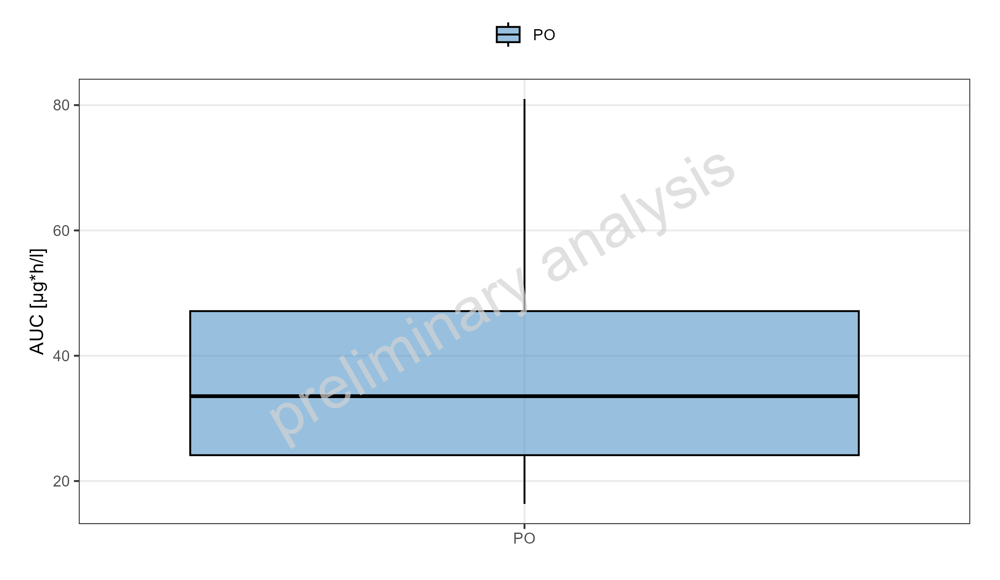
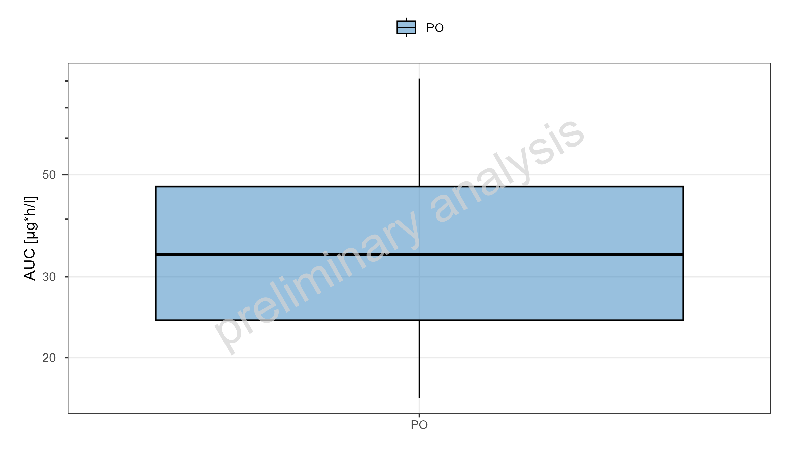
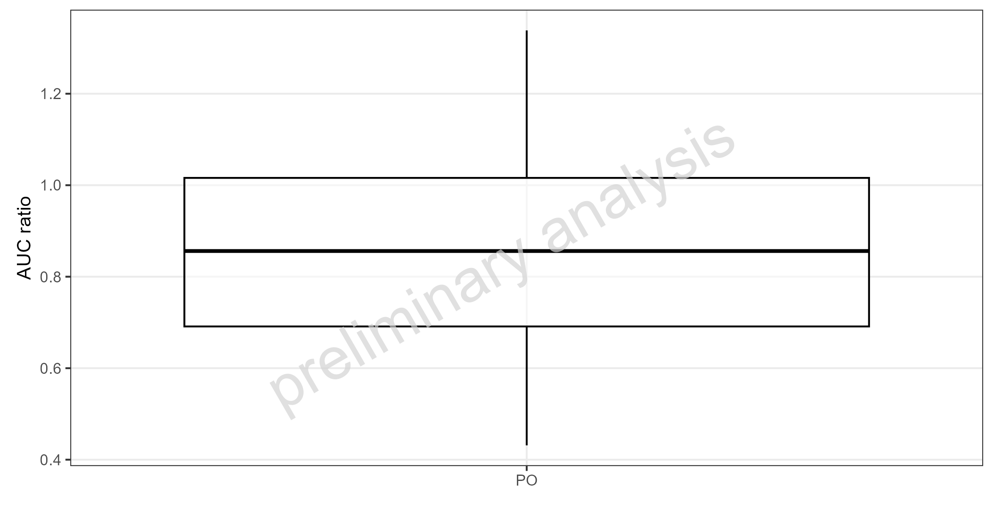
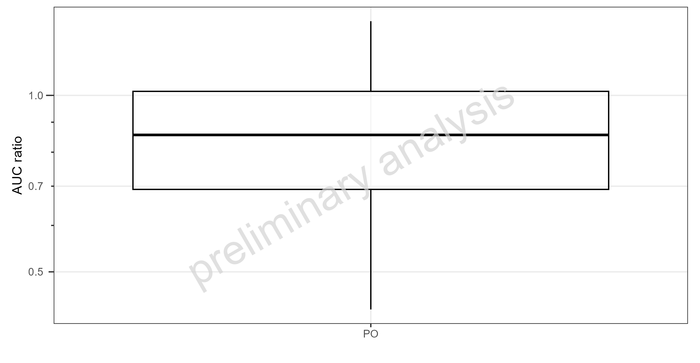

# Report

# Boxwhisker without refernce

Figure 1: Population summary statistics of DrugX. IV 1mg, PO 5mg. Shown
as box-whisker plot, which indicates the 5th, 25th, 50th, 75th, 95th
percentiles on a linear y-scale



Figure 2: Population summary statistics of DrugX. IV 1mg, PO 5mg. Shown
as box-whisker plot, which indicates the 5th, 25th, 50th, 75th, 95th
percentiles on a logarithmic y-scale



Table 1: Population summary statistics of DrugX. IV 1mg, PO 5mg.

| scenario | plotTag | N | 5th percentile | 25th percentile | median | 75th percentile | 95th percentile | arith mean | arith standard deviation | arith CV | geo mean | geo standard deviation | geo CV |
|:---|:---|---:|---:|---:|---:|---:|---:|---:|---:|---:|---:|---:|---:|
| IV scenario | A | 100 | 27.2 | 34.9 | 40.0 | 45.2 | 67.5 | 41.9 | 11.9 | 0.284 | 40.5 | 1.30 | 21.4 |
| PO scenario | A | 100 | 16.4 | 24.1 | 33.5 | 47.1 | 81.0 | 38.2 | 20.0 | 0.523 | 33.7 | 1.65 | 88.8 |



Figure 3: Population summary statistics of DrugX. IV 1mg, PO 5mg. Shown
as box-whisker plot, which indicates the 5th, 25th, 50th, 75th, 95th
percentiles on a linear y-scale



Figure 4: Population summary statistics of DrugX. IV 1mg, PO 5mg. Shown
as box-whisker plot, which indicates the 5th, 25th, 50th, 75th, 95th
percentiles on a logarithmic y-scale



Table 2: Population summary statistics of DrugX. IV 1mg, PO 5mg.

| scenario | plotTag | N | 5th percentile | 25th percentile | median | 75th percentile | 95th percentile | arith mean | arith standard deviation | arith CV | geo mean | geo standard deviation | geo CV |
|:---|:---|---:|---:|---:|---:|---:|---:|---:|---:|---:|---:|---:|---:|
| IV scenario | A | 100 | 0.0833 | 0.0833 | 0.0833 | 0.0833 | 0.0833 | 0.0835 | 0.00167 | 0.020 | 0.0835 | 1.02 | 7.69e+08 |
| PO scenario | A | 100 | 0.4820 | 0.6330 | 0.7500 | 0.8500 | 1.0200 | 0.7520 | 0.19300 | 0.256 | 0.7300 | 1.28 | 3.75e+00 |



# Boxwhisker with refernce

Figure 5: Population summary statistics of DrugX. IV 1mg, PO 5mg. Shown
as box-whisker plot, which indicates the 5th, 25th, 50th, 75th, 95th
percentiles on a linear y-scale



Figure 6: Population summary statistics of DrugX. IV 1mg, PO 5mg. Shown
as box-whisker plot, which indicates the 5th, 25th, 50th, 75th, 95th
percentiles on a logarithmic y-scale



Table 3: Population summary statistics of DrugX. IV 1mg, PO 5mg.

| scenario | plotTag | N | 5th percentile | 25th percentile | median | 75th percentile | 95th percentile | arith mean | arith standard deviation | arith CV | geo mean | geo standard deviation | geo CV |
|:---|:---|---:|---:|---:|---:|---:|---:|---:|---:|---:|---:|---:|---:|
| PO PO | A | 100 | 16.4 | 24.1 | 33.5 | 47.1 | 81 | 38.2 | 20 | 0.523 | 33.7 | 1.65 | 88.8 |



Figure 7: Population summary statistics of ratios DrugX. IV 1mg, PO 5mg.
Shown as box-whisker plot, which indicates the 5th, 25th, 50th, 75th,
95th percentiles on a linear y-scale



Figure 8: Population summary statistics of ratios DrugX. IV 1mg, PO 5mg.
Shown as box-whisker plot, which indicates the 5th, 25th, 50th, 75th,
95th percentiles on a logarithmic y-scale



Table 4: Population summary statistics of ratios DrugX. IV 1mg, PO 5mg.

| scenario | plotTag | N | 5th percentile | 25th percentile | median | 75th percentile | 95th percentile | arith mean | arith standard deviation | arith CV | geo mean | geo standard deviation | geo CV |
|:---|:---|---:|---:|---:|---:|---:|---:|---:|---:|---:|---:|---:|---:|
| PO | A | 100 | 0.431 | 0.691 | 0.856 | 1.02 | 1.34 | 0.873 | 0.26 | 0.298 | 0.833 | 1.37 | 2.27 |


