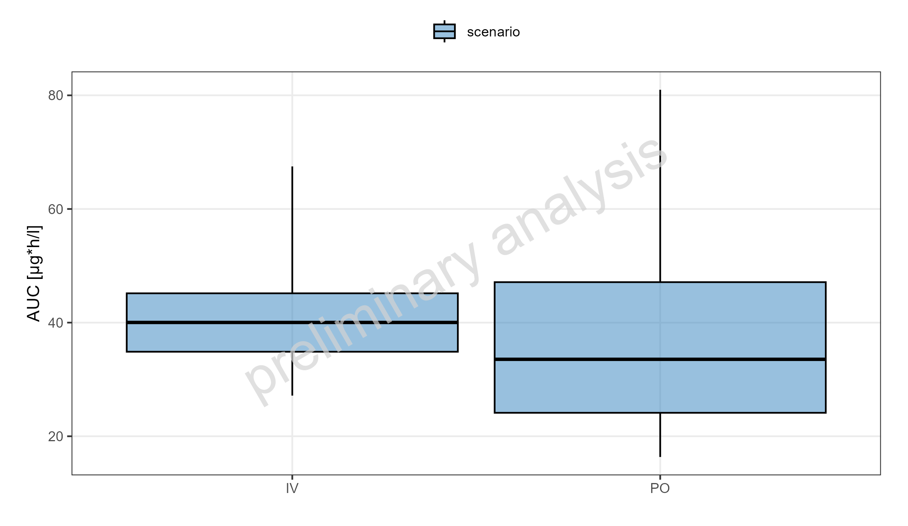
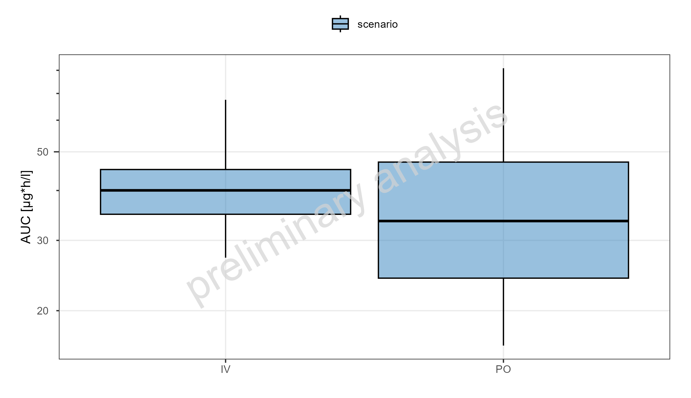
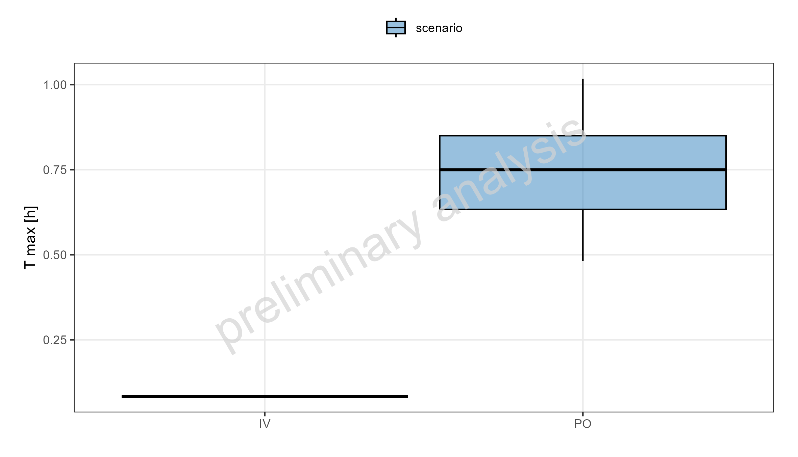
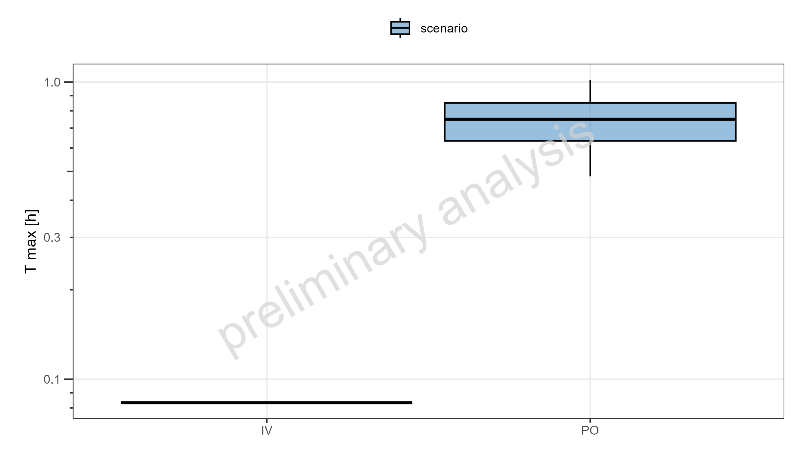
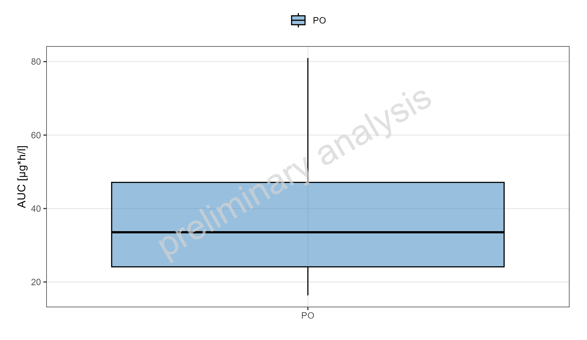
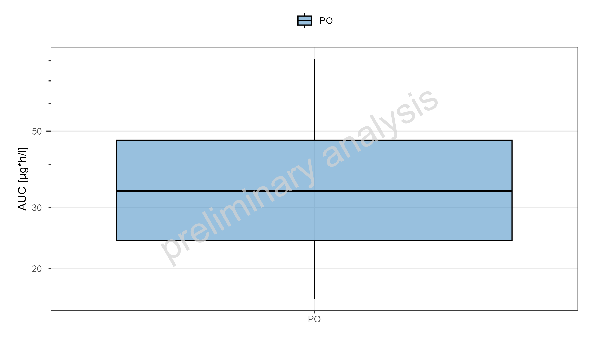
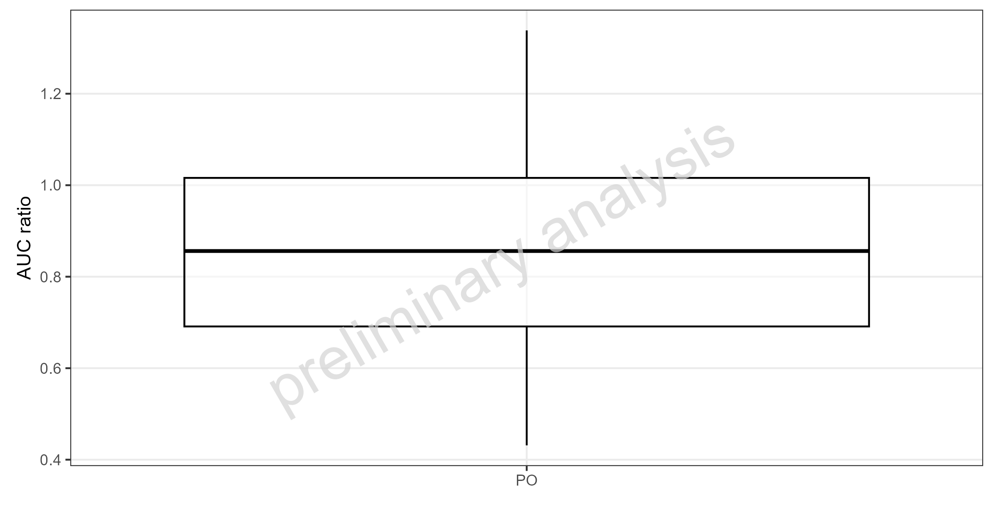
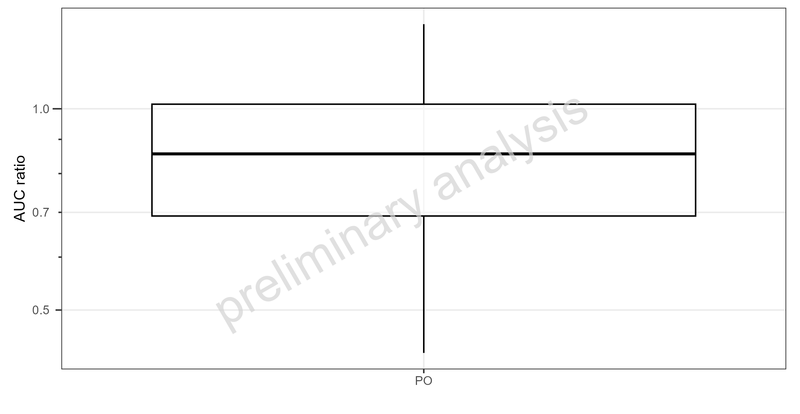

 
```{r}
#| include: false
knitr::opts_chunk$set(echo = FALSE, warning = FALSE, results = "asis", error = FALSE, message = FALSE)
```
 
  
  
  
# Boxwhisker without refernce  
  
  
```{r}
#| label: fig-AUC_tEnd_t_max_AUC_tEnd-linear-abs
#| fig-cap: "Population summary statistics of DrugX. IV 1mg, PO 5mg. Shown as box-whisker plot, which indicates the 5th, 25th, 50th, 75th, 95th percentiles on a linear y-scale"

```
```{r}
#| output: asis
ospsuite.reportingframework::mdFootNote(subfolder = "UC07B_PK_Boxplot", footNoteFile = "AUC_tEnd_t_max_AUC_tEnd-linear-abs.footnote", footNoteCustomStyle = params$customStyles$FigureFootnote)
```
\newpage
  
```{r}
#| label: fig-AUC_tEnd_t_max_AUC_tEnd-log-abs
#| fig-cap: "Population summary statistics of DrugX. IV 1mg, PO 5mg. Shown as box-whisker plot, which indicates the 5th, 25th, 50th, 75th, 95th percentiles on a logarithmic y-scale"

```
```{r}
#| output: asis
ospsuite.reportingframework::mdFootNote(subfolder = "UC07B_PK_Boxplot", footNoteFile = "AUC_tEnd_t_max_AUC_tEnd-log-abs.footnote", footNoteCustomStyle = params$customStyles$FigureFootnote)
```
\newpage
  
```{r}
#| label: tbl-AUC_tEnd_t_max_AUC_tEnd-abs
#| tbl-cap: "Population summary statistics of DrugX. IV 1mg, PO 5mg."
dt <- data.table::fread("UC07B_PK_Boxplot/AUC_tEnd_t_max_AUC_tEnd-abs.csv")
numeric_cols <- names(dt)[sapply(dt, function(x) is.numeric(x) & !is.integer(x))]
if (length(numeric_cols) > 0) dt[, (numeric_cols) := signif(.SD, 3), .SDcols = numeric_cols]
knitr::kable(dt)
```
```{r}
#| output: asis
ospsuite.reportingframework::mdFootNote(subfolder = "UC07B_PK_Boxplot", footNoteFile = "AUC_tEnd_t_max_AUC_tEnd-abs.footnote", footNoteCustomStyle = params$customStyles$TableFootnote)
```
\newpage
  
```{r}
#| label: fig-AUC_tEnd_t_max_t_max-linear-abs
#| fig-cap: "Population summary statistics of DrugX. IV 1mg, PO 5mg. Shown as box-whisker plot, which indicates the 5th, 25th, 50th, 75th, 95th percentiles on a linear y-scale"

```
```{r}
#| output: asis
ospsuite.reportingframework::mdFootNote(subfolder = "UC07B_PK_Boxplot", footNoteFile = "AUC_tEnd_t_max_t_max-linear-abs.footnote", footNoteCustomStyle = params$customStyles$FigureFootnote)
```
\newpage
  
```{r}
#| label: fig-AUC_tEnd_t_max_t_max-log-abs
#| fig-cap: "Population summary statistics of DrugX. IV 1mg, PO 5mg. Shown as box-whisker plot, which indicates the 5th, 25th, 50th, 75th, 95th percentiles on a logarithmic y-scale"

```
```{r}
#| output: asis
ospsuite.reportingframework::mdFootNote(subfolder = "UC07B_PK_Boxplot", footNoteFile = "AUC_tEnd_t_max_t_max-log-abs.footnote", footNoteCustomStyle = params$customStyles$FigureFootnote)
```
\newpage
  
```{r}
#| label: tbl-AUC_tEnd_t_max_t_max-abs
#| tbl-cap: "Population summary statistics of DrugX. IV 1mg, PO 5mg."
dt <- data.table::fread("UC07B_PK_Boxplot/AUC_tEnd_t_max_t_max-abs.csv")
numeric_cols <- names(dt)[sapply(dt, function(x) is.numeric(x) & !is.integer(x))]
if (length(numeric_cols) > 0) dt[, (numeric_cols) := signif(.SD, 3), .SDcols = numeric_cols]
knitr::kable(dt)
```
```{r}
#| output: asis
ospsuite.reportingframework::mdFootNote(subfolder = "UC07B_PK_Boxplot", footNoteFile = "AUC_tEnd_t_max_t_max-abs.footnote", footNoteCustomStyle = params$customStyles$TableFootnote)
```
\newpage
  
  
  
  
# Boxwhisker with refernce  
  
  
```{r}
#| label: fig-AUC_tEnd_refernce-linear-abs
#| fig-cap: "Population summary statistics of DrugX. IV 1mg, PO 5mg. Shown as box-whisker plot, which indicates the 5th, 25th, 50th, 75th, 95th percentiles on a linear y-scale"

```
```{r}
#| output: asis
ospsuite.reportingframework::mdFootNote(subfolder = "UC07B_PK_Boxplot", footNoteFile = "AUC_tEnd_refernce-linear-abs.footnote", footNoteCustomStyle = params$customStyles$FigureFootnote)
```
\newpage
  
```{r}
#| label: fig-AUC_tEnd_refernce-log-abs
#| fig-cap: "Population summary statistics of DrugX. IV 1mg, PO 5mg. Shown as box-whisker plot, which indicates the 5th, 25th, 50th, 75th, 95th percentiles on a logarithmic y-scale"

```
```{r}
#| output: asis
ospsuite.reportingframework::mdFootNote(subfolder = "UC07B_PK_Boxplot", footNoteFile = "AUC_tEnd_refernce-log-abs.footnote", footNoteCustomStyle = params$customStyles$FigureFootnote)
```
\newpage
  
```{r}
#| label: tbl-AUC_tEnd_refernce-abs
#| tbl-cap: "Population summary statistics of DrugX. IV 1mg, PO 5mg."
dt <- data.table::fread("UC07B_PK_Boxplot/AUC_tEnd_refernce-abs.csv")
numeric_cols <- names(dt)[sapply(dt, function(x) is.numeric(x) & !is.integer(x))]
if (length(numeric_cols) > 0) dt[, (numeric_cols) := signif(.SD, 3), .SDcols = numeric_cols]
knitr::kable(dt)
```
```{r}
#| output: asis
ospsuite.reportingframework::mdFootNote(subfolder = "UC07B_PK_Boxplot", footNoteFile = "AUC_tEnd_refernce-abs.footnote", footNoteCustomStyle = params$customStyles$TableFootnote)
```
\newpage
  
```{r}
#| label: fig-AUC_tEnd_refernce-linear-ratio
#| fig-cap: "Population summary statistics of ratios DrugX. IV 1mg, PO 5mg. Shown as box-whisker plot, which indicates the 5th, 25th, 50th, 75th, 95th percentiles on a linear y-scale"

```
```{r}
#| output: asis
ospsuite.reportingframework::mdFootNote(subfolder = "UC07B_PK_Boxplot", footNoteFile = "AUC_tEnd_refernce-linear-ratio.footnote", footNoteCustomStyle = params$customStyles$FigureFootnote)
```
\newpage
  
```{r}
#| label: fig-AUC_tEnd_refernce-log-ratio
#| fig-cap: "Population summary statistics of ratios DrugX. IV 1mg, PO 5mg. Shown as box-whisker plot, which indicates the 5th, 25th, 50th, 75th, 95th percentiles on a logarithmic y-scale"

```
```{r}
#| output: asis
ospsuite.reportingframework::mdFootNote(subfolder = "UC07B_PK_Boxplot", footNoteFile = "AUC_tEnd_refernce-log-ratio.footnote", footNoteCustomStyle = params$customStyles$FigureFootnote)
```
\newpage
  
```{r}
#| label: tbl-AUC_tEnd_refernce-ratio
#| tbl-cap: "Population summary statistics of ratios DrugX. IV 1mg, PO 5mg."
dt <- data.table::fread("UC07B_PK_Boxplot/AUC_tEnd_refernce-ratio.csv")
numeric_cols <- names(dt)[sapply(dt, function(x) is.numeric(x) & !is.integer(x))]
if (length(numeric_cols) > 0) dt[, (numeric_cols) := signif(.SD, 3), .SDcols = numeric_cols]
knitr::kable(dt)
```
```{r}
#| output: asis
ospsuite.reportingframework::mdFootNote(subfolder = "UC07B_PK_Boxplot", footNoteFile = "AUC_tEnd_refernce-ratio.footnote", footNoteCustomStyle = params$customStyles$TableFootnote)
```
\newpage
  
