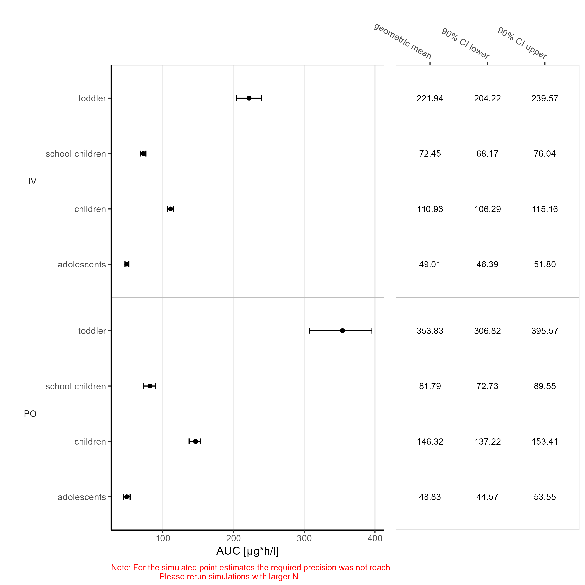
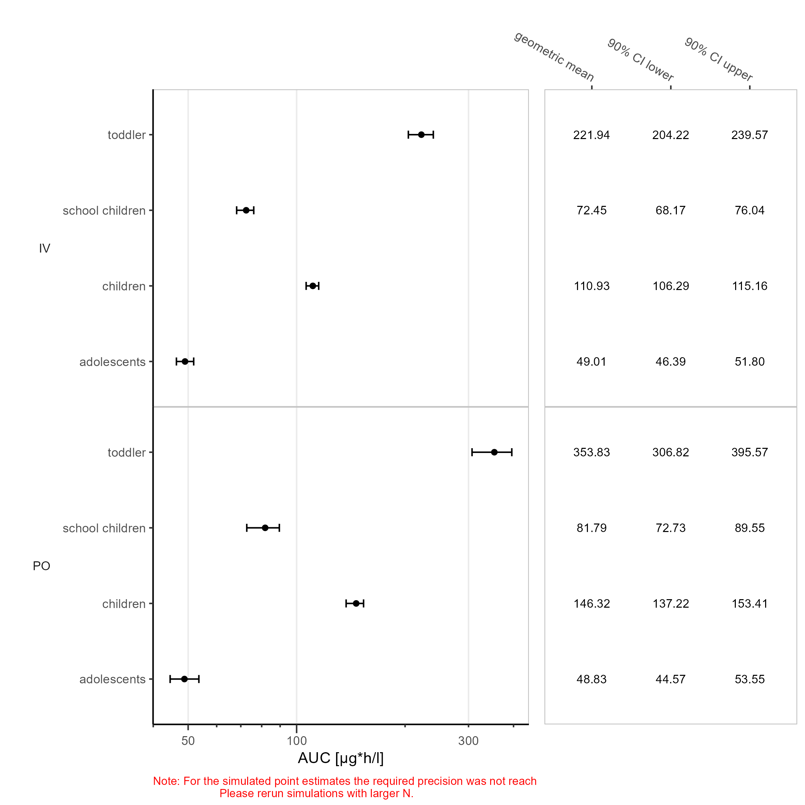
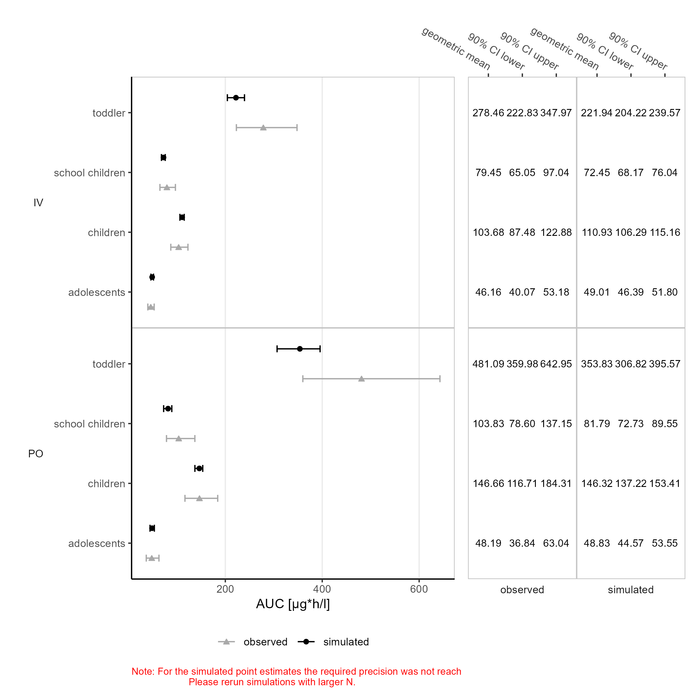
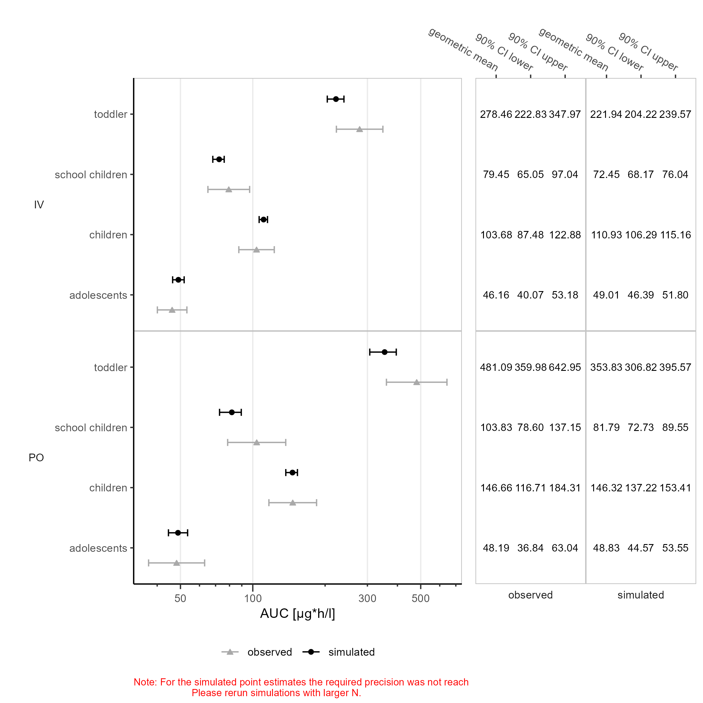

# Report

# PK Forest

Figure 1: Simulated AUC of DrugX on a linear x-scale. Number of
simulated values is 100 for all scenarios. IV 1mg, PO 5mg.

Simulated data is displayed as geometric mean, 90% CI lower and 90% CI
upper.



Figure 2: Simulated AUC of DrugX on a logarithmic x-scale. Number of
simulated values is 100 for all scenarios. IV 1mg, PO 5mg.

Simulated data is displayed as geometric mean, 90% CI lower and 90% CI
upper.



Figure 3: Simulated and observed AUC of DrugX on a linear x-scale.
Number of simulated values is 12 and 100 for adolescents, children,
school children and toddler. IV 1mg, PO 5mg.

Simulated and observed data is displayed as geometric mean, 90% CI lower
and 90% CI upper.



Figure 4: Simulated and observed AUC of DrugX on a logarithmic x-scale.
Number of simulated values is 12 and 100 for adolescents, children,
school children and toddler. IV 1mg, PO 5mg.

Simulated and observed data is displayed as geometric mean, 90% CI lower
and 90% CI upper.


