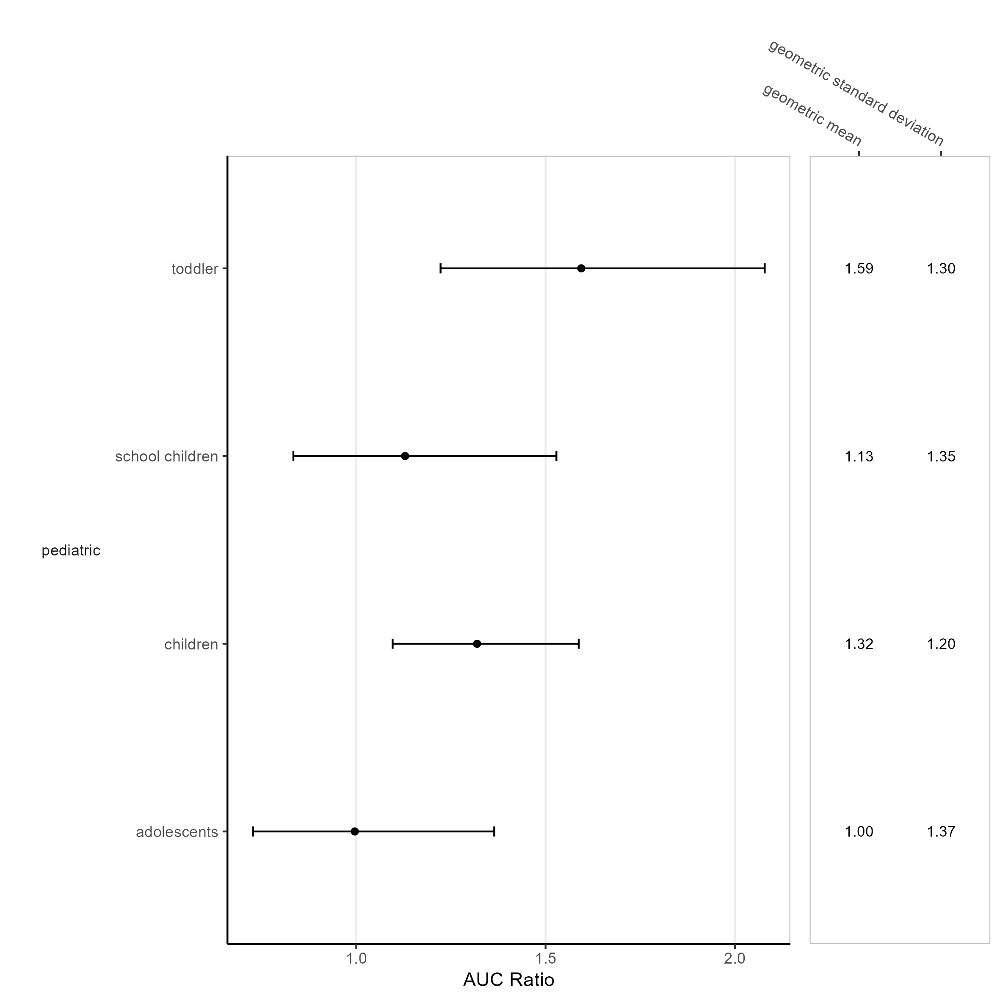
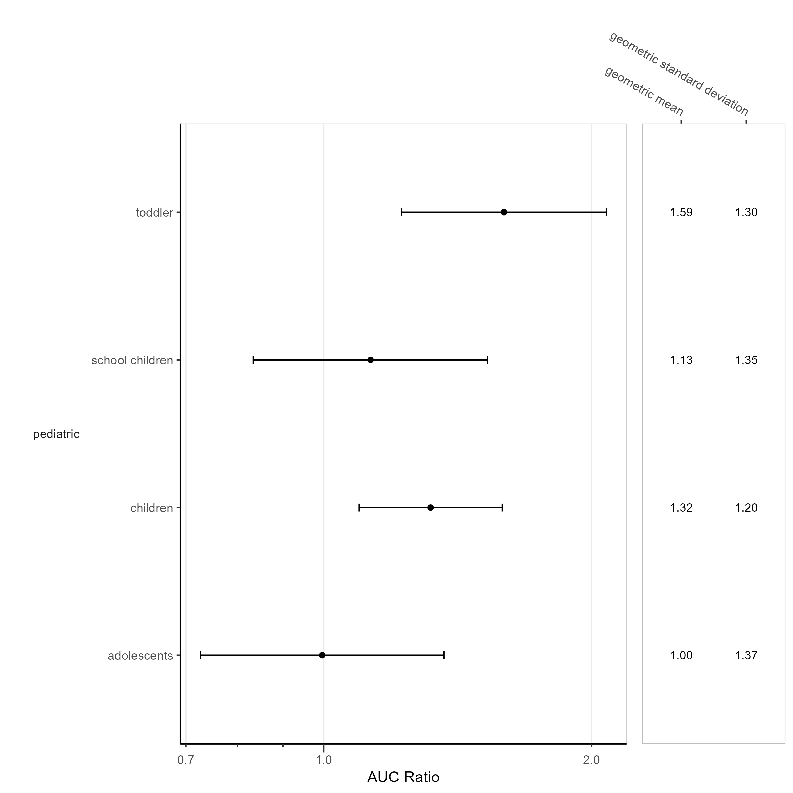
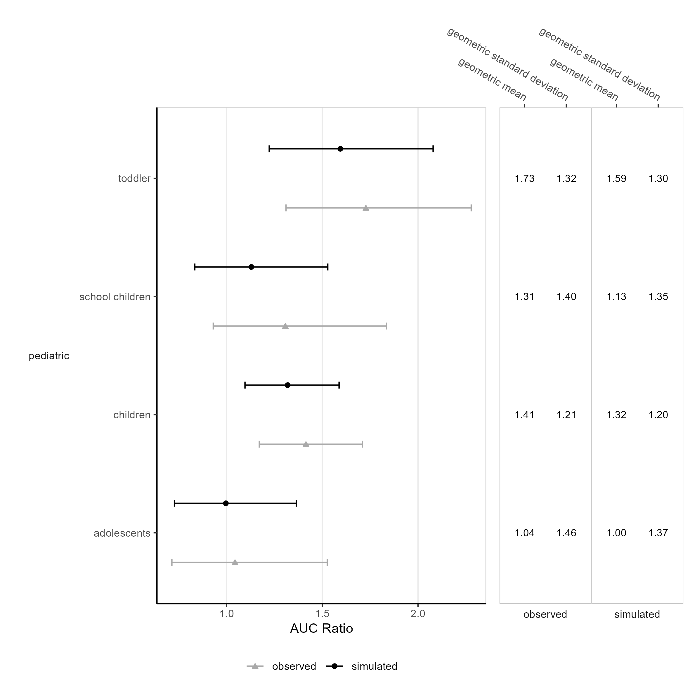
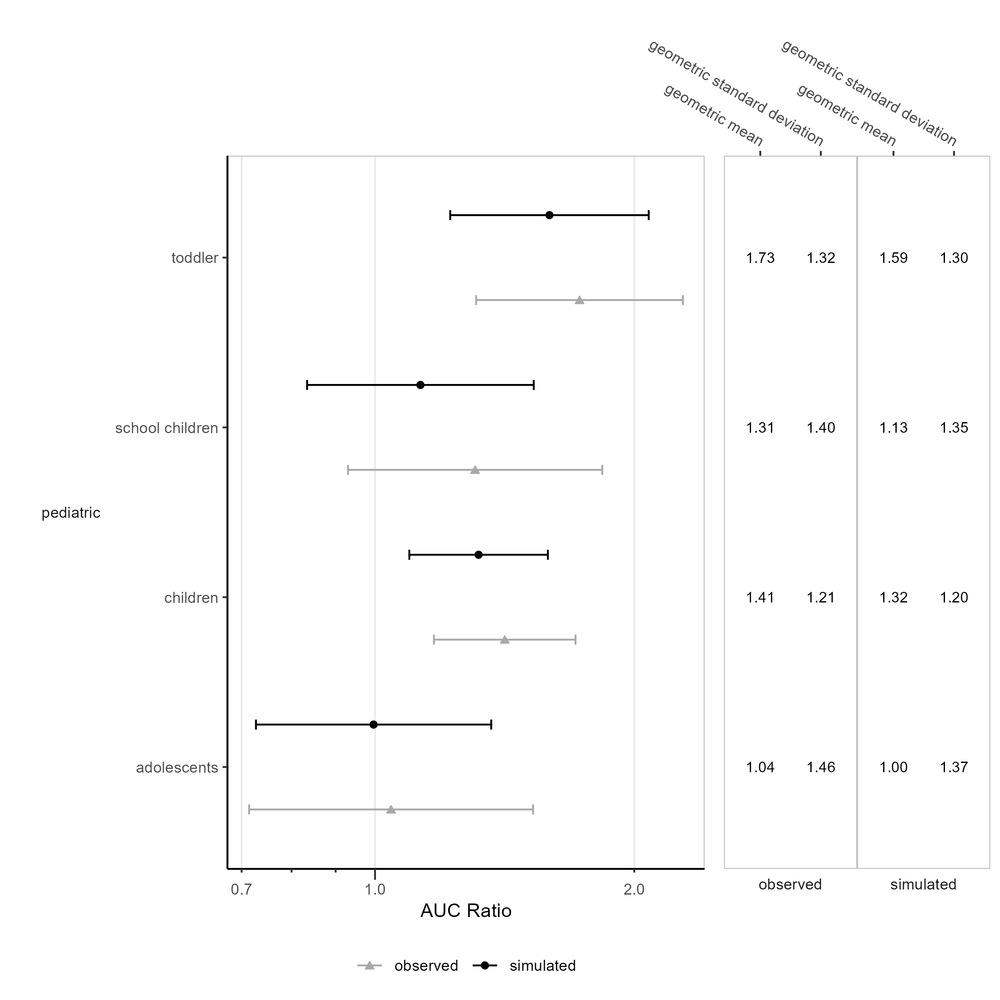

 
```{r}
#| include: false
knitr::opts_chunk$set(echo = FALSE, warning = FALSE, results = "asis", error = FALSE, message = FALSE)
```
 
  
  
  
# PK Forest  
  
  
```{r}
#| label: fig-without_data-Plasma-linear
#| fig-cap: "Simulated AUC ratios of DrugX on a linear x-scale. Number of simulated values is 100 for all scenarios. IV 1mg, PO 5mg."

```
```{r}
#| output: asis
ospsuite.reportingframework::mdFootNote(subfolder = "UC07E_PK_Forest", footNoteFile = "without_data-Plasma-linear.footnote", footNoteCustomStyle = params$customStyles$FigureFootnote)
```
\newpage
  
```{r}
#| label: fig-without_data-Plasma-log
#| fig-cap: "Simulated AUC ratios of DrugX on a logarithmic x-scale. Number of simulated values is 100 for all scenarios. IV 1mg, PO 5mg."

```
```{r}
#| output: asis
ospsuite.reportingframework::mdFootNote(subfolder = "UC07E_PK_Forest", footNoteFile = "without_data-Plasma-log.footnote", footNoteCustomStyle = params$customStyles$FigureFootnote)
```
\newpage
  
```{r}
#| label: fig-with_data-Plasma-linear
#| fig-cap: "Simulated and observed AUC ratios of DrugX on a linear x-scale. Number of simulated values is 12 and 100 for adolescents, children, school children and toddler. IV 1mg, PO 5mg."

```
```{r}
#| output: asis
ospsuite.reportingframework::mdFootNote(subfolder = "UC07E_PK_Forest", footNoteFile = "with_data-Plasma-linear.footnote", footNoteCustomStyle = params$customStyles$FigureFootnote)
```
\newpage
  
```{r}
#| label: fig-with_data-Plasma-log
#| fig-cap: "Simulated and observed AUC ratios of DrugX on a logarithmic x-scale. Number of simulated values is 12 and 100 for adolescents, children, school children and toddler. IV 1mg, PO 5mg."

```
```{r}
#| output: asis
ospsuite.reportingframework::mdFootNote(subfolder = "UC07E_PK_Forest", footNoteFile = "with_data-Plasma-log.footnote", footNoteCustomStyle = params$customStyles$FigureFootnote)
```
\newpage
  
