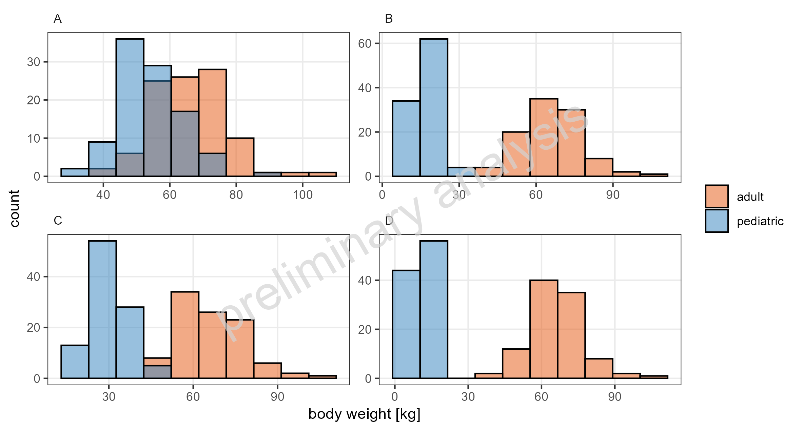
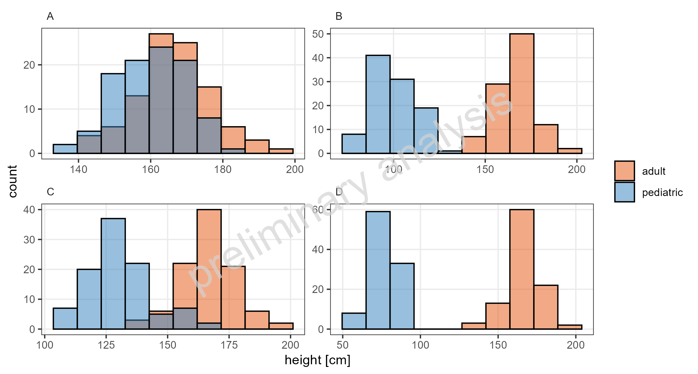
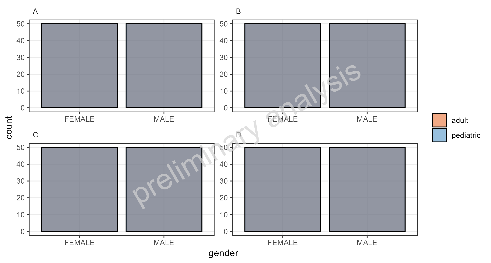
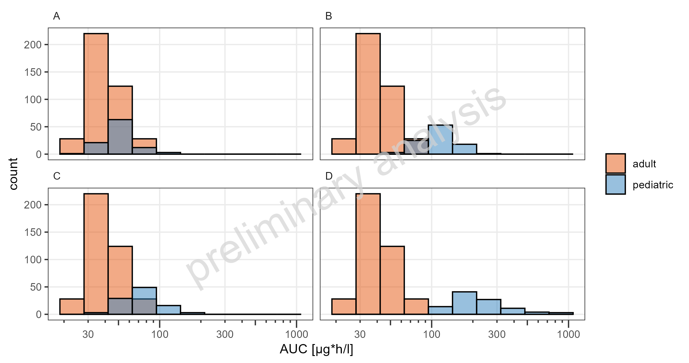

# Report

# Histograms

Figure 1: Simulated body weight for NA on a linear x-scale. This is a
comparison.



Figure 2: Simulated height for NA on a linear x-scale. This is a
comparison.



Figure 3: Simulated gender for NA on a linear x-scale. This is a
comparison.



Figure 4: Simulated AUC of DrugX for adolescents 1mg iv, children 1mg
iv, school-children 1mg iv and toddler 1mg iv on a logarithmic x-scale.
This is a comparison.


