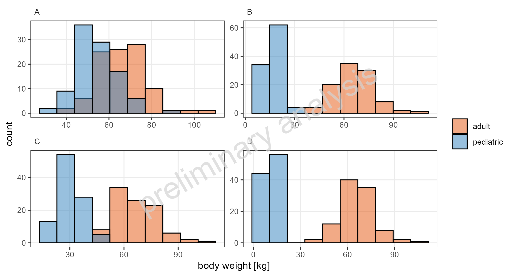
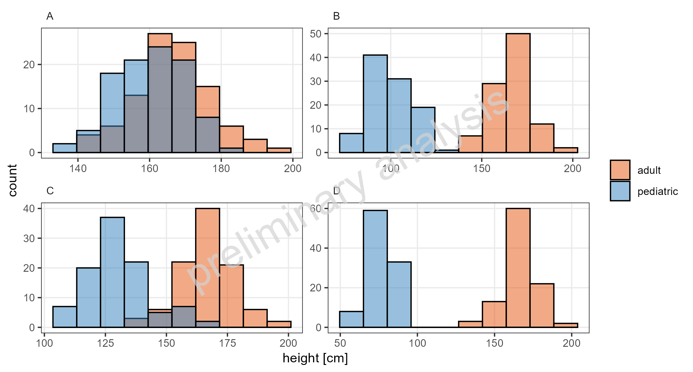
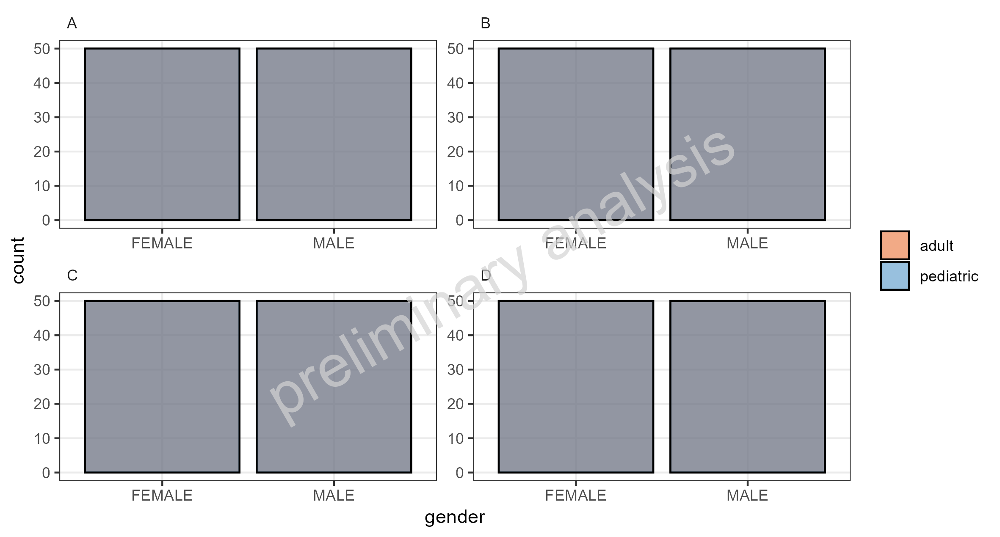
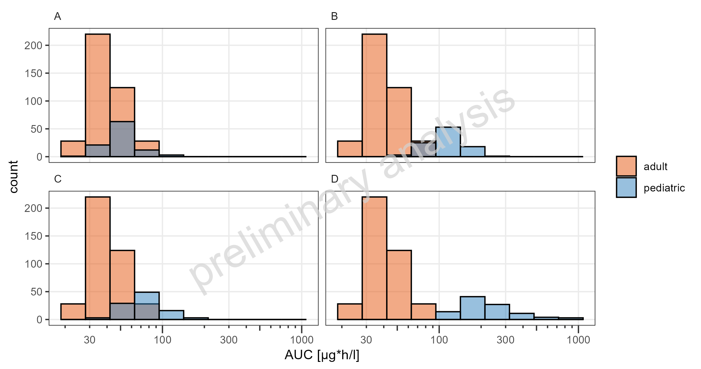

 
```{r}
#| include: false
knitr::opts_chunk$set(echo = FALSE, warning = FALSE, results = "asis", error = FALSE, message = FALSE)
```
 
  
  
  
# Histograms  
  
  
```{r}
#| label: fig-hist_demo_weight_linear
#| fig-cap: "Simulated body weight for NA on a linear x-scale. This is a comparison."

```
```{r}
#| output: asis
ospsuite.reportingframework::mdFootNote(subfolder = "UC07G_Histograms", footNoteFile = "hist_demo_weight_linear.footnote", footNoteCustomStyle = params$customStyles$FigureFootnote)
```
\newpage
  
```{r}
#| label: fig-hist_demo_height_linear
#| fig-cap: "Simulated height for NA on a linear x-scale. This is a comparison."

```
```{r}
#| output: asis
ospsuite.reportingframework::mdFootNote(subfolder = "UC07G_Histograms", footNoteFile = "hist_demo_height_linear.footnote", footNoteCustomStyle = params$customStyles$FigureFootnote)
```
\newpage
  
```{r}
#| label: fig-hist_demo_gender_linear
#| fig-cap: "Simulated gender for NA on a linear x-scale. This is a comparison."

```
```{r}
#| output: asis
ospsuite.reportingframework::mdFootNote(subfolder = "UC07G_Histograms", footNoteFile = "hist_demo_gender_linear.footnote", footNoteCustomStyle = params$customStyles$FigureFootnote)
```
\newpage
  
```{r}
#| label: fig-hist_pk_AUC_tEnd_log
#| fig-cap: "Simulated AUC of DrugX for adolescents 1mg iv, children 1mg iv, school-children 1mg iv and toddler 1mg iv on a logarithmic x-scale. This is a comparison."

```
```{r}
#| output: asis
ospsuite.reportingframework::mdFootNote(subfolder = "UC07G_Histograms", footNoteFile = "hist_pk_AUC_tEnd_log.footnote", footNoteCustomStyle = params$customStyles$FigureFootnote)
```
\newpage
  
