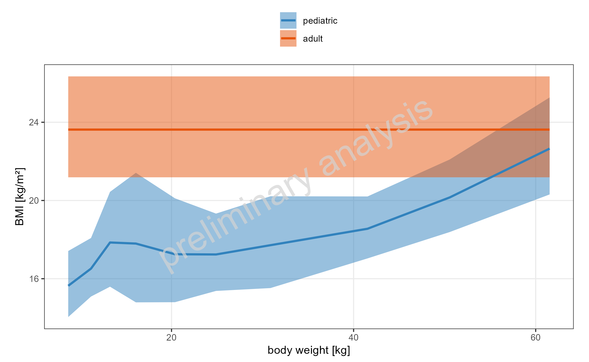
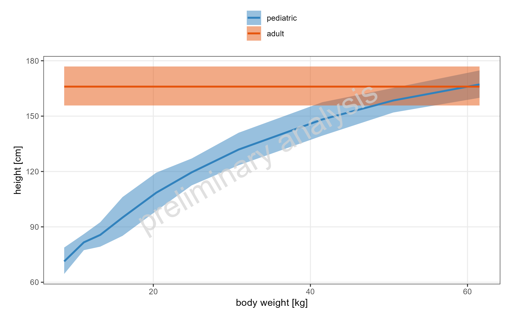
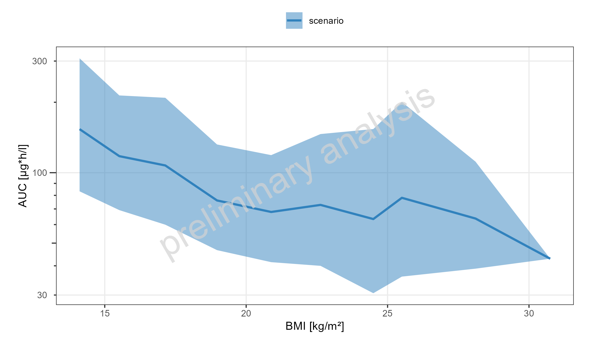
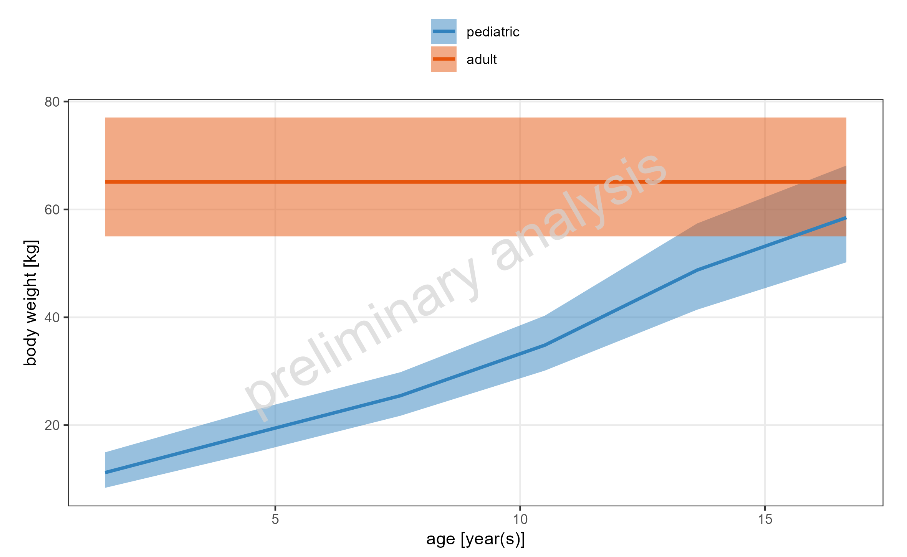

# Report

# Parameter vs age

Figure 1: Simulated BMI dependency vs body weight on a linear y-scale.
This is a comparison.

Data is displayed as geometric mean and geometric standard deviation.



Table 1: Simulated BMI dependency vs body weight. This is a comparison.

| body weight \[kg\] range | body weight \[kg\] median | N | geometric mean | geometric standard deviation |
|:---|---:|---:|---:|---:|
| adult | NA | 100 | 23.6 | 1.12 |
| 4.702 - 9.821 | 8.65 | 40 | 15.6 | 1.11 |
| 9.821 - 12.01 | 11.20 | 40 | 16.5 | 1.09 |
| 12.01 - 14.379 | 13.20 | 40 | 17.9 | 1.15 |
| 14.379 - 18.2 | 16.10 | 40 | 17.8 | 1.20 |
| 18.2 - 22.61 | 20.40 | 40 | 17.3 | 1.17 |
| 22.61 - 27.11 | 24.90 | 40 | 17.2 | 1.12 |
| 27.11 - 34.9 | 30.90 | 40 | 17.7 | 1.14 |
| 34.9 - 45.8 | 41.50 | 40 | 18.6 | 1.09 |
| 45.8 - 57.1 | 50.60 | 40 | 20.2 | 1.10 |
| 57.1 - 90.73 | 61.50 | 40 | 22.7 | 1.12 |



Figure 2: Simulated height dependency vs body weight on a linear
y-scale. This is a comparison.

Data is displayed as geometric mean and geometric standard deviation.



Table 2: Simulated height dependency vs body weight. This is a
comparison.

| body weight \[kg\] range | body weight \[kg\] median | N | geometric mean | geometric standard deviation |
|:---|---:|---:|---:|---:|
| adult | NA | 100 | 166.0 | 1.07 |
| 4.702 - 9.821 | 8.65 | 40 | 71.3 | 1.11 |
| 9.821 - 12.01 | 11.20 | 40 | 81.6 | 1.05 |
| 12.01 - 14.379 | 13.20 | 40 | 85.6 | 1.08 |
| 14.379 - 18.2 | 16.10 | 40 | 95.1 | 1.12 |
| 18.2 - 22.61 | 20.40 | 40 | 109.0 | 1.10 |
| 22.61 - 27.11 | 24.90 | 40 | 120.0 | 1.06 |
| 27.11 - 34.9 | 30.90 | 40 | 132.0 | 1.07 |
| 34.9 - 45.8 | 41.50 | 40 | 148.0 | 1.06 |
| 45.8 - 57.1 | 50.60 | 40 | 158.0 | 1.04 |
| 57.1 - 90.73 | 61.50 | 40 | 167.0 | 1.05 |



Figure 3: Simulated AUC dependency of DrugX vs BMI on a logarithmic
y-scale. This is a comparison.

Data is displayed as geometric mean and geometric standard deviation.



Table 3: Simulated AUC dependency of DrugX vs BMI. This is a comparison.

| BMI \[kg/m²\] range | BMI \[kg/m²\] median | N | geometric mean | geometric standard deviation |
|:---|---:|---:|---:|---:|
| 12.77 - 14.59 | 14.1 | 26 | 160.0 | 1.99 |
| 14.59 - 16.38 | 15.5 | 96 | 122.0 | 1.77 |
| 16.38 - 18.16 | 17.1 | 89 | 112.0 | 1.90 |
| 18.16 - 20 | 19.0 | 87 | 78.5 | 1.71 |
| 20 - 21.8 | 20.9 | 51 | 70.2 | 1.73 |
| 21.8 - 23.7 | 22.6 | 32 | 76.4 | 1.96 |
| 23.7 - 25.2 | 24.5 | 10 | 68.2 | 2.38 |
| 25.2 - 27.4 | 25.5 | 5 | 83.6 | 2.42 |
| 27.4 - 29 | 28.1 | 3 | 65.2 | 1.73 |
| 29 - 30.77 | 30.8 | 1 | 42.9 | NA |



Figure 4: Simulated body weight dependency vs age on a linear y-scale.
This is a comparison.

Data is displayed as geometric mean and geometric standard deviation.



Table 4: Simulated body weight dependency vs age. This is a comparison.

| age \[year(s)\] range | age \[year(s)\] median | N | geometric mean | geometric standard deviation |
|:---|---:|---:|---:|---:|
| adult | NA | 100 | 65.1 | 1.18 |
| 0 - 3 | 1.52 | 136 | 11.2 | 1.34 |
| 3 - 6 | 4.62 | 64 | 18.6 | 1.23 |
| 6 - 9 | 7.56 | 58 | 25.5 | 1.17 |
| 9 - 12 | 10.50 | 42 | 34.8 | 1.16 |
| 12 - 15 | 13.60 | 52 | 48.8 | 1.18 |
| 15 - 18 | 16.70 | 48 | 58.5 | 1.17 |


