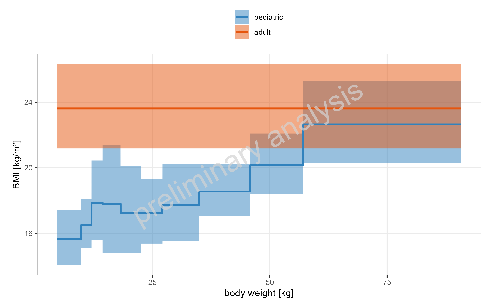
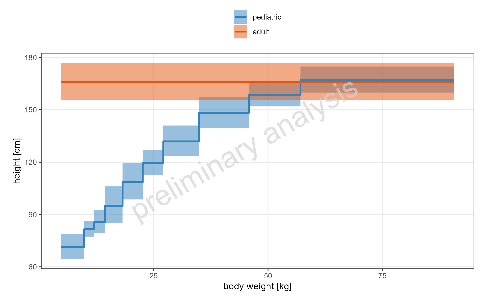
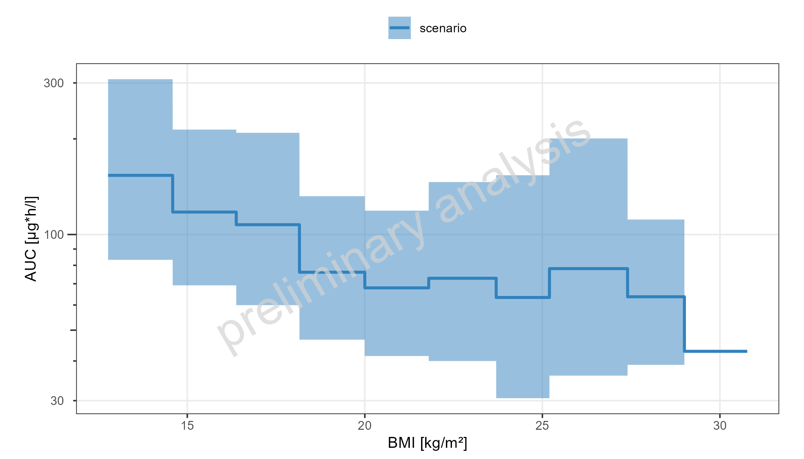
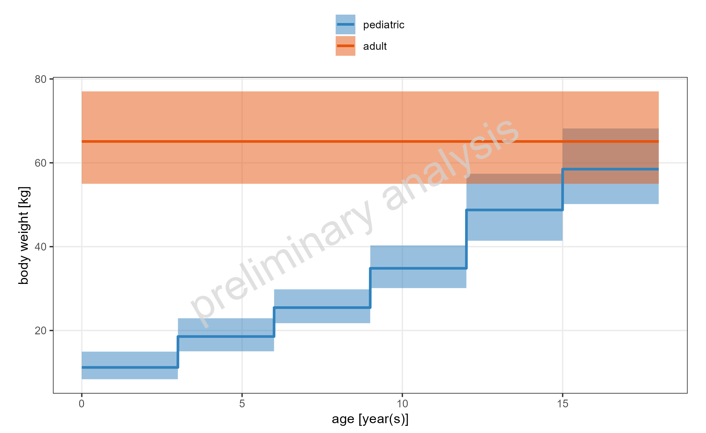

 
```{r}
#| include: false
knitr::opts_chunk$set(echo = FALSE, warning = FALSE, results = "asis", error = FALSE, message = FALSE)
```
 
  
  
  
# Parameter vs age  
  
  
```{r}
#| label: fig-demographics_BMI_linear
#| fig-cap: "Simulated BMI dependency vs body weight on a linear y-scale. This is a comparison."

```
```{r}
#| output: asis
ospsuite.reportingframework::mdFootNote(subfolder = "UC07H_DistVsDemo_StepPlot", footNoteFile = "demographics_BMI_linear.footnote", footNoteCustomStyle = params$customStyles$FigureFootnote)
```
\newpage
  
```{r}
#| label: tbl-demographics_BMI
#| tbl-cap: "Simulated BMI dependency vs body weight. This is a comparison."
dt <- data.table::fread("UC07H_DistVsDemo_StepPlot/demographics_BMI.csv")
numeric_cols <- names(dt)[sapply(dt, function(x) is.numeric(x) & !is.integer(x))]
if (length(numeric_cols) > 0) dt[, (numeric_cols) := signif(.SD, 3), .SDcols = numeric_cols]
knitr::kable(dt)
```
```{r}
#| output: asis
ospsuite.reportingframework::mdFootNote(subfolder = "UC07H_DistVsDemo_StepPlot", footNoteFile = "demographics_BMI.footnote", footNoteCustomStyle = params$customStyles$TableFootnote)
```
\newpage
  
```{r}
#| label: fig-demographics_height_linear
#| fig-cap: "Simulated height dependency vs body weight on a linear y-scale. This is a comparison."

```
```{r}
#| output: asis
ospsuite.reportingframework::mdFootNote(subfolder = "UC07H_DistVsDemo_StepPlot", footNoteFile = "demographics_height_linear.footnote", footNoteCustomStyle = params$customStyles$FigureFootnote)
```
\newpage
  
```{r}
#| label: tbl-demographics_height
#| tbl-cap: "Simulated height dependency vs body weight. This is a comparison."
dt <- data.table::fread("UC07H_DistVsDemo_StepPlot/demographics_height.csv")
numeric_cols <- names(dt)[sapply(dt, function(x) is.numeric(x) & !is.integer(x))]
if (length(numeric_cols) > 0) dt[, (numeric_cols) := signif(.SD, 3), .SDcols = numeric_cols]
knitr::kable(dt)
```
```{r}
#| output: asis
ospsuite.reportingframework::mdFootNote(subfolder = "UC07H_DistVsDemo_StepPlot", footNoteFile = "demographics_height.footnote", footNoteCustomStyle = params$customStyles$TableFootnote)
```
\newpage
  
```{r}
#| label: fig-AUC_AUC_tEnd_log
#| fig-cap: "Simulated AUC dependency of DrugX vs BMI on a logarithmic y-scale. This is a comparison."

```
```{r}
#| output: asis
ospsuite.reportingframework::mdFootNote(subfolder = "UC07H_DistVsDemo_StepPlot", footNoteFile = "AUC_AUC_tEnd_log.footnote", footNoteCustomStyle = params$customStyles$FigureFootnote)
```
\newpage
  
```{r}
#| label: tbl-AUC_AUC_tEnd
#| tbl-cap: "Simulated AUC dependency of DrugX vs BMI. This is a comparison."
dt <- data.table::fread("UC07H_DistVsDemo_StepPlot/AUC_AUC_tEnd.csv")
numeric_cols <- names(dt)[sapply(dt, function(x) is.numeric(x) & !is.integer(x))]
if (length(numeric_cols) > 0) dt[, (numeric_cols) := signif(.SD, 3), .SDcols = numeric_cols]
knitr::kable(dt)
```
```{r}
#| output: asis
ospsuite.reportingframework::mdFootNote(subfolder = "UC07H_DistVsDemo_StepPlot", footNoteFile = "AUC_AUC_tEnd.footnote", footNoteCustomStyle = params$customStyles$TableFootnote)
```
\newpage
  
```{r}
#| label: fig-weight_vs_age_weight_linear
#| fig-cap: "Simulated body weight dependency vs age on a linear y-scale. This is a comparison."

```
```{r}
#| output: asis
ospsuite.reportingframework::mdFootNote(subfolder = "UC07H_DistVsDemo_StepPlot", footNoteFile = "weight_vs_age_weight_linear.footnote", footNoteCustomStyle = params$customStyles$FigureFootnote)
```
\newpage
  
```{r}
#| label: tbl-weight_vs_age_weight
#| tbl-cap: "Simulated body weight dependency vs age. This is a comparison."
dt <- data.table::fread("UC07H_DistVsDemo_StepPlot/weight_vs_age_weight.csv")
numeric_cols <- names(dt)[sapply(dt, function(x) is.numeric(x) & !is.integer(x))]
if (length(numeric_cols) > 0) dt[, (numeric_cols) := signif(.SD, 3), .SDcols = numeric_cols]
knitr::kable(dt)
```
```{r}
#| output: asis
ospsuite.reportingframework::mdFootNote(subfolder = "UC07H_DistVsDemo_StepPlot", footNoteFile = "weight_vs_age_weight.footnote", footNoteCustomStyle = params$customStyles$TableFootnote)
```
\newpage
  
