 
```{r}
#| include: false
knitr::opts_chunk$set(echo = FALSE, warning = FALSE, results = "asis", error = FALSE, message = FALSE)
```
 
  
  
  
# Timeprofiles  
  
  
```{r}
#| label: fig-singlePlot_withoutData-TP-linear-total
#| fig-cap: "Customized Time Profile Plot - singlePlot_withoutData with reference lines and enhanced styling"
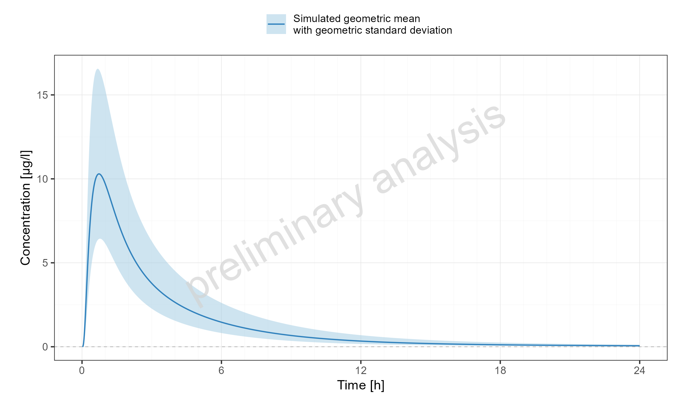
```
```{r}
#| output: asis
ospsuite.reportingframework::mdFootNote(subfolder = "UC07I_CustomAnnotatedTimeProfiles", footNoteFile = "singlePlot_withoutData-TP-linear-total.footnote", footNoteCustomStyle = params$customStyles$FigureFootnote)
```
\newpage
  
```{r}
#| label: fig-singlePlot_withoutData-TP-log-total
#| fig-cap: "Customized Time Profile Plot - singlePlot_withoutData with reference lines and enhanced styling"
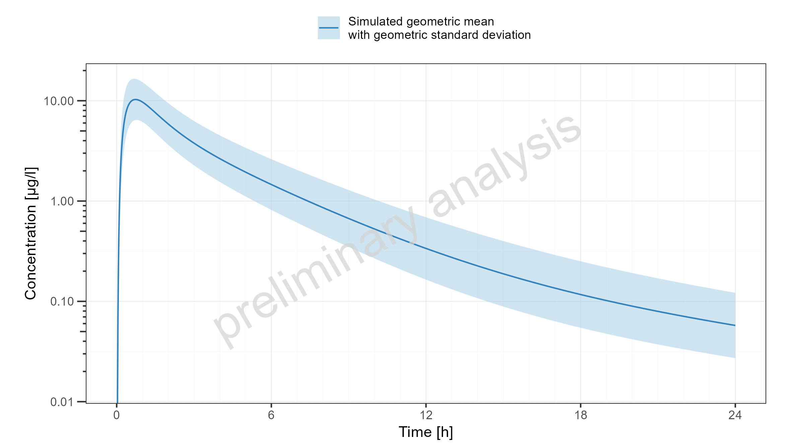
```
```{r}
#| output: asis
ospsuite.reportingframework::mdFootNote(subfolder = "UC07I_CustomAnnotatedTimeProfiles", footNoteFile = "singlePlot_withoutData-TP-log-total.footnote", footNoteCustomStyle = params$customStyles$FigureFootnote)
```
\newpage
  
```{r}
#| label: fig-singlePlot_withData-TP-linear-total
#| fig-cap: "Customized Time Profile Plot - singlePlot_withData with reference lines and enhanced styling"
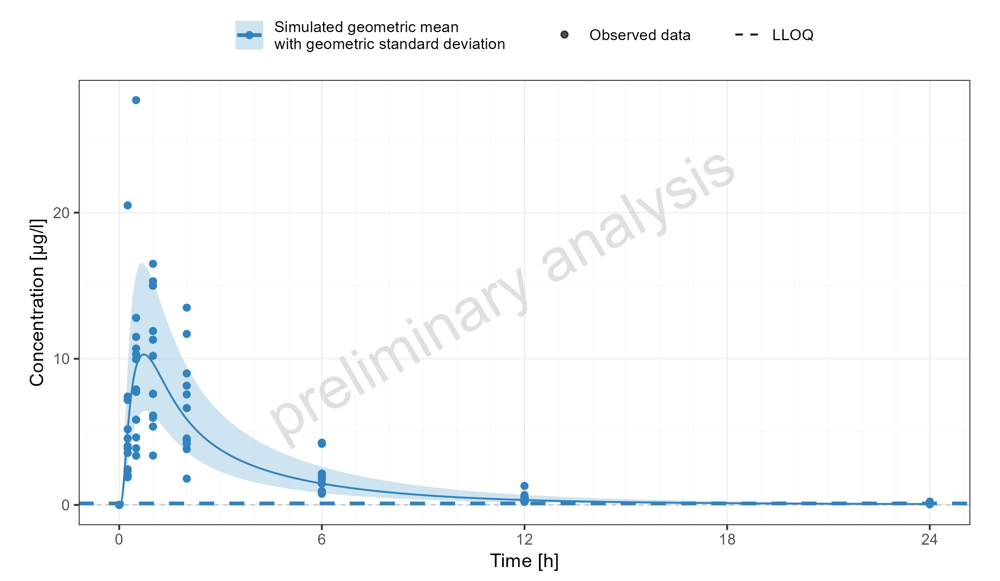
```
```{r}
#| output: asis
ospsuite.reportingframework::mdFootNote(subfolder = "UC07I_CustomAnnotatedTimeProfiles", footNoteFile = "singlePlot_withData-TP-linear-total.footnote", footNoteCustomStyle = params$customStyles$FigureFootnote)
```
\newpage
  
```{r}
#| label: fig-singlePlot_withData-TP-log-total
#| fig-cap: "Customized Time Profile Plot - singlePlot_withData with reference lines and enhanced styling"
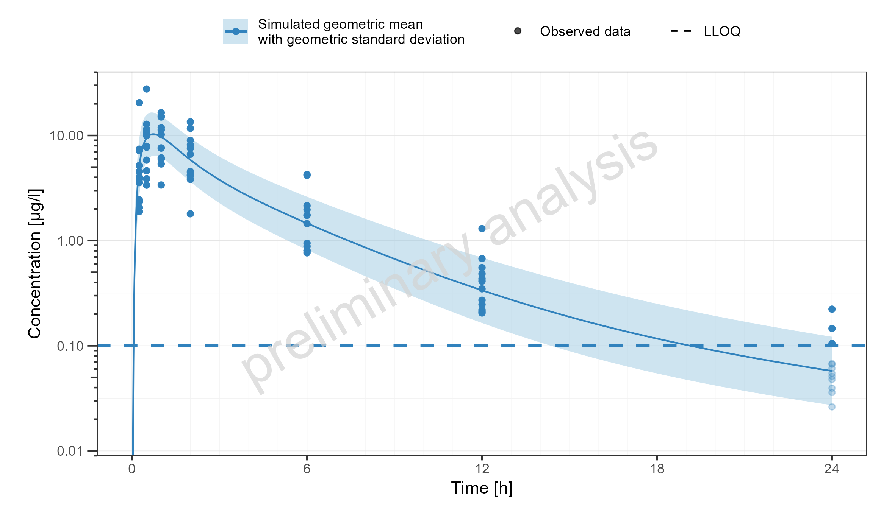
```
```{r}
#| output: asis
ospsuite.reportingframework::mdFootNote(subfolder = "UC07I_CustomAnnotatedTimeProfiles", footNoteFile = "singlePlot_withData-TP-log-total.footnote", footNoteCustomStyle = params$customStyles$FigureFootnote)
```
\newpage
  
```{r}
#| label: fig-singlePlot_withData-PvO-linear-total
#| fig-cap: "Customized Time Profile Plot - singlePlot_withData with reference lines and enhanced styling"
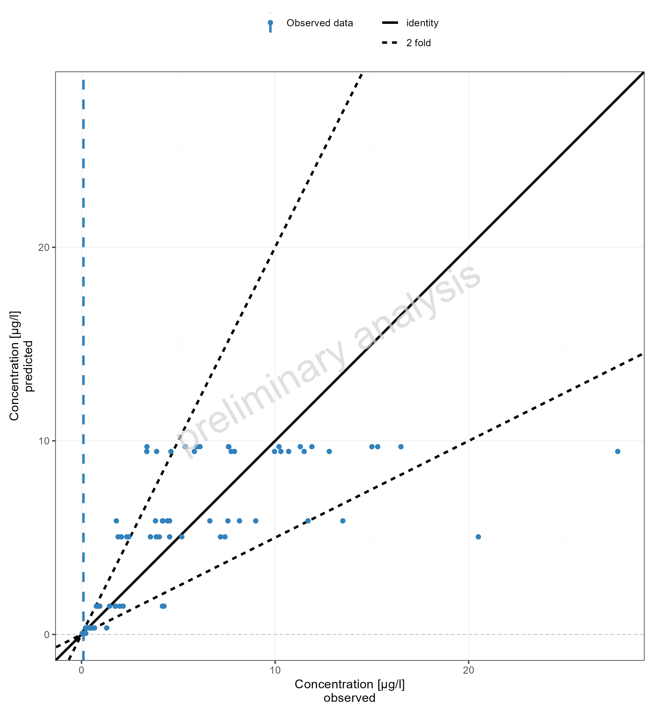
```
```{r}
#| output: asis
ospsuite.reportingframework::mdFootNote(subfolder = "UC07I_CustomAnnotatedTimeProfiles", footNoteFile = "singlePlot_withData-PvO-linear-total.footnote", footNoteCustomStyle = params$customStyles$FigureFootnote)
```
\newpage
  
```{r}
#| label: fig-singlePlot_withData-PvO-log-total
#| fig-cap: "Customized Time Profile Plot - singlePlot_withData with reference lines and enhanced styling"
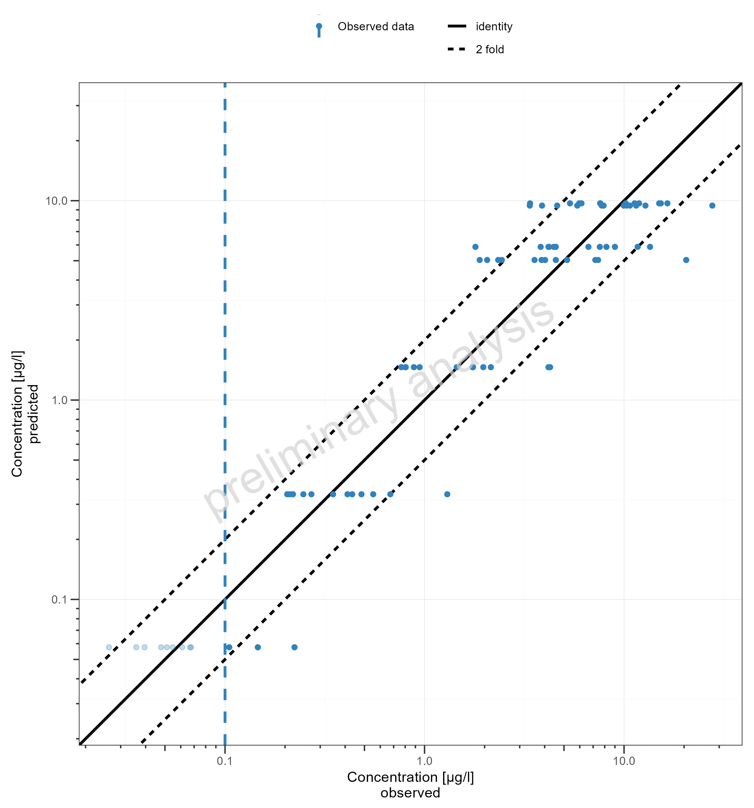
```
```{r}
#| output: asis
ospsuite.reportingframework::mdFootNote(subfolder = "UC07I_CustomAnnotatedTimeProfiles", footNoteFile = "singlePlot_withData-PvO-log-total.footnote", footNoteCustomStyle = params$customStyles$FigureFootnote)
```
\newpage
  
```{r}
#| label: fig-singlePlot_withData-ResvT-linear-total
#| fig-cap: "Customized Time Profile Plot - singlePlot_withData with reference lines and enhanced styling"
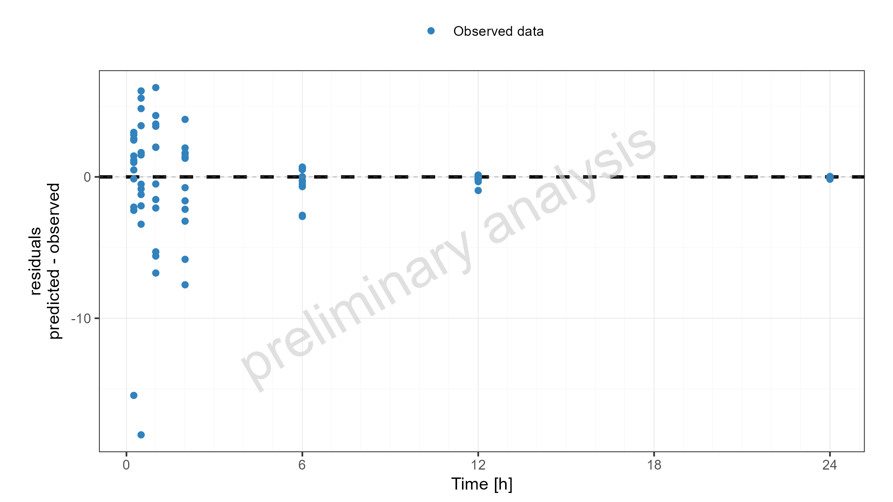
```
```{r}
#| output: asis
ospsuite.reportingframework::mdFootNote(subfolder = "UC07I_CustomAnnotatedTimeProfiles", footNoteFile = "singlePlot_withData-ResvT-linear-total.footnote", footNoteCustomStyle = params$customStyles$FigureFootnote)
```
\newpage
  
```{r}
#| label: fig-singlePlot_withData-ResvT-log-total
#| fig-cap: "Customized Time Profile Plot - singlePlot_withData with reference lines and enhanced styling"
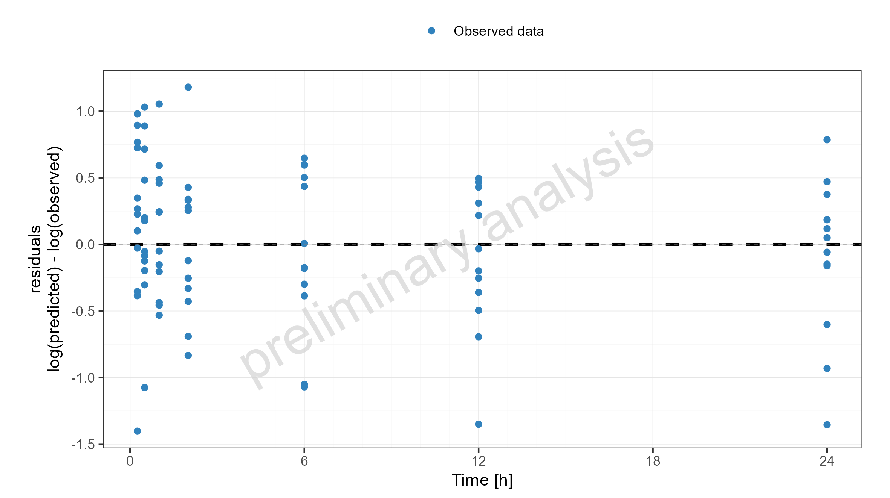
```
```{r}
#| output: asis
ospsuite.reportingframework::mdFootNote(subfolder = "UC07I_CustomAnnotatedTimeProfiles", footNoteFile = "singlePlot_withData-ResvT-log-total.footnote", footNoteCustomStyle = params$customStyles$FigureFootnote)
```
\newpage
  
```{r}
#| label: fig-singlePlot_withData-ResvO-linear-total
#| fig-cap: "Customized Time Profile Plot - singlePlot_withData with reference lines and enhanced styling"
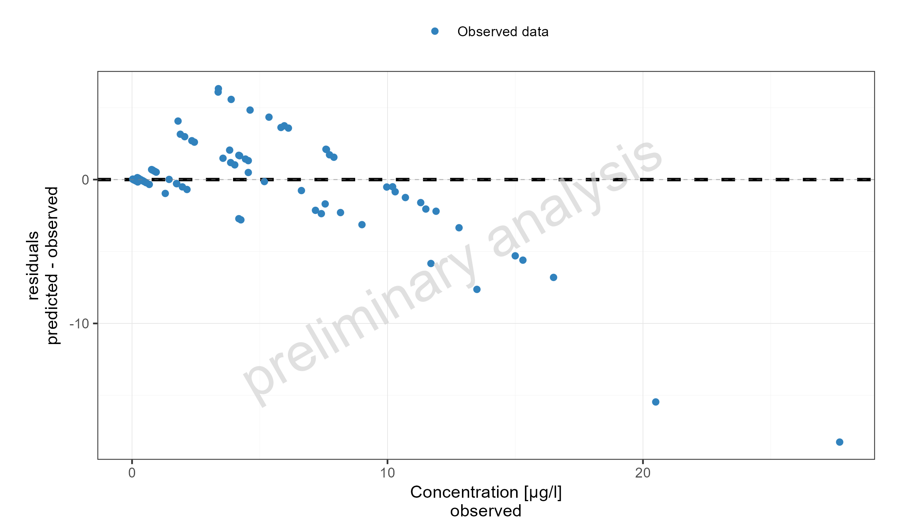
```
```{r}
#| output: asis
ospsuite.reportingframework::mdFootNote(subfolder = "UC07I_CustomAnnotatedTimeProfiles", footNoteFile = "singlePlot_withData-ResvO-linear-total.footnote", footNoteCustomStyle = params$customStyles$FigureFootnote)
```
\newpage
  
```{r}
#| label: fig-singlePlot_withData-ResvO-log-total
#| fig-cap: "Customized Time Profile Plot - singlePlot_withData with reference lines and enhanced styling"
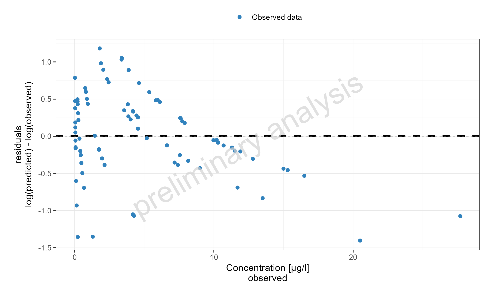
```
```{r}
#| output: asis
ospsuite.reportingframework::mdFootNote(subfolder = "UC07I_CustomAnnotatedTimeProfiles", footNoteFile = "singlePlot_withData-ResvO-log-total.footnote", footNoteCustomStyle = params$customStyles$FigureFootnote)
```
\newpage
  
```{r}
#| label: fig-singlePlot_withData-ResH-linear-total
#| fig-cap: "Customized Time Profile Plot - singlePlot_withData with reference lines and enhanced styling"
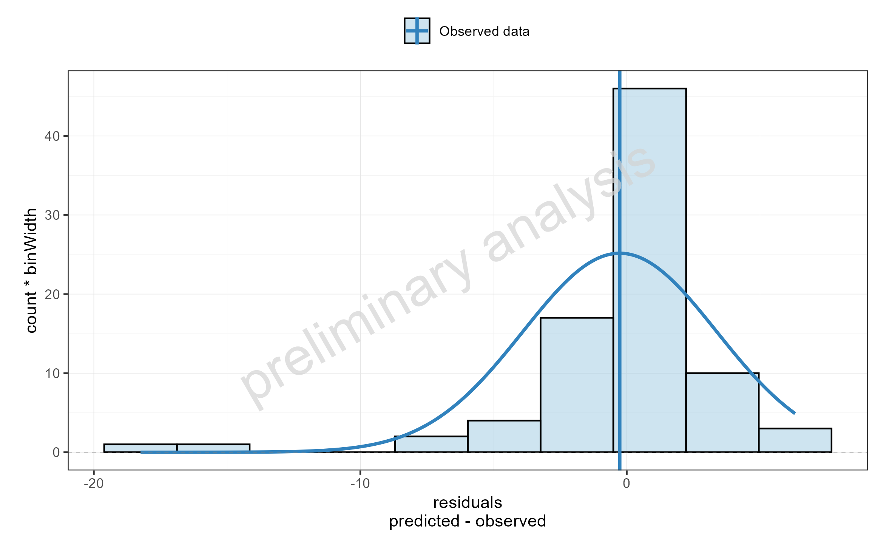
```
```{r}
#| output: asis
ospsuite.reportingframework::mdFootNote(subfolder = "UC07I_CustomAnnotatedTimeProfiles", footNoteFile = "singlePlot_withData-ResH-linear-total.footnote", footNoteCustomStyle = params$customStyles$FigureFootnote)
```
\newpage
  
```{r}
#| label: fig-singlePlot_withData-ResH-log-total
#| fig-cap: "Customized Time Profile Plot - singlePlot_withData with reference lines and enhanced styling"
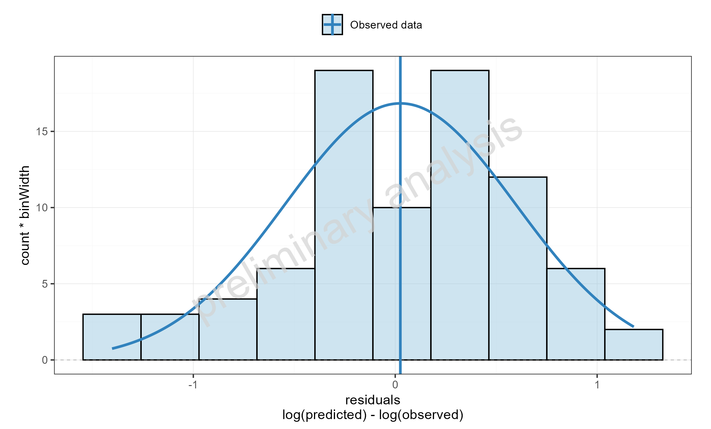
```
```{r}
#| output: asis
ospsuite.reportingframework::mdFootNote(subfolder = "UC07I_CustomAnnotatedTimeProfiles", footNoteFile = "singlePlot_withData-ResH-log-total.footnote", footNoteCustomStyle = params$customStyles$FigureFootnote)
```
\newpage
  
```{r}
#| label: fig-singlePlot_withData-QQ-linear-total
#| fig-cap: "Customized Time Profile Plot - singlePlot_withData with reference lines and enhanced styling"
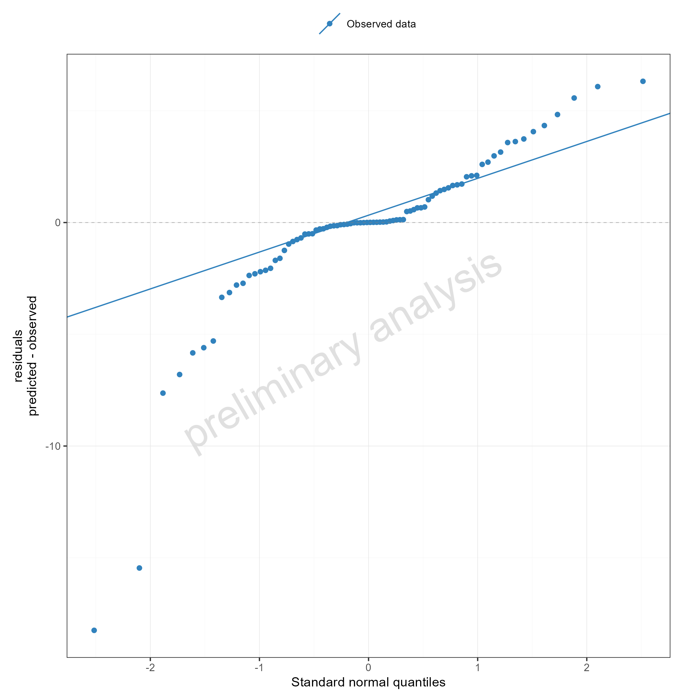
```
```{r}
#| output: asis
ospsuite.reportingframework::mdFootNote(subfolder = "UC07I_CustomAnnotatedTimeProfiles", footNoteFile = "singlePlot_withData-QQ-linear-total.footnote", footNoteCustomStyle = params$customStyles$FigureFootnote)
```
\newpage
  
```{r}
#| label: fig-singlePlot_withData-QQ-log-total
#| fig-cap: "Customized Time Profile Plot - singlePlot_withData with reference lines and enhanced styling"
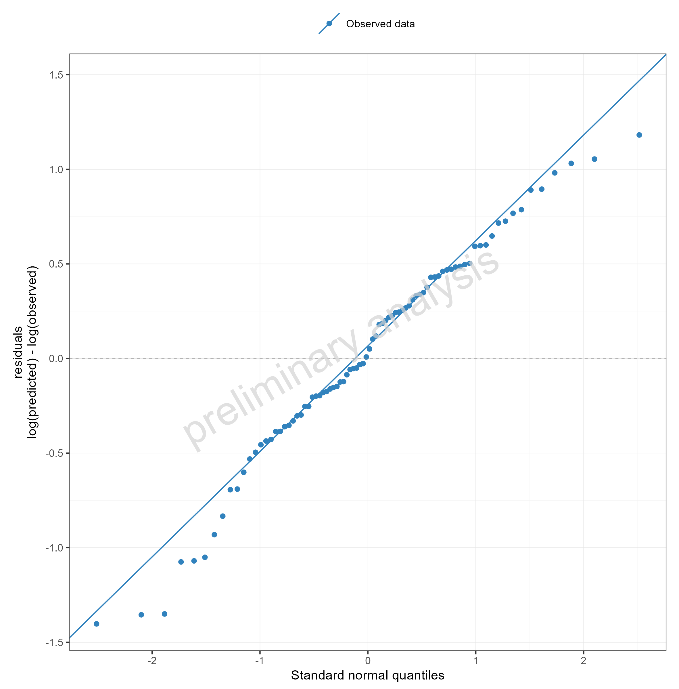
```
```{r}
#| output: asis
ospsuite.reportingframework::mdFootNote(subfolder = "UC07I_CustomAnnotatedTimeProfiles", footNoteFile = "singlePlot_withData-QQ-log-total.footnote", footNoteCustomStyle = params$customStyles$FigureFootnote)
```
\newpage
  
```{r}
#| label: fig-singlePlot_withReference-TP-linear-total
#| fig-cap: "Customized Time Profile Plot - singlePlot_withReference with reference lines and enhanced styling"
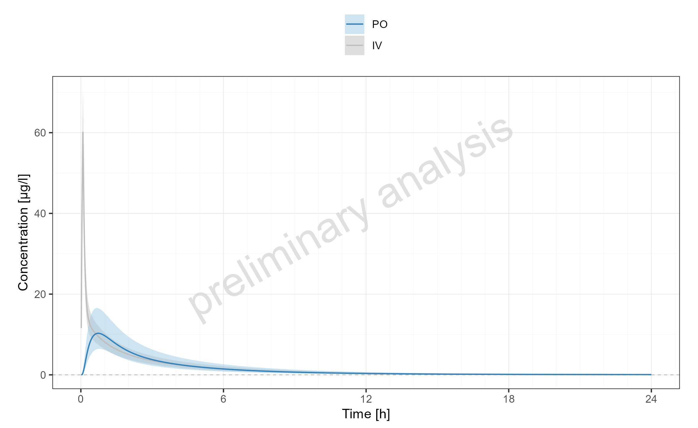
```
```{r}
#| output: asis
ospsuite.reportingframework::mdFootNote(subfolder = "UC07I_CustomAnnotatedTimeProfiles", footNoteFile = "singlePlot_withReference-TP-linear-total.footnote", footNoteCustomStyle = params$customStyles$FigureFootnote)
```
\newpage
  
```{r}
#| label: fig-singlePlot_withReference-TP-log-total
#| fig-cap: "Customized Time Profile Plot - singlePlot_withReference with reference lines and enhanced styling"
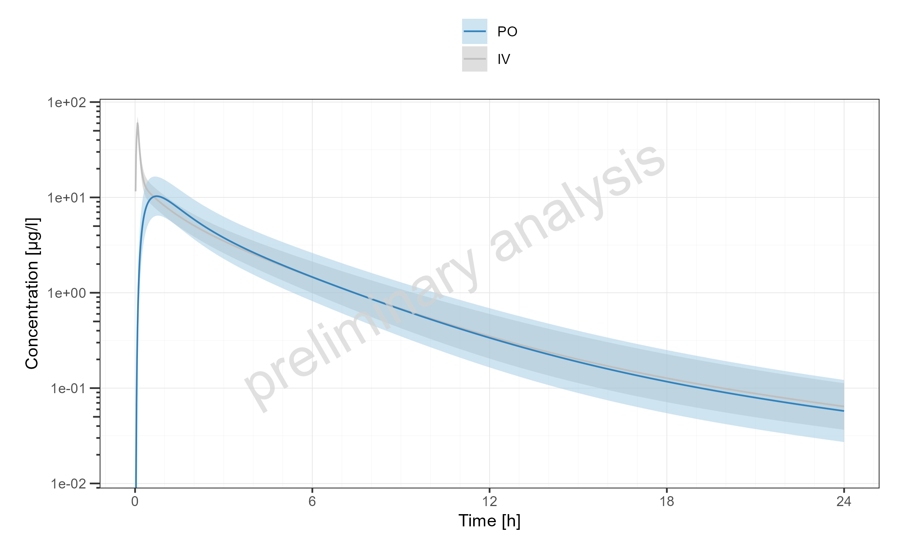
```
```{r}
#| output: asis
ospsuite.reportingframework::mdFootNote(subfolder = "UC07I_CustomAnnotatedTimeProfiles", footNoteFile = "singlePlot_withReference-TP-log-total.footnote", footNoteCustomStyle = params$customStyles$FigureFootnote)
```
\newpage
  
```{r}
#| label: fig-singlePlot_withOffset-TP-linear-total
#| fig-cap: "Customized Time Profile Plot - singlePlot_withOffset with reference lines and enhanced styling"
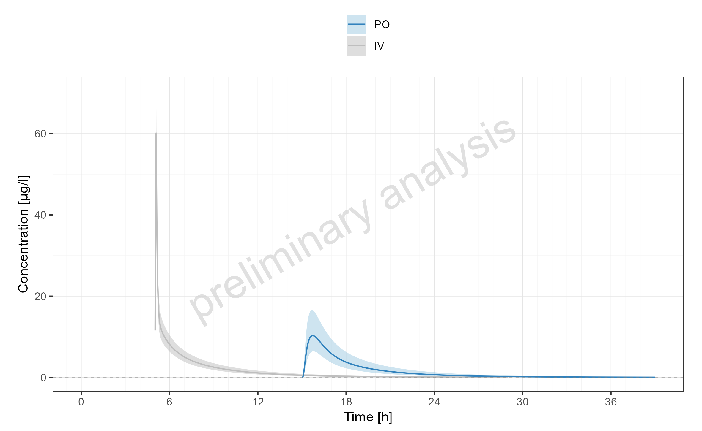
```
```{r}
#| output: asis
ospsuite.reportingframework::mdFootNote(subfolder = "UC07I_CustomAnnotatedTimeProfiles", footNoteFile = "singlePlot_withOffset-TP-linear-total.footnote", footNoteCustomStyle = params$customStyles$FigureFootnote)
```
\newpage
  
```{r}
#| label: fig-singlePlot_withOffset-TP-log-total
#| fig-cap: "Customized Time Profile Plot - singlePlot_withOffset with reference lines and enhanced styling"
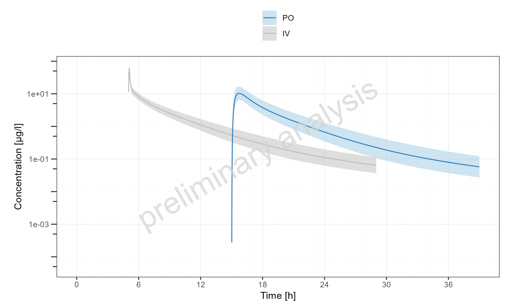
```
```{r}
#| output: asis
ospsuite.reportingframework::mdFootNote(subfolder = "UC07I_CustomAnnotatedTimeProfiles", footNoteFile = "singlePlot_withOffset-TP-log-total.footnote", footNoteCustomStyle = params$customStyles$FigureFootnote)
```
\newpage
  
```{r}
#| label: fig-singlePlot_withLimits-TP-linear-total
#| fig-cap: "Customized Time Profile Plot - singlePlot_withLimits with reference lines and enhanced styling"
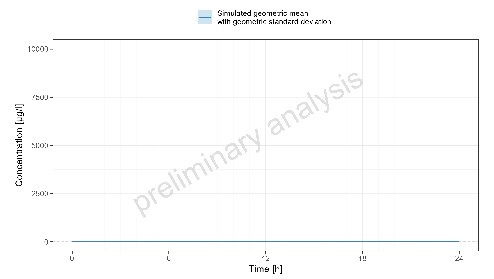
```
```{r}
#| output: asis
ospsuite.reportingframework::mdFootNote(subfolder = "UC07I_CustomAnnotatedTimeProfiles", footNoteFile = "singlePlot_withLimits-TP-linear-total.footnote", footNoteCustomStyle = params$customStyles$FigureFootnote)
```
\newpage
  
```{r}
#| label: fig-singlePlot_withLimits-TP-log-total
#| fig-cap: "Customized Time Profile Plot - singlePlot_withLimits with reference lines and enhanced styling"
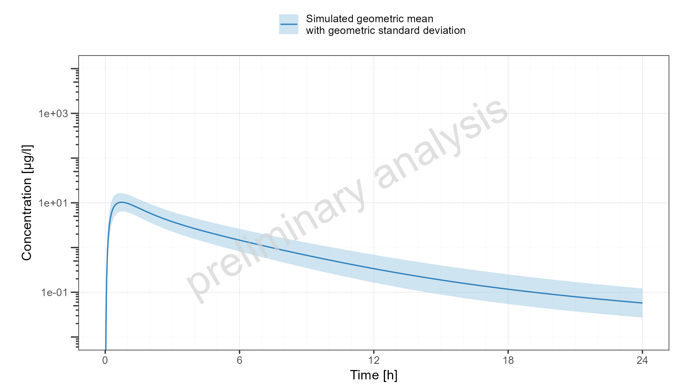
```
```{r}
#| output: asis
ospsuite.reportingframework::mdFootNote(subfolder = "UC07I_CustomAnnotatedTimeProfiles", footNoteFile = "singlePlot_withLimits-TP-log-total.footnote", footNoteCustomStyle = params$customStyles$FigureFootnote)
```
\newpage
  
```{r}
#| label: fig-multiDosePlot-TP-linear-total
#| fig-cap: "Customized Time Profile Plot - multiDosePlot with reference lines and enhanced styling"
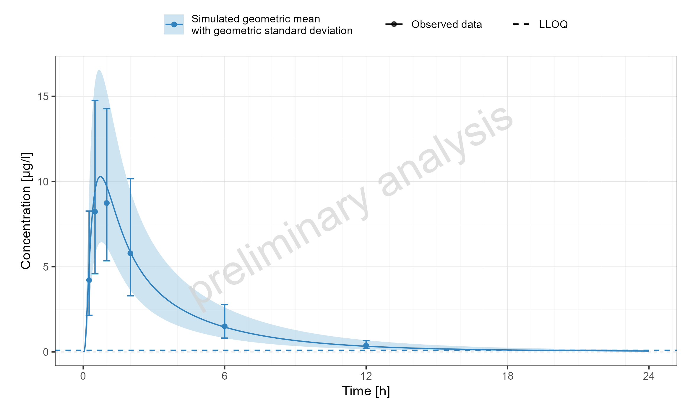
```
```{r}
#| output: asis
ospsuite.reportingframework::mdFootNote(subfolder = "UC07I_CustomAnnotatedTimeProfiles", footNoteFile = "multiDosePlot-TP-linear-total.footnote", footNoteCustomStyle = params$customStyles$FigureFootnote)
```
\newpage
  
```{r}
#| label: fig-multiDosePlot-TP-log-total
#| fig-cap: "Customized Time Profile Plot - multiDosePlot with reference lines and enhanced styling"
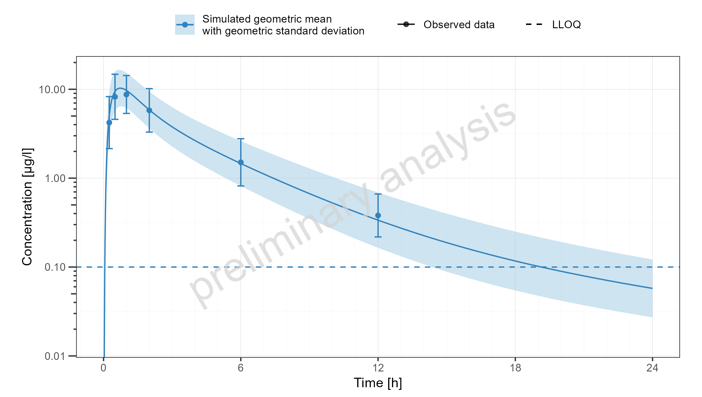
```
```{r}
#| output: asis
ospsuite.reportingframework::mdFootNote(subfolder = "UC07I_CustomAnnotatedTimeProfiles", footNoteFile = "multiDosePlot-TP-log-total.footnote", footNoteCustomStyle = params$customStyles$FigureFootnote)
```
\newpage
  
```{r}
#| label: fig-multiDosePlot-TP-linear-firstApplication
#| fig-cap: "Customized Time Profile Plot - multiDosePlot with reference lines and enhanced styling"
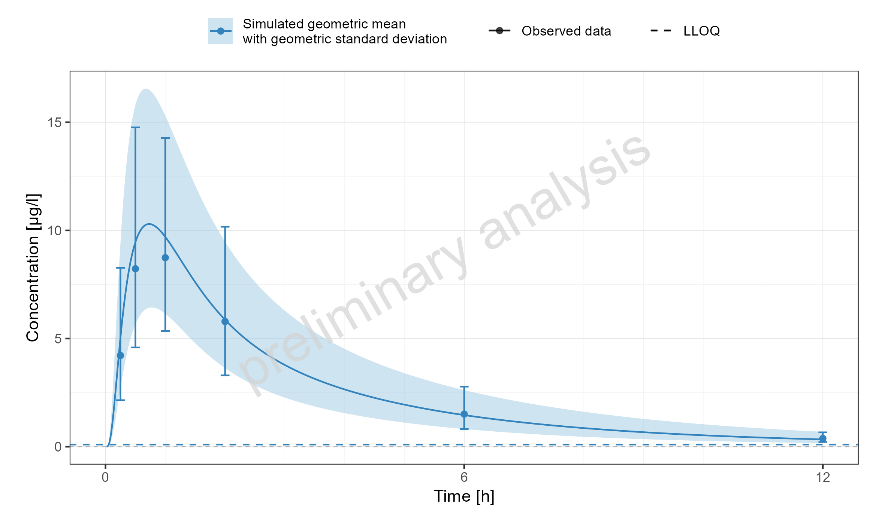
```
```{r}
#| output: asis
ospsuite.reportingframework::mdFootNote(subfolder = "UC07I_CustomAnnotatedTimeProfiles", footNoteFile = "multiDosePlot-TP-linear-firstApplication.footnote", footNoteCustomStyle = params$customStyles$FigureFootnote)
```
\newpage
  
```{r}
#| label: fig-multiDosePlot-TP-log-firstApplication
#| fig-cap: "Customized Time Profile Plot - multiDosePlot with reference lines and enhanced styling"
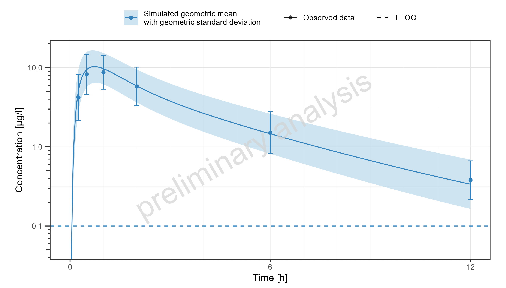
```
```{r}
#| output: asis
ospsuite.reportingframework::mdFootNote(subfolder = "UC07I_CustomAnnotatedTimeProfiles", footNoteFile = "multiDosePlot-TP-log-firstApplication.footnote", footNoteCustomStyle = params$customStyles$FigureFootnote)
```
\newpage
  
```{r}
#| label: fig-multiDosePlot-TP-linear-lastApplication
#| fig-cap: "Customized Time Profile Plot - multiDosePlot with reference lines and enhanced styling"
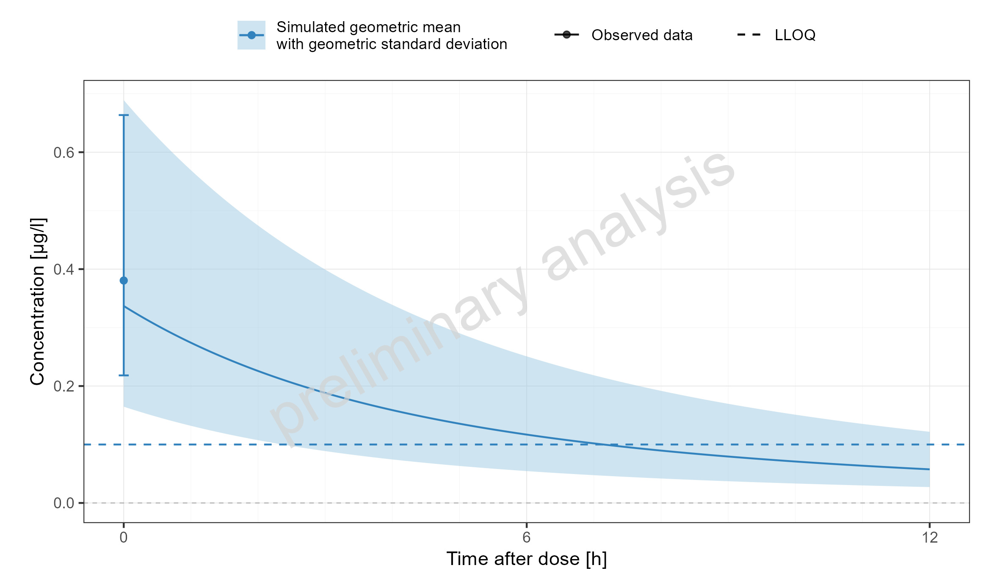
```
```{r}
#| output: asis
ospsuite.reportingframework::mdFootNote(subfolder = "UC07I_CustomAnnotatedTimeProfiles", footNoteFile = "multiDosePlot-TP-linear-lastApplication.footnote", footNoteCustomStyle = params$customStyles$FigureFootnote)
```
\newpage
  
```{r}
#| label: fig-multiDosePlot-TP-log-lastApplication
#| fig-cap: "Customized Time Profile Plot - multiDosePlot with reference lines and enhanced styling"
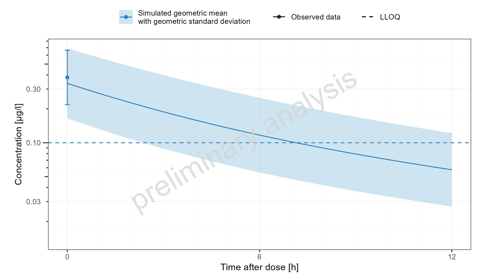
```
```{r}
#| output: asis
ospsuite.reportingframework::mdFootNote(subfolder = "UC07I_CustomAnnotatedTimeProfiles", footNoteFile = "multiDosePlot-TP-log-lastApplication.footnote", footNoteCustomStyle = params$customStyles$FigureFootnote)
```
\newpage
  
```{r}
#| label: fig-manyPanelPlot-TP-linear-total
#| fig-cap: "Customized Time Profile Plot - manyPanelPlot with reference lines and enhanced styling"
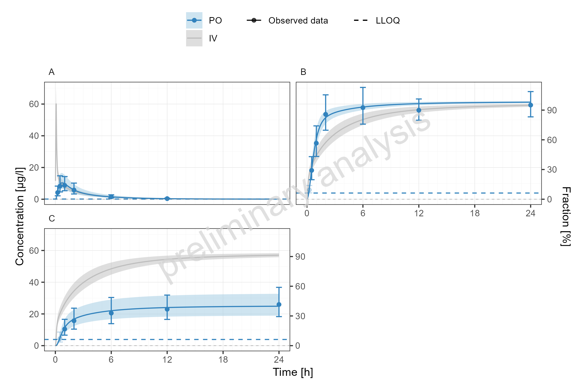
```
```{r}
#| output: asis
ospsuite.reportingframework::mdFootNote(subfolder = "UC07I_CustomAnnotatedTimeProfiles", footNoteFile = "manyPanelPlot-TP-linear-total.footnote", footNoteCustomStyle = params$customStyles$FigureFootnote)
```
\newpage
  
```{r}
#| label: fig-manyPanelPlot-TP-log-total
#| fig-cap: "Customized Time Profile Plot - manyPanelPlot with reference lines and enhanced styling"
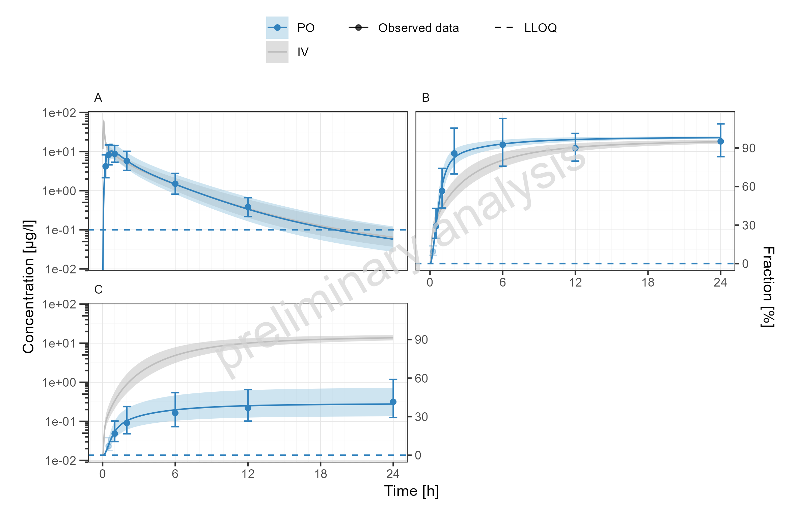
```
```{r}
#| output: asis
ospsuite.reportingframework::mdFootNote(subfolder = "UC07I_CustomAnnotatedTimeProfiles", footNoteFile = "manyPanelPlot-TP-log-total.footnote", footNoteCustomStyle = params$customStyles$FigureFootnote)
```
\newpage
  
```{r}
#| label: fig-manyPanelPlot_col3-TP-linear-total
#| fig-cap: "Customized Time Profile Plot - manyPanelPlot_col3 with reference lines and enhanced styling"
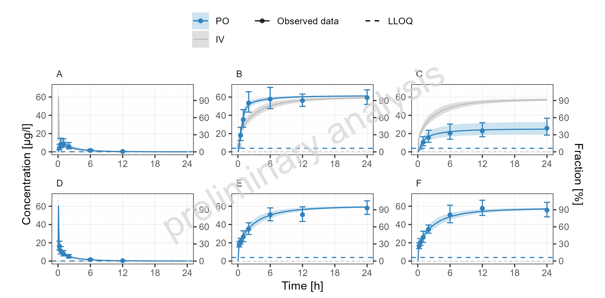
```
```{r}
#| output: asis
ospsuite.reportingframework::mdFootNote(subfolder = "UC07I_CustomAnnotatedTimeProfiles", footNoteFile = "manyPanelPlot_col3-TP-linear-total.footnote", footNoteCustomStyle = params$customStyles$FigureFootnote)
```
\newpage
  
```{r}
#| label: fig-manyPanelPlot_col3-TP-log-total
#| fig-cap: "Customized Time Profile Plot - manyPanelPlot_col3 with reference lines and enhanced styling"
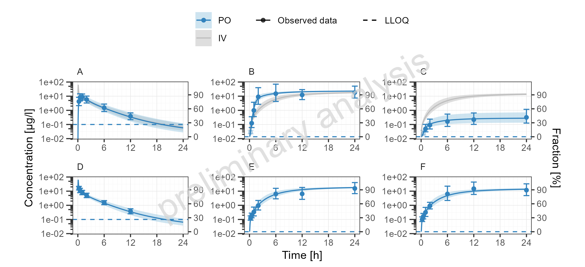
```
```{r}
#| output: asis
ospsuite.reportingframework::mdFootNote(subfolder = "UC07I_CustomAnnotatedTimeProfiles", footNoteFile = "manyPanelPlot_col3-TP-log-total.footnote", footNoteCustomStyle = params$customStyles$FigureFootnote)
```
\newpage
  
