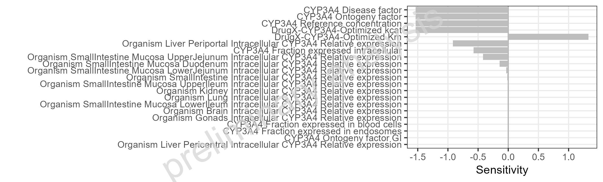
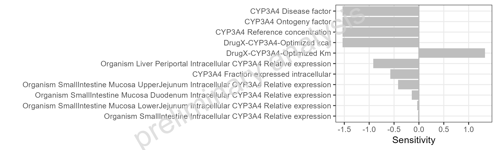
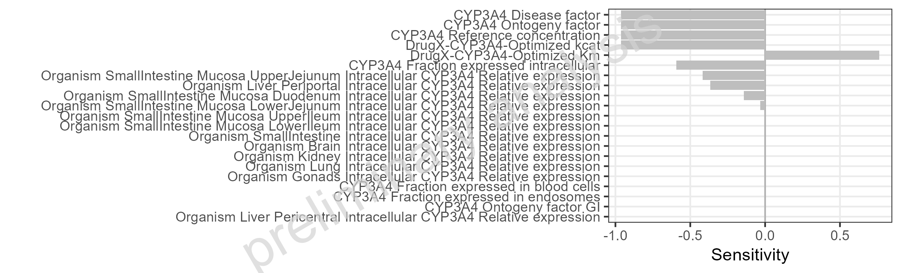
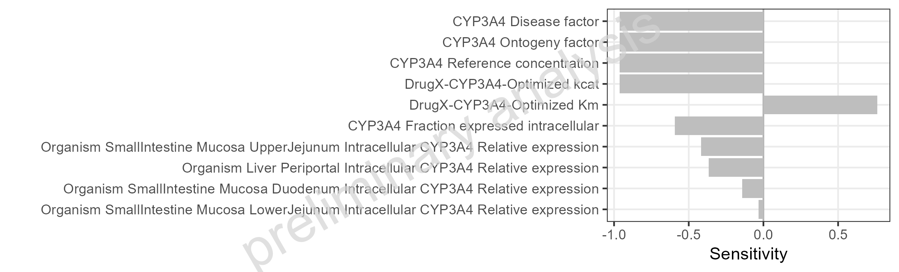

# Report

# Sensitivity absolut

Figure 1: Simulated Sensitivity of AUC for DrugX for adult individual
5mg po sorted by absolute sensitivity.



Table 1: Simulated Sensitivity of AUC for DrugX for adult individual 5mg
po sorted by absolute sensitivity.

| Parameter | Sensitivity |
|:---|---:|
| CYP3A4 Disease factor | -1.53e+00 |
| CYP3A4 Ontogeny factor | -1.53e+00 |
| CYP3A4 Reference concentration | -1.53e+00 |
| DrugX-CYP3A4-Optimized kcat | -1.53e+00 |
| DrugX-CYP3A4-Optimized Km | 1.33e+00 |
| Organism Liver Periportal Intracellular CYP3A4 Relative expression | -9.17e-01 |
| CYP3A4 Fraction expressed intracellular | -5.76e-01 |
| Organism SmallIntestine Mucosa UpperJejunum Intracellular CYP3A4 Relative expression | -4.18e-01 |
| Organism SmallIntestine Mucosa Duodenum Intracellular CYP3A4 Relative expression | -1.42e-01 |
| Organism SmallIntestine Mucosa LowerJejunum Intracellular CYP3A4 Relative expression | -3.23e-02 |
| Organism SmallIntestine Intracellular CYP3A4 Relative expression | -1.58e-02 |
| Organism SmallIntestine Mucosa UpperIleum Intracellular CYP3A4 Relative expression | -2.53e-03 |
| Organism Kidney Intracellular CYP3A4 Relative expression | -1.51e-03 |
| Organism Lung Intracellular CYP3A4 Relative expression | -3.34e-04 |
| Organism SmallIntestine Mucosa LowerIleum Intracellular CYP3A4 Relative expression | -1.82e-04 |
| Organism Brain Intracellular CYP3A4 Relative expression | -8.22e-05 |
| Organism Gonads Intracellular CYP3A4 Relative expression | -2.01e-05 |
| CYP3A4 Fraction expressed in blood cells | 0.00e+00 |
| CYP3A4 Fraction expressed in endosomes | 0.00e+00 |
| CYP3A4 Ontogeny factor GI | 0.00e+00 |
| Organism Liver Pericentral Intracellular CYP3A4 Relative expression | 0.00e+00 |



Figure 2: Simulated Sensitivity of AUC for DrugX for adult individual
5mg po sorted by absolute sensitivity. Filtering threshold (absolute
sensitivity): \>= 0.01.



Table 2: Simulated Sensitivity of AUC for DrugX for adult individual 5mg
po sorted by absolute sensitivity. Filtering threshold (absolute
sensitivity): \>= 0.01.

| Parameter | Sensitivity |
|:---|---:|
| CYP3A4 Disease factor | -1.5300 |
| CYP3A4 Ontogeny factor | -1.5300 |
| CYP3A4 Reference concentration | -1.5300 |
| DrugX-CYP3A4-Optimized kcat | -1.5300 |
| DrugX-CYP3A4-Optimized Km | 1.3300 |
| Organism Liver Periportal Intracellular CYP3A4 Relative expression | -0.9170 |
| CYP3A4 Fraction expressed intracellular | -0.5760 |
| Organism SmallIntestine Mucosa UpperJejunum Intracellular CYP3A4 Relative expression | -0.4180 |
| Organism SmallIntestine Mucosa Duodenum Intracellular CYP3A4 Relative expression | -0.1420 |
| Organism SmallIntestine Mucosa LowerJejunum Intracellular CYP3A4 Relative expression | -0.0323 |
| Organism SmallIntestine Intracellular CYP3A4 Relative expression | -0.0158 |



# Sensitivity ratios

Figure 3: Simulated Sensitivity of AUC for DrugX for adult individual
5mg po sorted by absolute sensitivity. Ratio mode (scenario/reference):
adult individual 5mg po / adult individual 1mg iv.



Table 3: Simulated Sensitivity of AUC for DrugX for adult individual 5mg
po sorted by absolute sensitivity. Ratio mode (scenario/reference):
adult individual 5mg po / adult individual 1mg iv.

| Parameter | Sensitivity |
|:---|---:|
| CYP3A4 Disease factor | -9.62e-01 |
| CYP3A4 Ontogeny factor | -9.62e-01 |
| CYP3A4 Reference concentration | -9.62e-01 |
| DrugX-CYP3A4-Optimized kcat | -9.62e-01 |
| DrugX-CYP3A4-Optimized Km | 7.63e-01 |
| CYP3A4 Fraction expressed intracellular | -5.94e-01 |
| Organism SmallIntestine Mucosa UpperJejunum Intracellular CYP3A4 Relative expression | -4.18e-01 |
| Organism Liver Periportal Intracellular CYP3A4 Relative expression | -3.67e-01 |
| Organism SmallIntestine Mucosa Duodenum Intracellular CYP3A4 Relative expression | -1.42e-01 |
| Organism SmallIntestine Mucosa LowerJejunum Intracellular CYP3A4 Relative expression | -3.22e-02 |
| Organism SmallIntestine Mucosa UpperIleum Intracellular CYP3A4 Relative expression | -2.43e-03 |
| Organism SmallIntestine Mucosa LowerIleum Intracellular CYP3A4 Relative expression | -1.47e-04 |
| Organism SmallIntestine Intracellular CYP3A4 Relative expression | 2.80e-05 |
| Organism Brain Intracellular CYP3A4 Relative expression | 7.70e-06 |
| Organism Kidney Intracellular CYP3A4 Relative expression | 5.00e-06 |
| Organism Lung Intracellular CYP3A4 Relative expression | 1.50e-06 |
| Organism Gonads Intracellular CYP3A4 Relative expression | 1.00e-06 |
| CYP3A4 Fraction expressed in blood cells | 0.00e+00 |
| CYP3A4 Fraction expressed in endosomes | 0.00e+00 |
| CYP3A4 Ontogeny factor GI | 0.00e+00 |
| Organism Liver Pericentral Intracellular CYP3A4 Relative expression | 0.00e+00 |



Figure 4: Simulated Sensitivity of AUC for DrugX for adult individual
5mg po sorted by absolute sensitivity. Filtering threshold (absolute
sensitivity): \>= 0.01. Ratio mode (scenario/reference): adult
individual 5mg po / adult individual 1mg iv.



Table 4: Simulated Sensitivity of AUC for DrugX for adult individual 5mg
po sorted by absolute sensitivity. Filtering threshold (absolute
sensitivity): \>= 0.01. Ratio mode (scenario/reference): adult
individual 5mg po / adult individual 1mg iv.

| Parameter | Sensitivity |
|:---|---:|
| CYP3A4 Disease factor | -0.9620 |
| CYP3A4 Ontogeny factor | -0.9620 |
| CYP3A4 Reference concentration | -0.9620 |
| DrugX-CYP3A4-Optimized kcat | -0.9620 |
| DrugX-CYP3A4-Optimized Km | 0.7630 |
| CYP3A4 Fraction expressed intracellular | -0.5940 |
| Organism SmallIntestine Mucosa UpperJejunum Intracellular CYP3A4 Relative expression | -0.4180 |
| Organism Liver Periportal Intracellular CYP3A4 Relative expression | -0.3670 |
| Organism SmallIntestine Mucosa Duodenum Intracellular CYP3A4 Relative expression | -0.1420 |
| Organism SmallIntestine Mucosa LowerJejunum Intracellular CYP3A4 Relative expression | -0.0322 |


