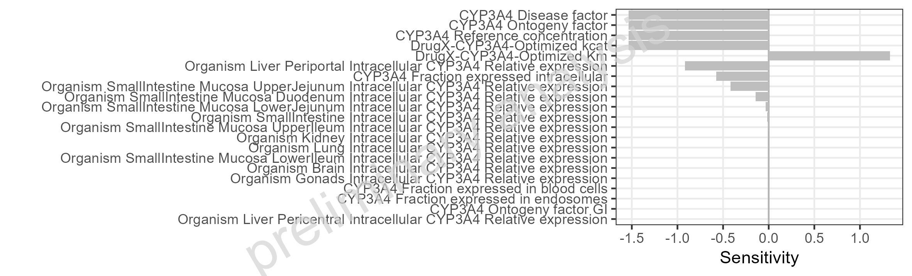
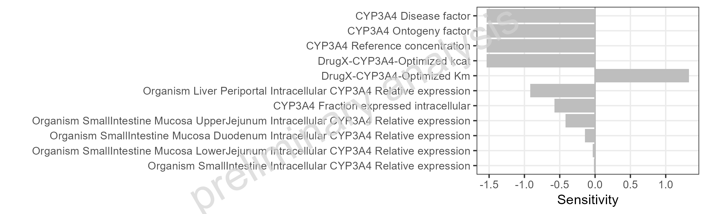
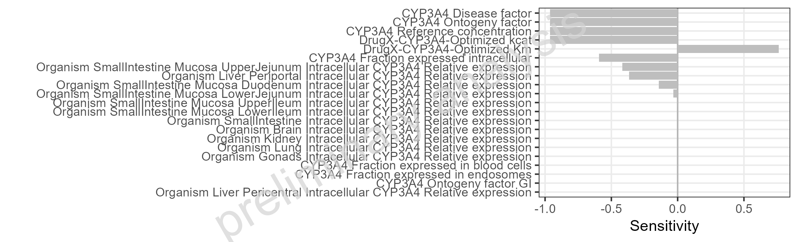
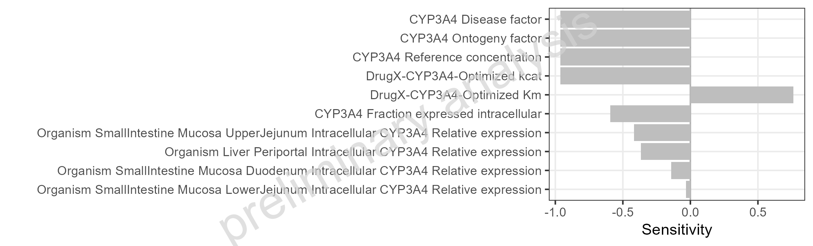

 
```{r}
#| include: false
knitr::opts_chunk$set(echo = FALSE, warning = FALSE, results = "asis", error = FALSE, message = FALSE)
```
 
  
  
  
# Sensitivity absolut  
  
  
```{r}
#| label: fig-Sensitivity_all
#| fig-cap: "Simulated Sensitivity of AUC for DrugX for adult individual 5mg po sorted by absolute sensitivity."

```
```{r}
#| output: asis
ospsuite.reportingframework::mdFootNote(subfolder = "UC08A_Sensitivity", footNoteFile = "Sensitivity_all.footnote", footNoteCustomStyle = params$customStyles$FigureFootnote)
```
\newpage
  
```{r}
#| label: tbl-Sensitivity_all-A
#| tbl-cap: "Simulated Sensitivity of AUC for DrugX for adult individual 5mg po sorted by absolute sensitivity."
dt <- data.table::fread("UC08A_Sensitivity/Sensitivity_all-A.csv")
numeric_cols <- names(dt)[sapply(dt, function(x) is.numeric(x) & !is.integer(x))]
if (length(numeric_cols) > 0) dt[, (numeric_cols) := signif(.SD, 3), .SDcols = numeric_cols]
knitr::kable(dt)
```
```{r}
#| output: asis
ospsuite.reportingframework::mdFootNote(subfolder = "UC08A_Sensitivity", footNoteFile = "Sensitivity_all-A.footnote", footNoteCustomStyle = params$customStyles$TableFootnote)
```
\newpage
  
```{r}
#| label: fig-Sensitivity_cut
#| fig-cap: "Simulated Sensitivity of AUC for DrugX for adult individual 5mg po sorted by absolute sensitivity. Filtering threshold (absolute sensitivity): >= 0.01."

```
```{r}
#| output: asis
ospsuite.reportingframework::mdFootNote(subfolder = "UC08A_Sensitivity", footNoteFile = "Sensitivity_cut.footnote", footNoteCustomStyle = params$customStyles$FigureFootnote)
```
\newpage
  
```{r}
#| label: tbl-Sensitivity_cut-A
#| tbl-cap: "Simulated Sensitivity of AUC for DrugX for adult individual 5mg po sorted by absolute sensitivity. Filtering threshold (absolute sensitivity): >= 0.01."
dt <- data.table::fread("UC08A_Sensitivity/Sensitivity_cut-A.csv")
numeric_cols <- names(dt)[sapply(dt, function(x) is.numeric(x) & !is.integer(x))]
if (length(numeric_cols) > 0) dt[, (numeric_cols) := signif(.SD, 3), .SDcols = numeric_cols]
knitr::kable(dt)
```
```{r}
#| output: asis
ospsuite.reportingframework::mdFootNote(subfolder = "UC08A_Sensitivity", footNoteFile = "Sensitivity_cut-A.footnote", footNoteCustomStyle = params$customStyles$TableFootnote)
```
\newpage
  
  
  
  
# Sensitivity ratios  
  
  
```{r}
#| label: fig-Sensitivity_all_ratio
#| fig-cap: "Simulated Sensitivity of AUC for DrugX for adult individual 5mg po sorted by absolute sensitivity. Ratio mode (scenario/reference): adult individual 5mg po / adult individual 1mg iv."

```
```{r}
#| output: asis
ospsuite.reportingframework::mdFootNote(subfolder = "UC08A_Sensitivity", footNoteFile = "Sensitivity_all_ratio.footnote", footNoteCustomStyle = params$customStyles$FigureFootnote)
```
\newpage
  
```{r}
#| label: tbl-Sensitivity_all_ratio-A
#| tbl-cap: "Simulated Sensitivity of AUC for DrugX for adult individual 5mg po sorted by absolute sensitivity. Ratio mode (scenario/reference): adult individual 5mg po / adult individual 1mg iv."
dt <- data.table::fread("UC08A_Sensitivity/Sensitivity_all_ratio-A.csv")
numeric_cols <- names(dt)[sapply(dt, function(x) is.numeric(x) & !is.integer(x))]
if (length(numeric_cols) > 0) dt[, (numeric_cols) := signif(.SD, 3), .SDcols = numeric_cols]
knitr::kable(dt)
```
```{r}
#| output: asis
ospsuite.reportingframework::mdFootNote(subfolder = "UC08A_Sensitivity", footNoteFile = "Sensitivity_all_ratio-A.footnote", footNoteCustomStyle = params$customStyles$TableFootnote)
```
\newpage
  
```{r}
#| label: fig-Sensitivity_cut_ratio
#| fig-cap: "Simulated Sensitivity of AUC for DrugX for adult individual 5mg po sorted by absolute sensitivity. Filtering threshold (absolute sensitivity): >= 0.01. Ratio mode (scenario/reference): adult individual 5mg po / adult individual 1mg iv."

```
```{r}
#| output: asis
ospsuite.reportingframework::mdFootNote(subfolder = "UC08A_Sensitivity", footNoteFile = "Sensitivity_cut_ratio.footnote", footNoteCustomStyle = params$customStyles$FigureFootnote)
```
\newpage
  
```{r}
#| label: tbl-Sensitivity_cut_ratio-A
#| tbl-cap: "Simulated Sensitivity of AUC for DrugX for adult individual 5mg po sorted by absolute sensitivity. Filtering threshold (absolute sensitivity): >= 0.01. Ratio mode (scenario/reference): adult individual 5mg po / adult individual 1mg iv."
dt <- data.table::fread("UC08A_Sensitivity/Sensitivity_cut_ratio-A.csv")
numeric_cols <- names(dt)[sapply(dt, function(x) is.numeric(x) & !is.integer(x))]
if (length(numeric_cols) > 0) dt[, (numeric_cols) := signif(.SD, 3), .SDcols = numeric_cols]
knitr::kable(dt)
```
```{r}
#| output: asis
ospsuite.reportingframework::mdFootNote(subfolder = "UC08A_Sensitivity", footNoteFile = "Sensitivity_cut_ratio-A.footnote", footNoteCustomStyle = params$customStyles$TableFootnote)
```
\newpage
  
