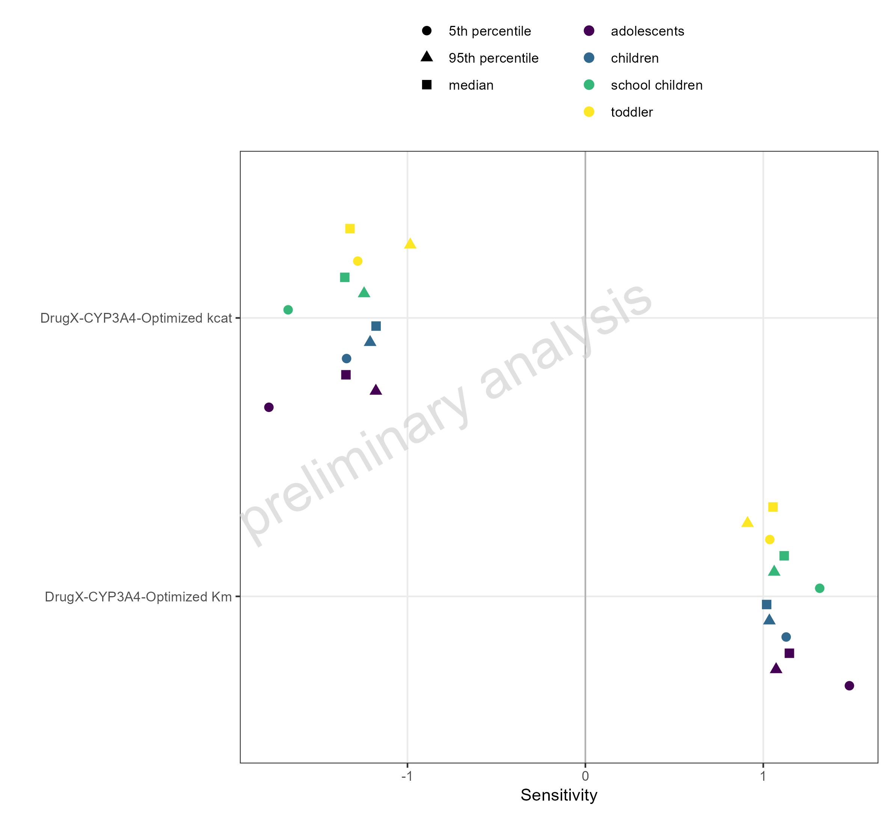

# Report

# Sensitivity

Figure 1: Simulated Sensitivity of AUC for DrugX for adolescents 5mg po,
children 5mg po, school-children 5mg po and toddler 5mg po sorted by
absolute sensitivity.



Table 1: Simulated Sensitivity of AUC for DrugX for adolescents 5mg po,
children 5mg po, school-children 5mg po and toddler 5mg po sorted by
absolute sensitivity.

| Representative  | Parameter                   | Sensitivity |
|:----------------|:----------------------------|------------:|
| 5th percentile  | DrugX-CYP3A4-Optimized kcat |      -1.780 |
| 5th percentile  | DrugX-CYP3A4-Optimized kcat |      -1.670 |
| 5th percentile  | DrugX-CYP3A4-Optimized Km   |       1.480 |
| median          | DrugX-CYP3A4-Optimized kcat |      -1.350 |
| median          | DrugX-CYP3A4-Optimized kcat |      -1.350 |
| 5th percentile  | DrugX-CYP3A4-Optimized kcat |      -1.340 |
| median          | DrugX-CYP3A4-Optimized kcat |      -1.320 |
| 5th percentile  | DrugX-CYP3A4-Optimized Km   |       1.320 |
| 5th percentile  | DrugX-CYP3A4-Optimized kcat |      -1.280 |
| 95th percentile | DrugX-CYP3A4-Optimized kcat |      -1.240 |
| 95th percentile | DrugX-CYP3A4-Optimized kcat |      -1.210 |
| 95th percentile | DrugX-CYP3A4-Optimized kcat |      -1.180 |
| median          | DrugX-CYP3A4-Optimized kcat |      -1.180 |
| median          | DrugX-CYP3A4-Optimized Km   |       1.150 |
| 5th percentile  | DrugX-CYP3A4-Optimized Km   |       1.130 |
| median          | DrugX-CYP3A4-Optimized Km   |       1.120 |
| 95th percentile | DrugX-CYP3A4-Optimized Km   |       1.070 |
| 95th percentile | DrugX-CYP3A4-Optimized Km   |       1.060 |
| median          | DrugX-CYP3A4-Optimized Km   |       1.050 |
| 5th percentile  | DrugX-CYP3A4-Optimized Km   |       1.040 |
| 95th percentile | DrugX-CYP3A4-Optimized Km   |       1.030 |
| median          | DrugX-CYP3A4-Optimized Km   |       1.020 |
| 95th percentile | DrugX-CYP3A4-Optimized kcat |      -0.984 |
| 95th percentile | DrugX-CYP3A4-Optimized Km   |       0.912 |


