# Report

# Concentration time profiles

## Setting Up the Project and Basic Simulations

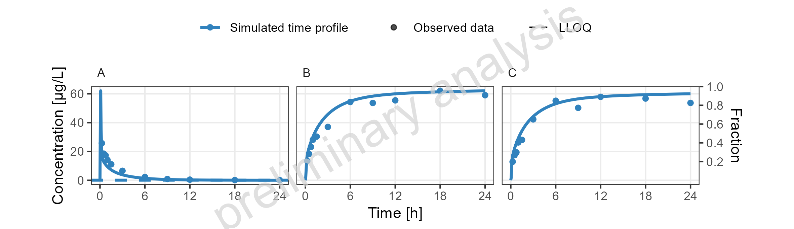

Figure 1: Simulated Concentration-time profiles for drugX metabolized by
CYP3A4 (B), drugX metabolized by CYP3A4 in liver (C) and drugX plasma
concentration (A) for simulation of an 1mg iv application for individual
id 13 study 1234 on a linear y-scale. DrugX was administered as a 1mg Iv
application with an infusion time of 5 minutes.



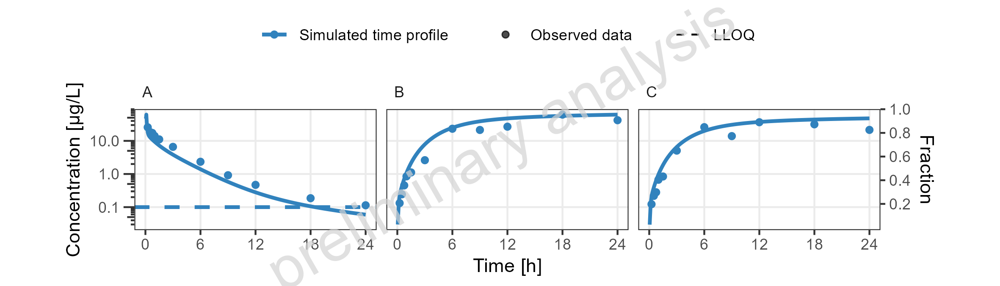

Figure 2: Simulated Concentration-time profiles for drugX metabolized by
CYP3A4 (B), drugX metabolized by CYP3A4 in liver (C) and drugX plasma
concentration (A) for simulation of an 1mg iv application for individual
id 13 study 1234 on a logarithmic y-scale. DrugX was administered as a
1mg Iv application with an infusion time of 5 minutes.



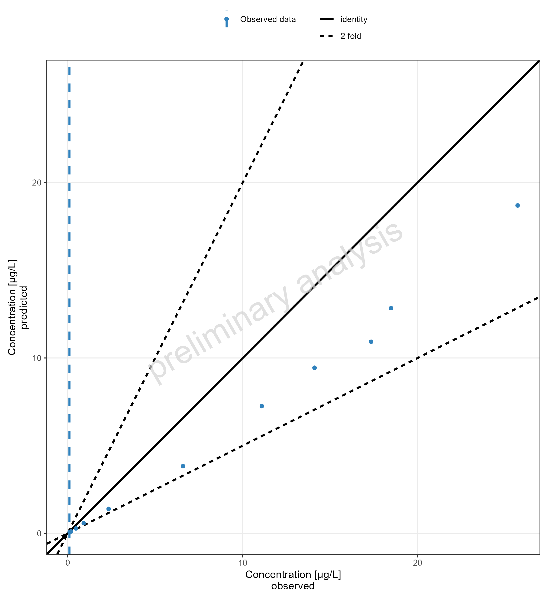

Figure 3: Simulated Predicted vs Observed for drugX plasma concentration
for simulation of an 1mg iv application for individual id 13 study 1234
on a linear x and y-scale. DrugX was administered as a 1mg Iv
application with an infusion time of 5 minutes.



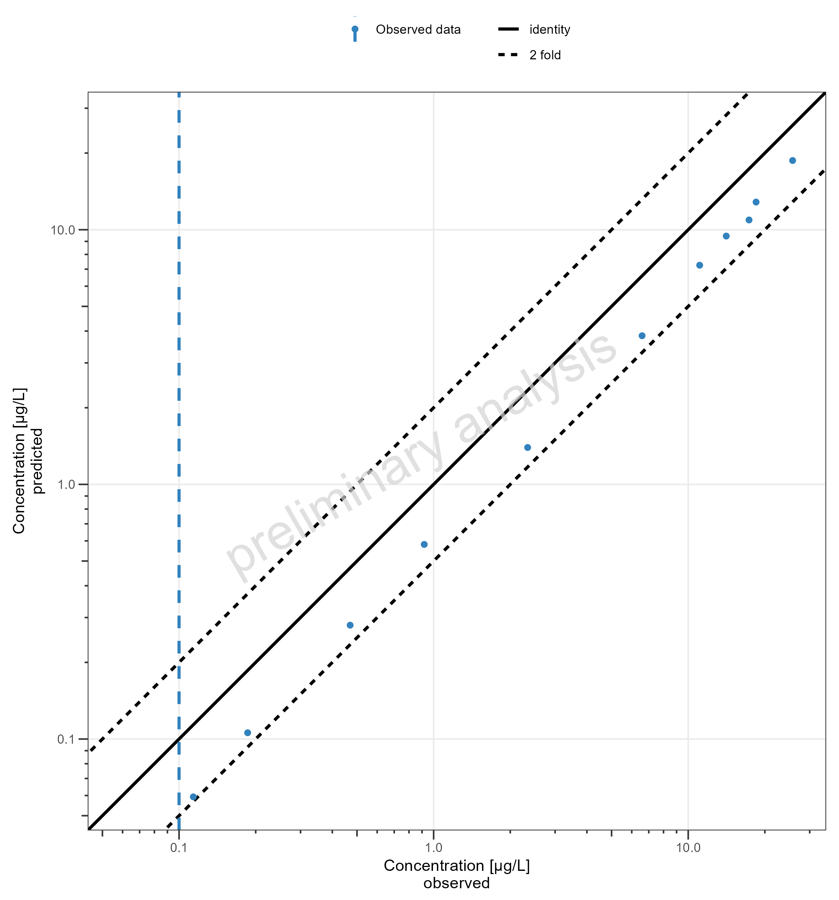

Figure 4: Simulated Predicted vs Observed for drugX plasma concentration
for simulation of an 1mg iv application for individual id 13 study 1234
on a logarithmic x and y-scale. DrugX was administered as a 1mg Iv
application with an infusion time of 5 minutes.



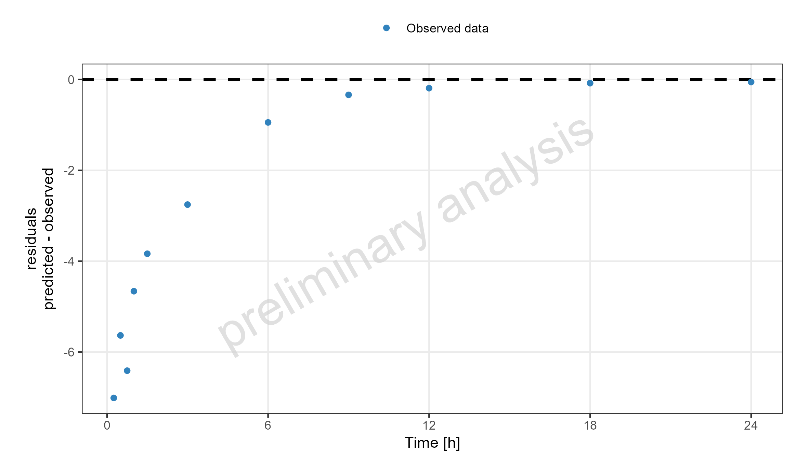

Figure 5: Simulated Residuals vs time values for drugX plasma
concentration for simulation of an 1mg iv application for individual id
13 study 1234. DrugX was administered as a 1mg Iv application with an
infusion time of 5 minutes.



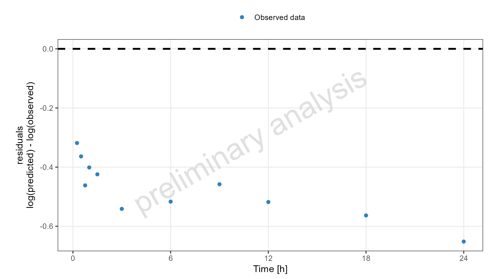

Figure 6: Simulated Residuals vs time values for drugX plasma
concentration for simulation of an 1mg iv application for individual id
13 study 1234. DrugX was administered as a 1mg Iv application with an
infusion time of 5 minutes.



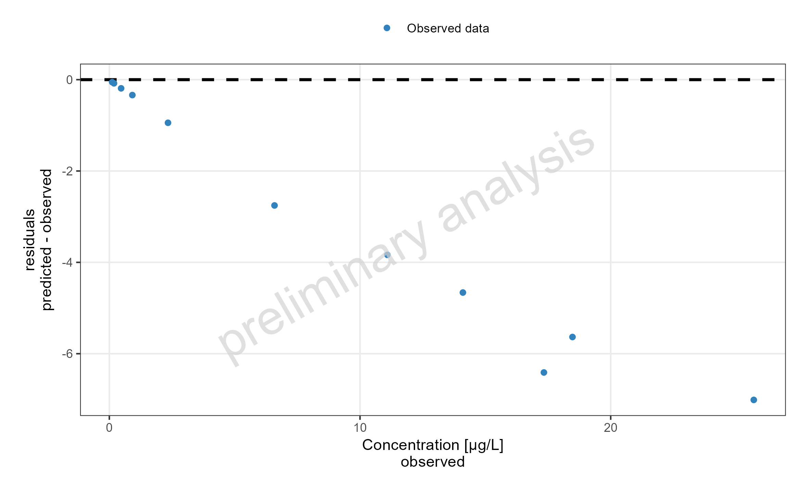

Figure 7: Simulated Residuals vs observed values for drugX plasma
concentration for simulation of an 1mg iv application for individual id
13 study 1234. DrugX was administered as a 1mg Iv application with an
infusion time of 5 minutes.



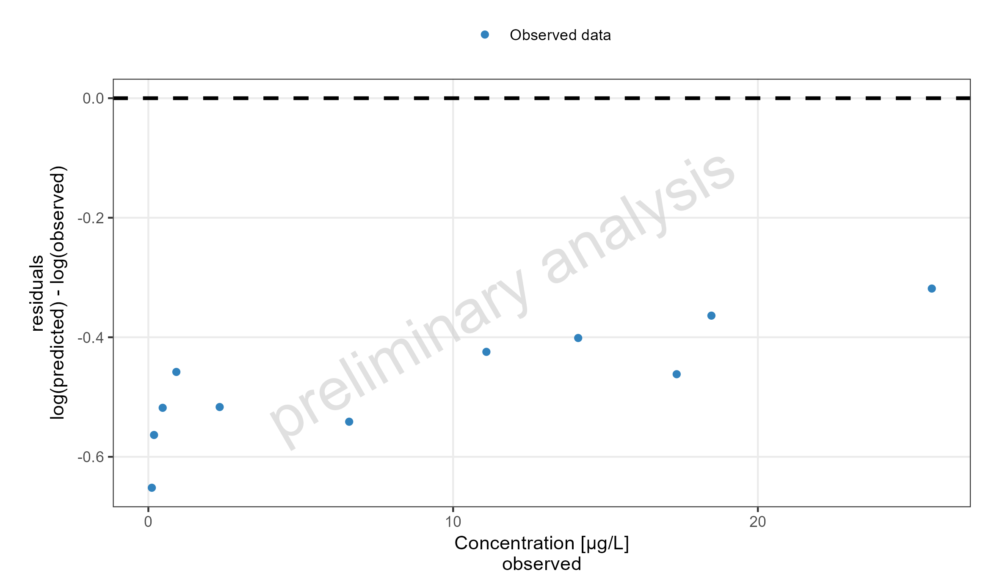

Figure 8: Simulated Residuals vs observed values for drugX plasma
concentration for simulation of an 1mg iv application for individual id
13 study 1234. DrugX was administered as a 1mg Iv application with an
infusion time of 5 minutes.



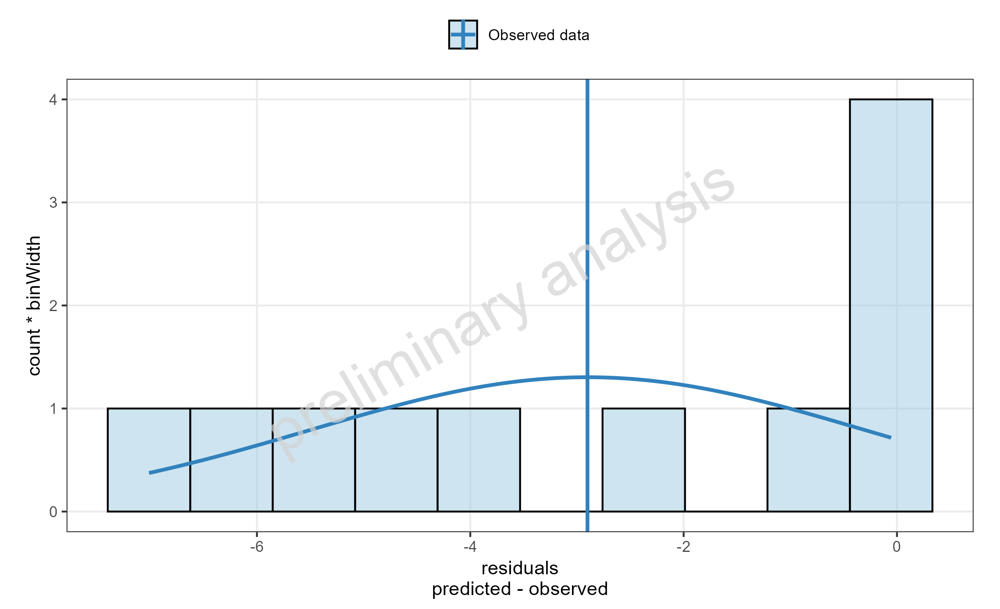

Figure 9: Simulated Residuals distribution for drugX plasma
concentration for simulation of an 1mg iv application for individual id
13 study 1234. DrugX was administered as a 1mg Iv application with an
infusion time of 5 minutes.



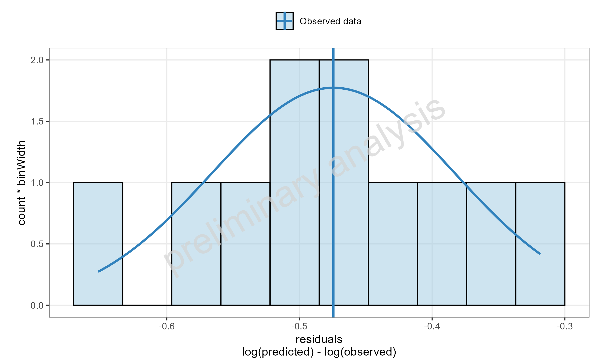

Figure 10: Simulated Residuals distribution for drugX plasma
concentration for simulation of an 1mg iv application for individual id
13 study 1234. DrugX was administered as a 1mg Iv application with an
infusion time of 5 minutes.



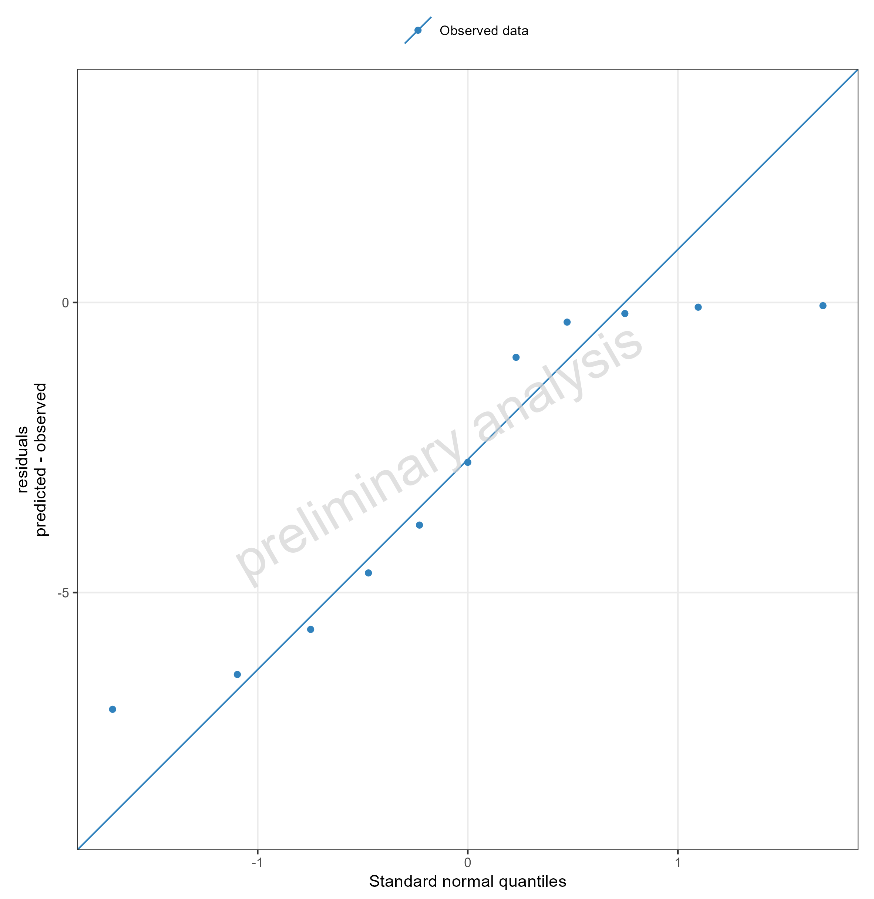

Figure 11: Simulated Residuals as quantile-quantile plot for drugX
plasma concentration for simulation of an 1mg iv application for
individual id 13 study 1234. DrugX was administered as a 1mg Iv
application with an infusion time of 5 minutes.



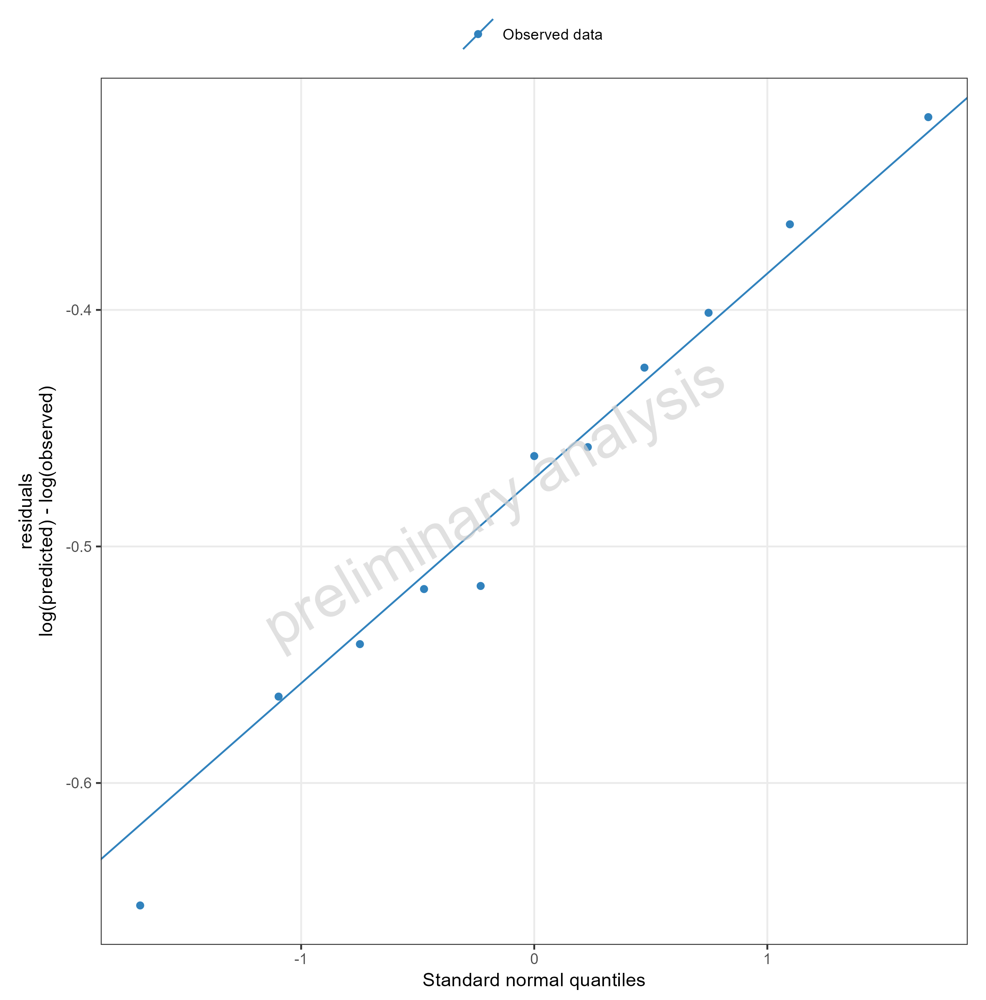

Figure 12: Simulated Residuals as quantile-quantile plot for drugX
plasma concentration for simulation of an 1mg iv application for
individual id 13 study 1234. DrugX was administered as a 1mg Iv
application with an infusion time of 5 minutes.



## Adding Virtual Twin Populations

### filtered individual

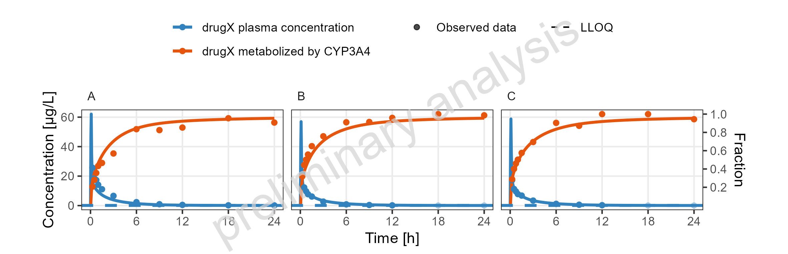

Figure 13: Simulated Concentration-time profiles for drugX metabolized
by CYP3A4 and drugX plasma concentration for simulation of an 1mg iv
application for individuals of study 1234 for subject I123413 (A),
I123430 (B) and I123441 (C) on a linear y-scale. DrugX was administered
as a 1mg Iv application with an infusion time of 5 minutes.



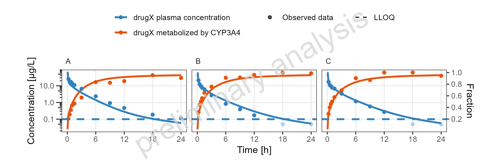

Figure 14: Simulated Concentration-time profiles for drugX metabolized
by CYP3A4 and drugX plasma concentration for simulation of an 1mg iv
application for individuals of study 1234 for subject I123413 (A),
I123430 (B) and I123441 (C) on a logarithmic y-scale. DrugX was
administered as a 1mg Iv application with an infusion time of 5 minutes.



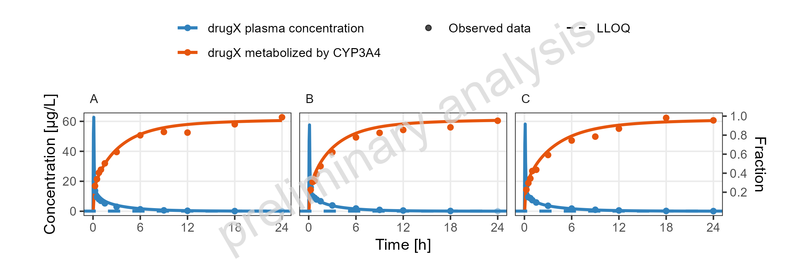

Figure 15: Simulated Concentration-time profiles for drugX metabolized
by CYP3A4 and drugX plasma concentration for simulation of an 1mg iv
application for individuals of study 1234 for subject I123450 (A),
I123466 (B) and I123478 (C) on a linear y-scale. DrugX was administered
as a 1mg Iv application with an infusion time of 5 minutes.



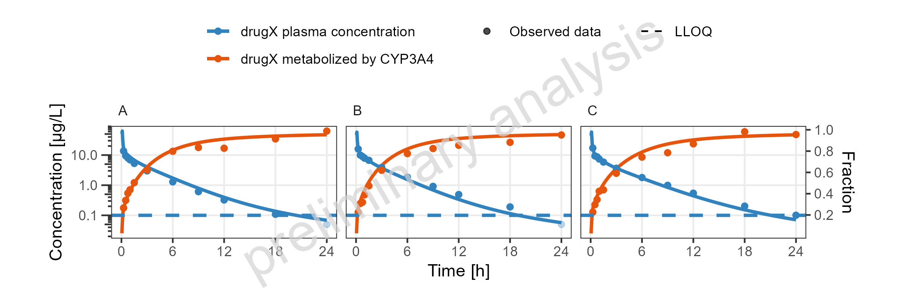

Figure 16: Simulated Concentration-time profiles for drugX metabolized
by CYP3A4 and drugX plasma concentration for simulation of an 1mg iv
application for individuals of study 1234 for subject I123450 (A),
I123466 (B) and I123478 (C) on a logarithmic y-scale. DrugX was
administered as a 1mg Iv application with an infusion time of 5 minutes.



### shortcut for individual filter

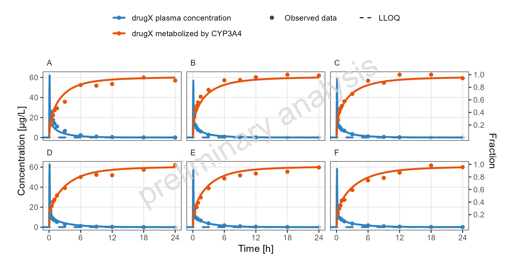

Figure 17: Simulated Concentration-time profiles for drugX metabolized
by CYP3A4 and drugX plasma concentration for simulation of an 1mg iv
application for individuals of study 1234 for subject I123413 (A),
I123430 (B), I123441 (C), I123450 (D), I123466 (E) and I123478 (F) on a
linear y-scale. DrugX was administered as a 1mg Iv application with an
infusion time of 5 minutes.



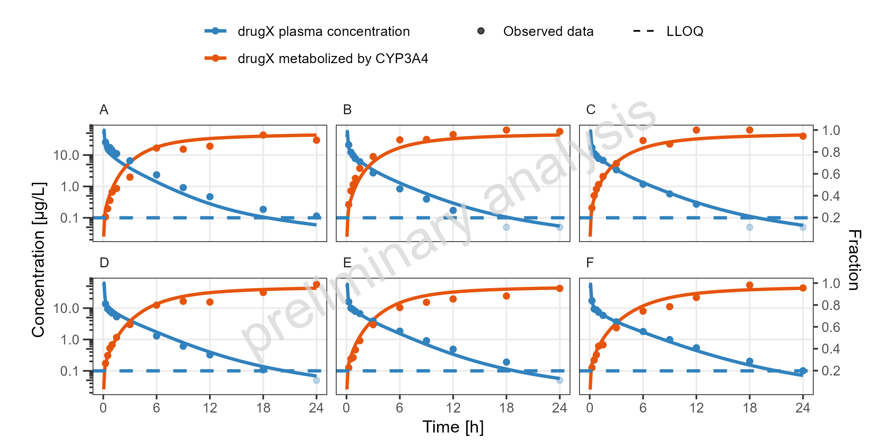

Figure 18: Simulated Concentration-time profiles for drugX metabolized
by CYP3A4 and drugX plasma concentration for simulation of an 1mg iv
application for individuals of study 1234 for subject I123413 (A),
I123430 (B), I123441 (C), I123450 (D), I123466 (E) and I123478 (F) on a
logarithmic y-scale. DrugX was administered as a 1mg Iv application with
an infusion time of 5 minutes.



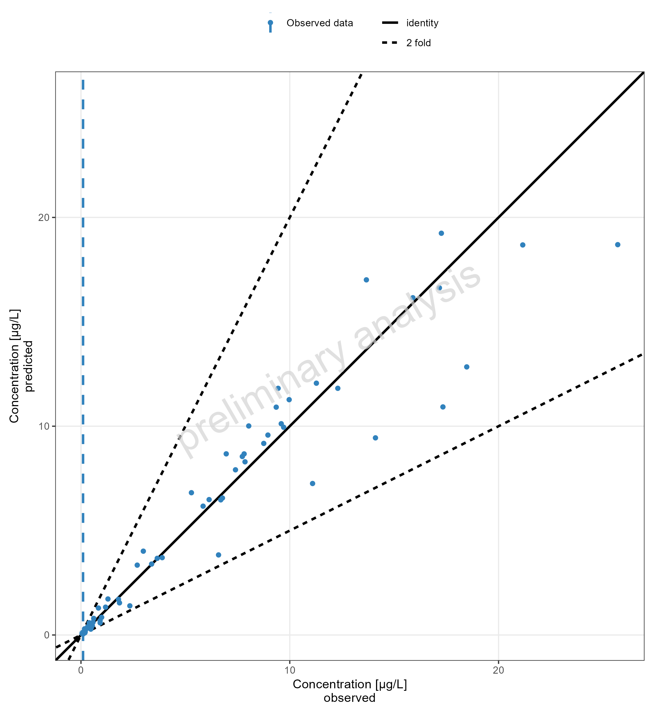

Figure 19: Simulated Predicted vs Observed for drugX plasma
concentration for simulation of an 1mg iv application for individuals of
study 1234 on a linear x and y-scale. DrugX was administered as a 1mg Iv
application with an infusion time of 5 minutes.



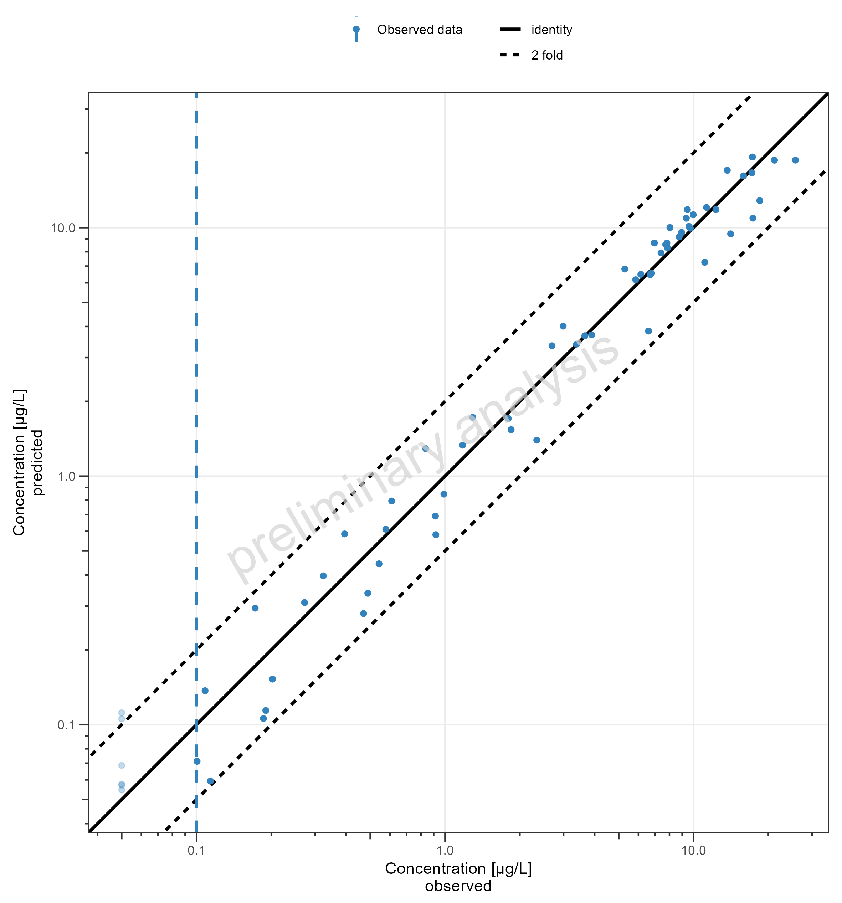

Figure 20: Simulated Predicted vs Observed for drugX plasma
concentration for simulation of an 1mg iv application for individuals of
study 1234 on a logarithmic x and y-scale. DrugX was administered as a
1mg Iv application with an infusion time of 5 minutes.



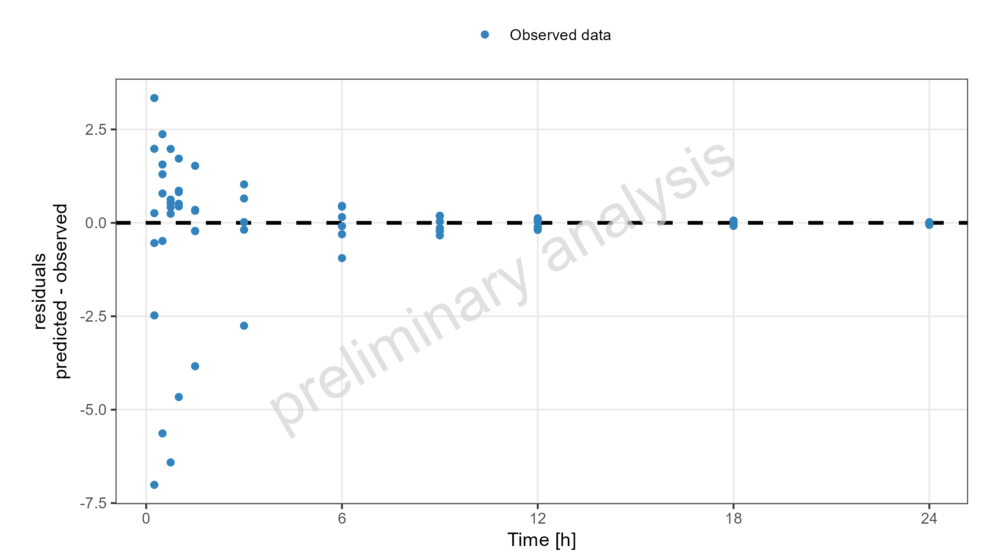

Figure 21: Simulated Residuals vs time values for drugX plasma
concentration for simulation of an 1mg iv application for individuals of
study 1234. DrugX was administered as a 1mg Iv application with an
infusion time of 5 minutes.



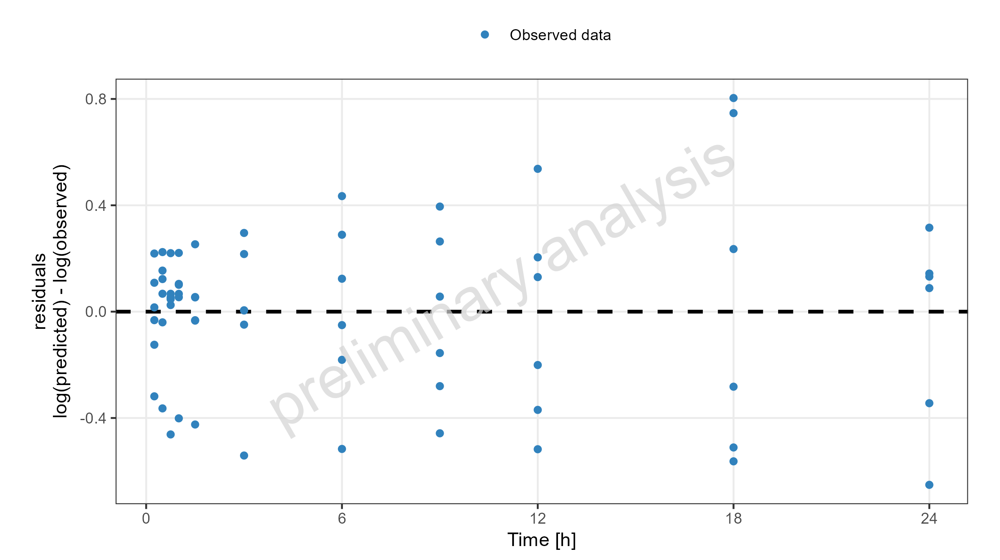

Figure 22: Simulated Residuals vs time values for drugX plasma
concentration for simulation of an 1mg iv application for individuals of
study 1234. DrugX was administered as a 1mg Iv application with an
infusion time of 5 minutes.



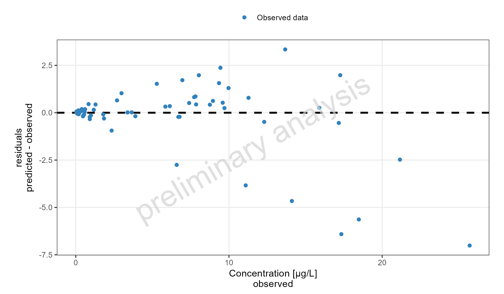

Figure 23: Simulated Residuals vs observed values for drugX plasma
concentration for simulation of an 1mg iv application for individuals of
study 1234. DrugX was administered as a 1mg Iv application with an
infusion time of 5 minutes.



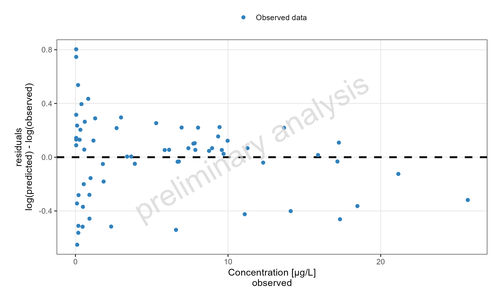

Figure 24: Simulated Residuals vs observed values for drugX plasma
concentration for simulation of an 1mg iv application for individuals of
study 1234. DrugX was administered as a 1mg Iv application with an
infusion time of 5 minutes.



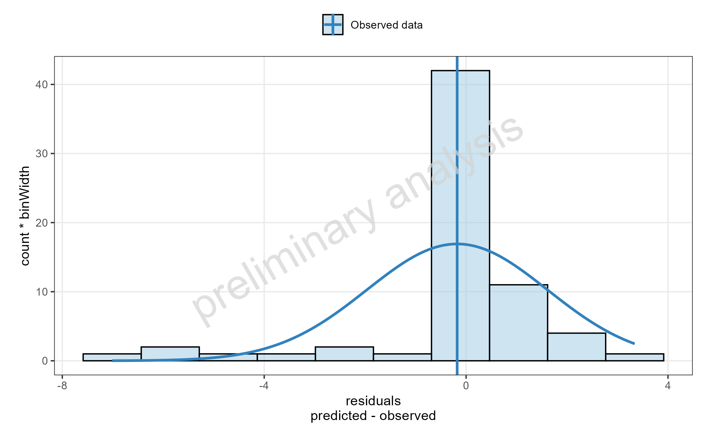

Figure 25: Simulated Residuals distribution for drugX plasma
concentration for simulation of an 1mg iv application for individuals of
study 1234. DrugX was administered as a 1mg Iv application with an
infusion time of 5 minutes.



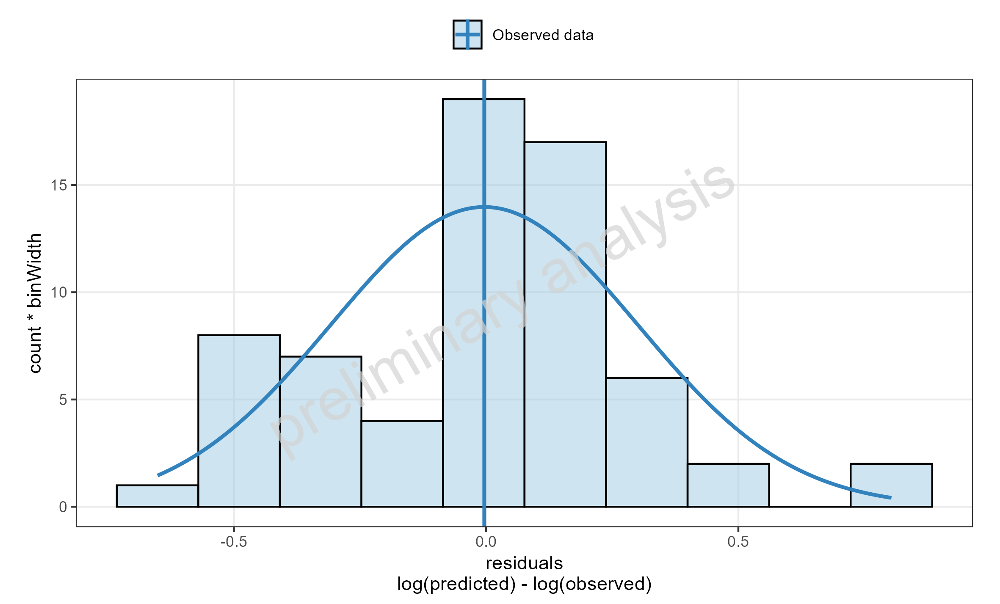

Figure 26: Simulated Residuals distribution for drugX plasma
concentration for simulation of an 1mg iv application for individuals of
study 1234. DrugX was administered as a 1mg Iv application with an
infusion time of 5 minutes.



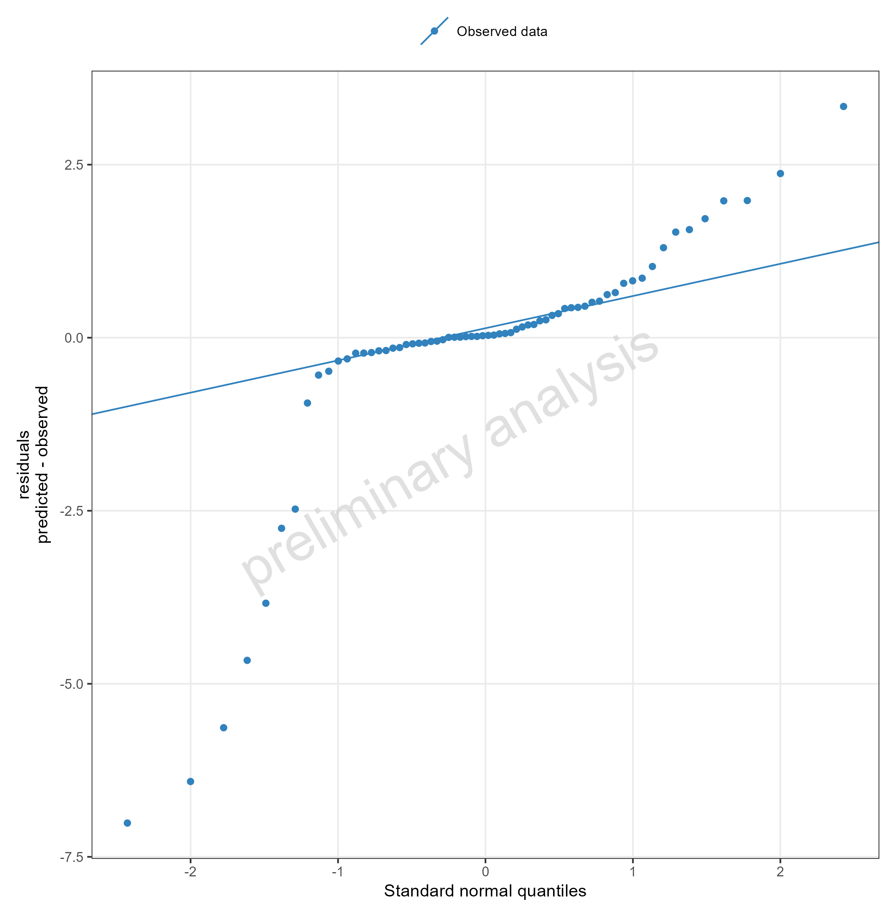

Figure 27: Simulated Residuals as quantile-quantile plot for drugX
plasma concentration for simulation of an 1mg iv application for
individuals of study 1234. DrugX was administered as a 1mg Iv
application with an infusion time of 5 minutes.



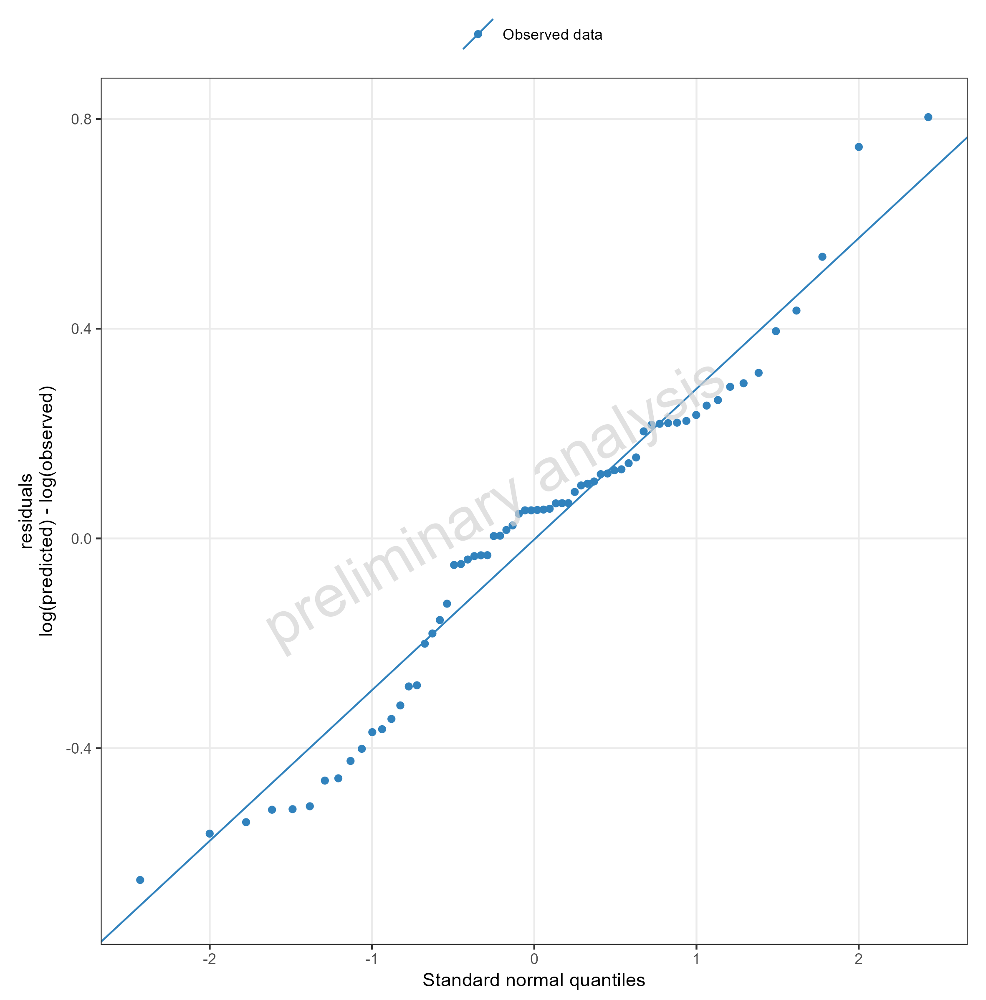

Figure 28: Simulated Residuals as quantile-quantile plot for drugX
plasma concentration for simulation of an 1mg iv application for
individuals of study 1234. DrugX was administered as a 1mg Iv
application with an infusion time of 5 minutes.



## Adding Random Populations and use of aggregated data

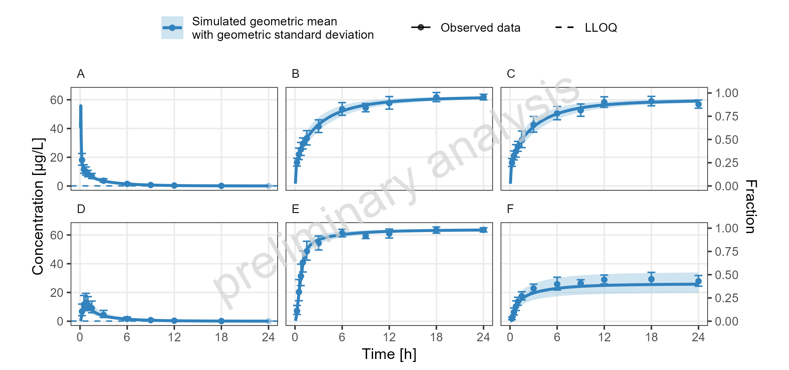

Figure 29: Simulated Concentration-time profiles for drugX metabolized
by CYP3A4 (B, E), drugX metabolized by CYP3A4 in liver (C, F) and drugX
plasma concentration (A, D) for simulation of an 1mg iv application for
an adult population (A, B, C) and simulation of an 5mg oral application
for an adult population (D, E, F) on a linear y-scale.

Observed data is displayed as geometric mean and geometric standard
deviation



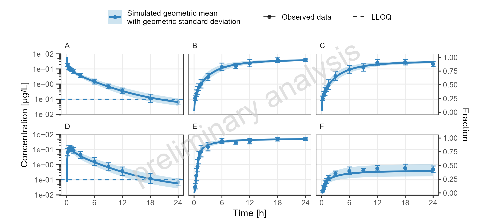

Figure 30: Simulated Concentration-time profiles for drugX metabolized
by CYP3A4 (B, E), drugX metabolized by CYP3A4 in liver (C, F) and drugX
plasma concentration (A, D) for simulation of an 1mg iv application for
an adult population (A, B, C) and simulation of an 5mg oral application
for an adult population (D, E, F) on a logarithmic y-scale.

Observed data is displayed as geometric mean and geometric standard
deviation



## Adding Reference Populations

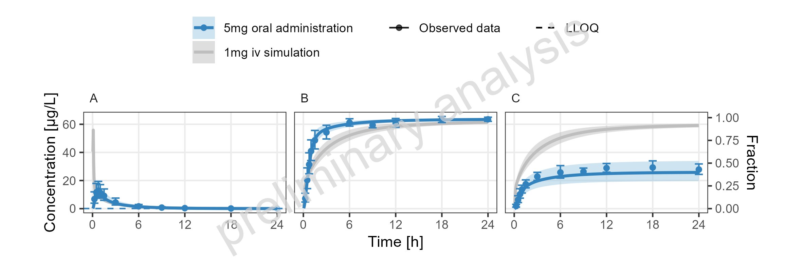

Figure 31: Simulated Concentration-time profiles for drugX metabolized
by CYP3A4 (B), drugX metabolized by CYP3A4 in liver (C) and drugX plasma
concentration (A) for simulation of a 5mg oral administration vs 1mg iv
simulation on a linear y-scale.

Observed data is displayed as geometric mean and geometric standard
deviation



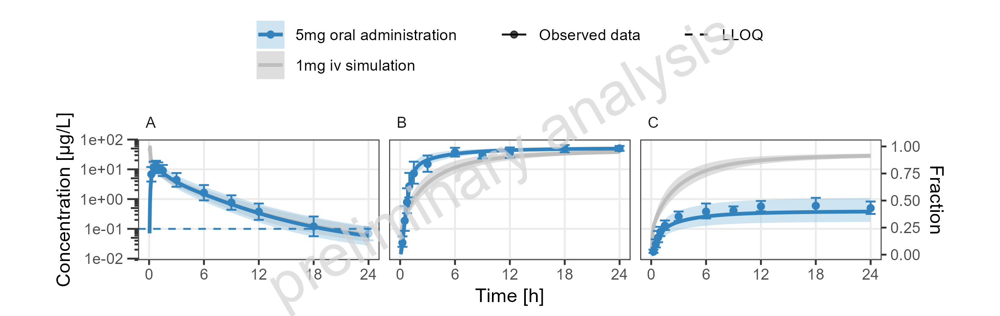

Figure 32: Simulated Concentration-time profiles for drugX metabolized
by CYP3A4 (B), drugX metabolized by CYP3A4 in liver (C) and drugX plasma
concentration (A) for simulation of a 5mg oral administration vs 1mg iv
simulation on a logarithmic y-scale.

Observed data is displayed as geometric mean and geometric standard
deviation



## Adding Plots with different Time Ranges

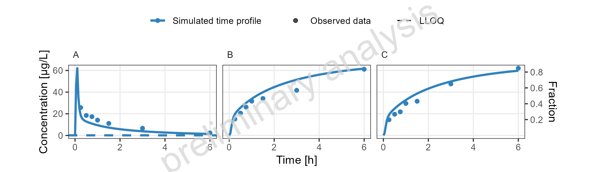

Figure 33: Simulated Concentration-time profiles for drugX metabolized
by CYP3A4 (B), drugX metabolized by CYP3A4 in liver (C) and drugX plasma
concentration (A) for simulation of an 1mg iv application for individual
id 13 study 1234 on a linear y-scale Zoom on first 6 hours. DrugX was
administered as a 1mg Iv application with an infusion time of 5 minutes.



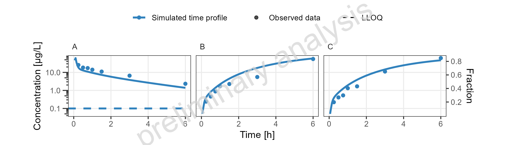

Figure 34: Simulated Concentration-time profiles for drugX metabolized
by CYP3A4 (B), drugX metabolized by CYP3A4 in liver (C) and drugX plasma
concentration (A) for simulation of an 1mg iv application for individual
id 13 study 1234 on a logarithmic y-scale Zoom on first 6 hours. DrugX
was administered as a 1mg Iv application with an infusion time of 5
minutes.



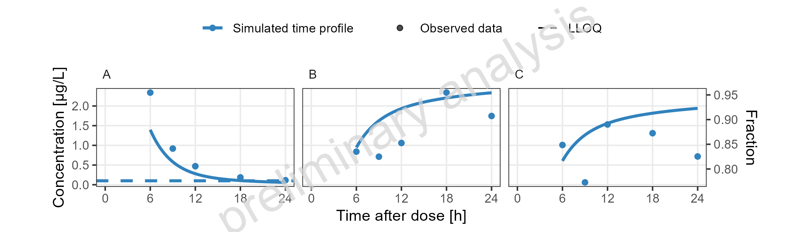

Figure 35: Simulated Concentration-time profiles for drugX metabolized
by CYP3A4 (B), drugX metabolized by CYP3A4 in liver (C) and drugX plasma
concentration (A) for simulation of an 1mg iv application for individual
id 13 study 1234 on a linear y-scale Zoom on time range 6 to 24 hours.
DrugX was administered as a 1mg Iv application with an infusion time of
5 minutes.



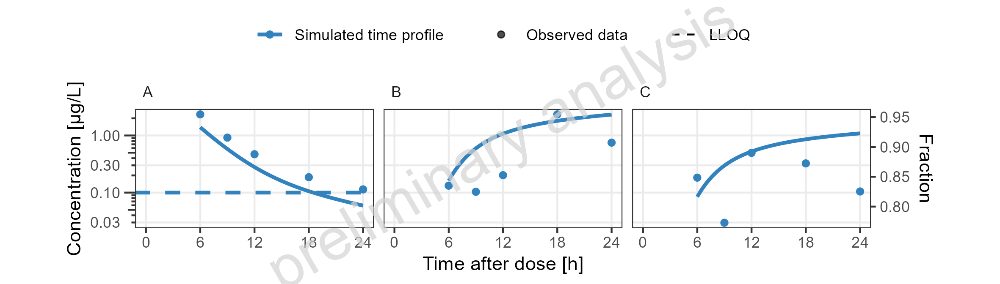

Figure 36: Simulated Concentration-time profiles for drugX metabolized
by CYP3A4 (B), drugX metabolized by CYP3A4 in liver (C) and drugX plasma
concentration (A) for simulation of an 1mg iv application for individual
id 13 study 1234 on a logarithmic y-scale Zoom on time range 6 to 24
hours. DrugX was administered as a 1mg Iv application with an infusion
time of 5 minutes.



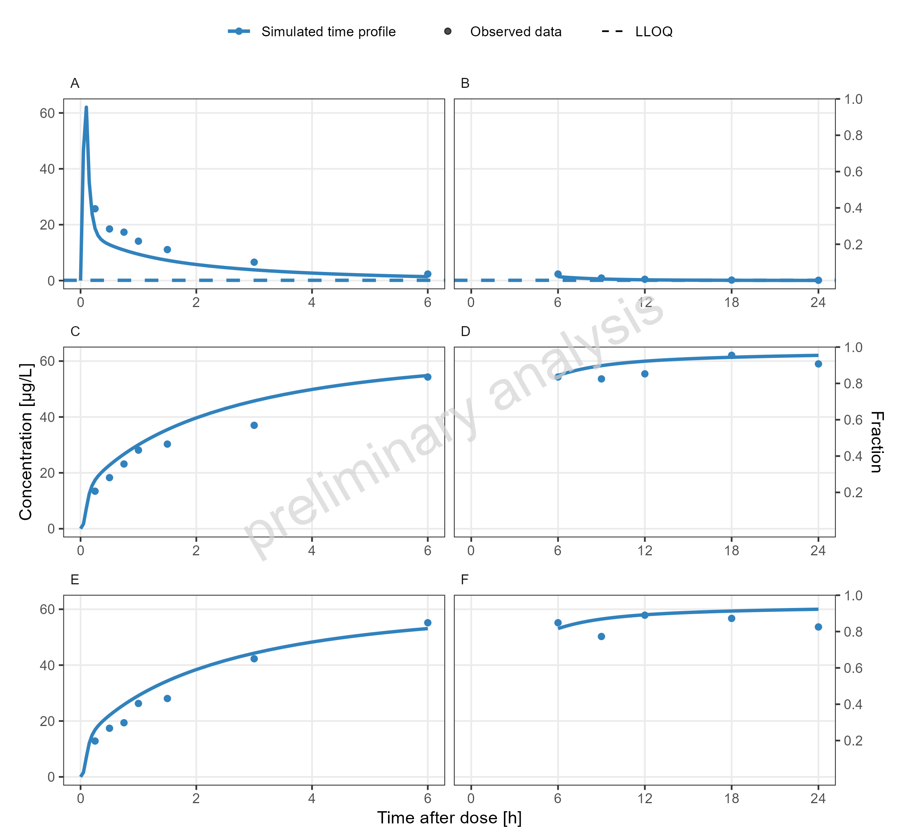

Figure 37: Simulated Concentration-time profiles for drugX metabolized
by CYP3A4 (C, D), drugX metabolized by CYP3A4 in liver (E, F) and drugX
plasma concentration (A, B) for simulation of an 1mg iv application for
individual id 13 study 1234 on a linear y-scale Zoom on first 6 hours
(A, C, E) and Zoom on time range 6 to 24 hours (B, D, F). DrugX was
administered as a 1mg Iv application with an infusion time of 5 minutes.



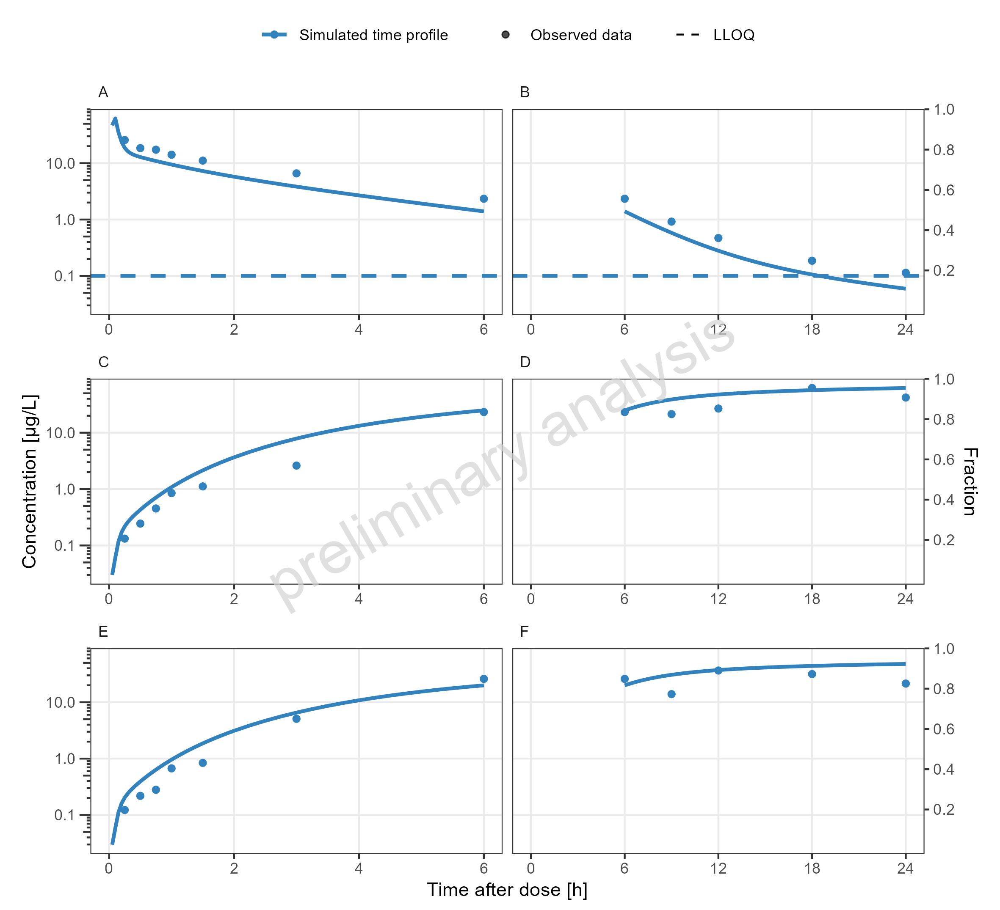

Figure 38: Simulated Concentration-time profiles for drugX metabolized
by CYP3A4 (C, D), drugX metabolized by CYP3A4 in liver (E, F) and drugX
plasma concentration (A, B) for simulation of an 1mg iv application for
individual id 13 study 1234 on a logarithmic y-scale Zoom on first 6
hours (A, C, E) and Zoom on time range 6 to 24 hours (B, D, F). DrugX
was administered as a 1mg Iv application with an infusion time of 5
minutes.


