 
```{r}
#| include: false
knitr::opts_chunk$set(echo = FALSE, warning = FALSE, results = "asis", error = FALSE, message = FALSE)
```
 
  
  
  
# Concentration time profiles  
  
  
  
  
## Setting Up the Project and Basic Simulations  
  
  
```{r}
#| label: fig-one_individual-TP-linear-total
#| fig-cap: "Simulated Concentration-time profiles for drugX metabolized by CYP3A4 (B), drugX metabolized by CYP3A4 in liver (C) and drugX plasma concentration (A) for simulation of an 1mg iv application for individual id 13 study 1234 on a linear y-scale. DrugX was administered as a 1mg Iv application with an infusion time of 5 minutes."
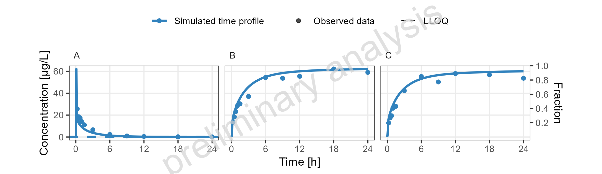
```
```{r}
#| output: asis
ospsuite.reportingframework::mdFootNote(subfolder = "Timeprofile", footNoteFile = "one_individual-TP-linear-total.footnote", footNoteCustomStyle = params$customStyles$FigureFootnote)
```
\newpage
  
```{r}
#| label: fig-one_individual-TP-log-total
#| fig-cap: "Simulated Concentration-time profiles for drugX metabolized by CYP3A4 (B), drugX metabolized by CYP3A4 in liver (C) and drugX plasma concentration (A) for simulation of an 1mg iv application for individual id 13 study 1234 on a logarithmic y-scale. DrugX was administered as a 1mg Iv application with an infusion time of 5 minutes."
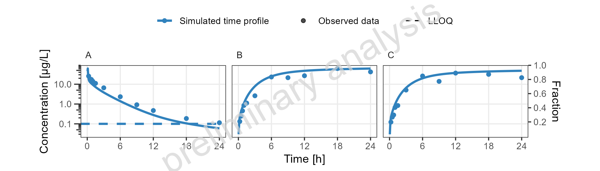
```
```{r}
#| output: asis
ospsuite.reportingframework::mdFootNote(subfolder = "Timeprofile", footNoteFile = "one_individual-TP-log-total.footnote", footNoteCustomStyle = params$customStyles$FigureFootnote)
```
\newpage
  
```{r}
#| label: fig-one_individual-gof-PvO-linear-total
#| fig-cap: "Simulated Predicted vs Observed for drugX plasma concentration for simulation of an 1mg iv application for individual id 13 study 1234 on a linear x and y-scale. DrugX was administered as a 1mg Iv application with an infusion time of 5 minutes."
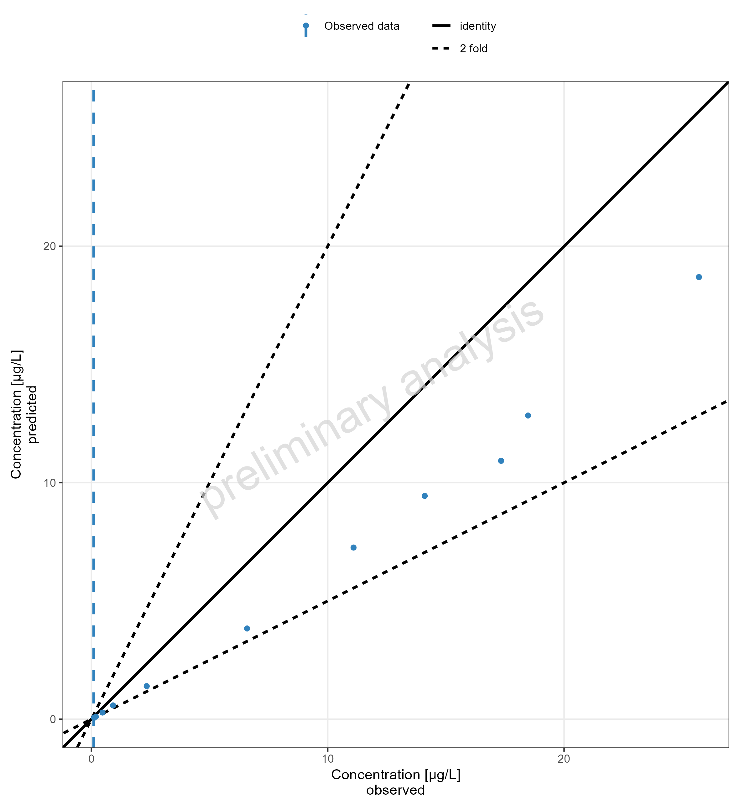
```
```{r}
#| output: asis
ospsuite.reportingframework::mdFootNote(subfolder = "Timeprofile", footNoteFile = "one_individual-gof-PvO-linear-total.footnote", footNoteCustomStyle = params$customStyles$FigureFootnote)
```
\newpage
  
```{r}
#| label: fig-one_individual-gof-PvO-log-total
#| fig-cap: "Simulated Predicted vs Observed for drugX plasma concentration for simulation of an 1mg iv application for individual id 13 study 1234 on a logarithmic x and y-scale. DrugX was administered as a 1mg Iv application with an infusion time of 5 minutes."
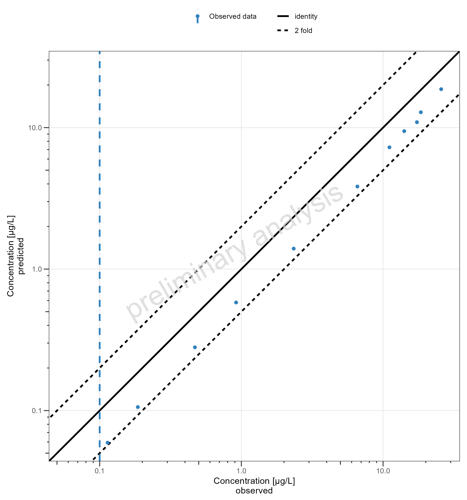
```
```{r}
#| output: asis
ospsuite.reportingframework::mdFootNote(subfolder = "Timeprofile", footNoteFile = "one_individual-gof-PvO-log-total.footnote", footNoteCustomStyle = params$customStyles$FigureFootnote)
```
\newpage
  
```{r}
#| label: fig-one_individual-gof-ResvT-linear-total
#| fig-cap: "Simulated Residuals vs time values for drugX plasma concentration for simulation of an 1mg iv application for individual id 13 study 1234. DrugX was administered as a 1mg Iv application with an infusion time of 5 minutes."
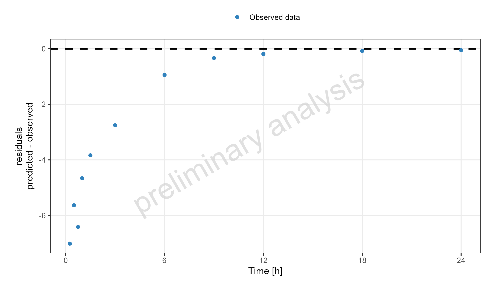
```
```{r}
#| output: asis
ospsuite.reportingframework::mdFootNote(subfolder = "Timeprofile", footNoteFile = "one_individual-gof-ResvT-linear-total.footnote", footNoteCustomStyle = params$customStyles$FigureFootnote)
```
\newpage
  
```{r}
#| label: fig-one_individual-gof-ResvT-log-total
#| fig-cap: "Simulated Residuals vs time values for drugX plasma concentration for simulation of an 1mg iv application for individual id 13 study 1234. DrugX was administered as a 1mg Iv application with an infusion time of 5 minutes."
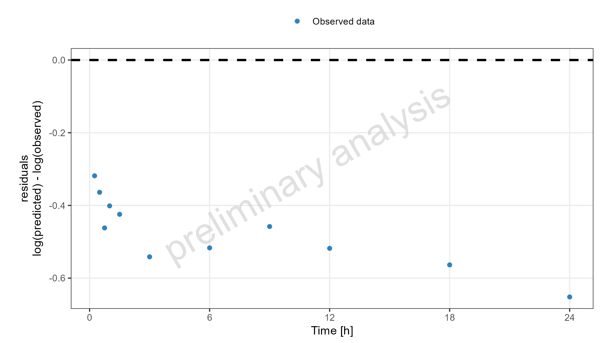
```
```{r}
#| output: asis
ospsuite.reportingframework::mdFootNote(subfolder = "Timeprofile", footNoteFile = "one_individual-gof-ResvT-log-total.footnote", footNoteCustomStyle = params$customStyles$FigureFootnote)
```
\newpage
  
```{r}
#| label: fig-one_individual-gof-ResvO-linear-total
#| fig-cap: "Simulated Residuals vs observed values for drugX plasma concentration for simulation of an 1mg iv application for individual id 13 study 1234. DrugX was administered as a 1mg Iv application with an infusion time of 5 minutes."
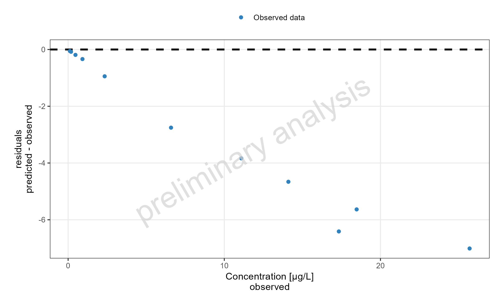
```
```{r}
#| output: asis
ospsuite.reportingframework::mdFootNote(subfolder = "Timeprofile", footNoteFile = "one_individual-gof-ResvO-linear-total.footnote", footNoteCustomStyle = params$customStyles$FigureFootnote)
```
\newpage
  
```{r}
#| label: fig-one_individual-gof-ResvO-log-total
#| fig-cap: "Simulated Residuals vs observed values for drugX plasma concentration for simulation of an 1mg iv application for individual id 13 study 1234. DrugX was administered as a 1mg Iv application with an infusion time of 5 minutes."
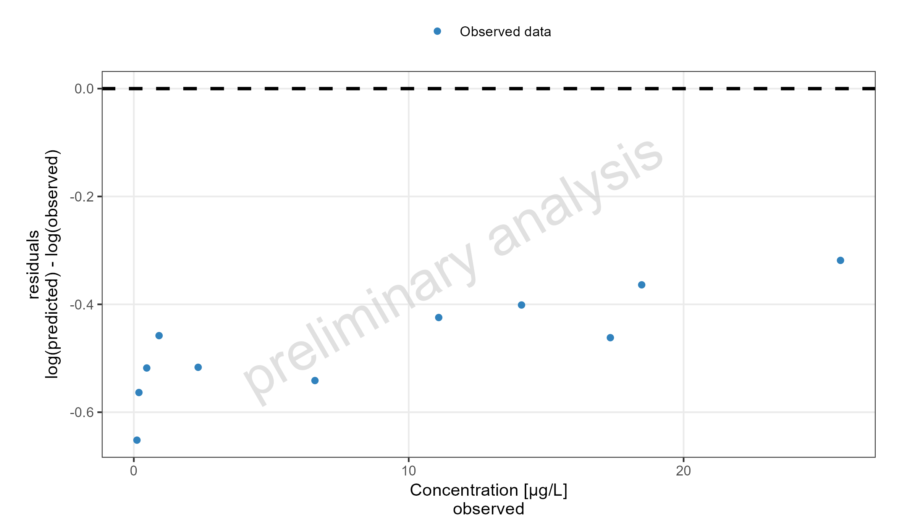
```
```{r}
#| output: asis
ospsuite.reportingframework::mdFootNote(subfolder = "Timeprofile", footNoteFile = "one_individual-gof-ResvO-log-total.footnote", footNoteCustomStyle = params$customStyles$FigureFootnote)
```
\newpage
  
```{r}
#| label: fig-one_individual-gof-ResH-linear-total
#| fig-cap: "Simulated Residuals distribution for drugX plasma concentration for simulation of an 1mg iv application for individual id 13 study 1234. DrugX was administered as a 1mg Iv application with an infusion time of 5 minutes."
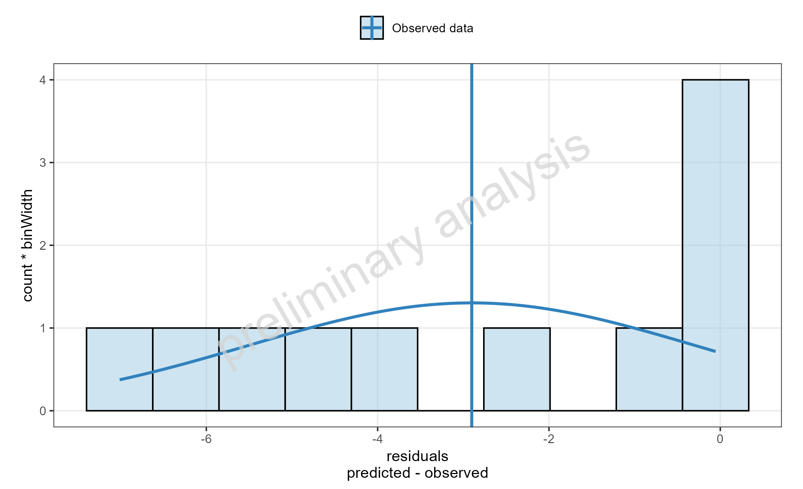
```
```{r}
#| output: asis
ospsuite.reportingframework::mdFootNote(subfolder = "Timeprofile", footNoteFile = "one_individual-gof-ResH-linear-total.footnote", footNoteCustomStyle = params$customStyles$FigureFootnote)
```
\newpage
  
```{r}
#| label: fig-one_individual-gof-ResH-log-total
#| fig-cap: "Simulated Residuals distribution for drugX plasma concentration for simulation of an 1mg iv application for individual id 13 study 1234. DrugX was administered as a 1mg Iv application with an infusion time of 5 minutes."
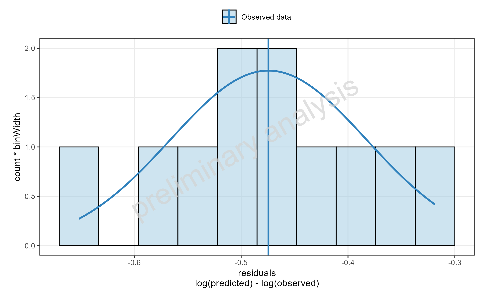
```
```{r}
#| output: asis
ospsuite.reportingframework::mdFootNote(subfolder = "Timeprofile", footNoteFile = "one_individual-gof-ResH-log-total.footnote", footNoteCustomStyle = params$customStyles$FigureFootnote)
```
\newpage
  
```{r}
#| label: fig-one_individual-gof-QQ-linear-total
#| fig-cap: "Simulated Residuals as quantile-quantile plot for drugX plasma concentration for simulation of an 1mg iv application for individual id 13 study 1234. DrugX was administered as a 1mg Iv application with an infusion time of 5 minutes."
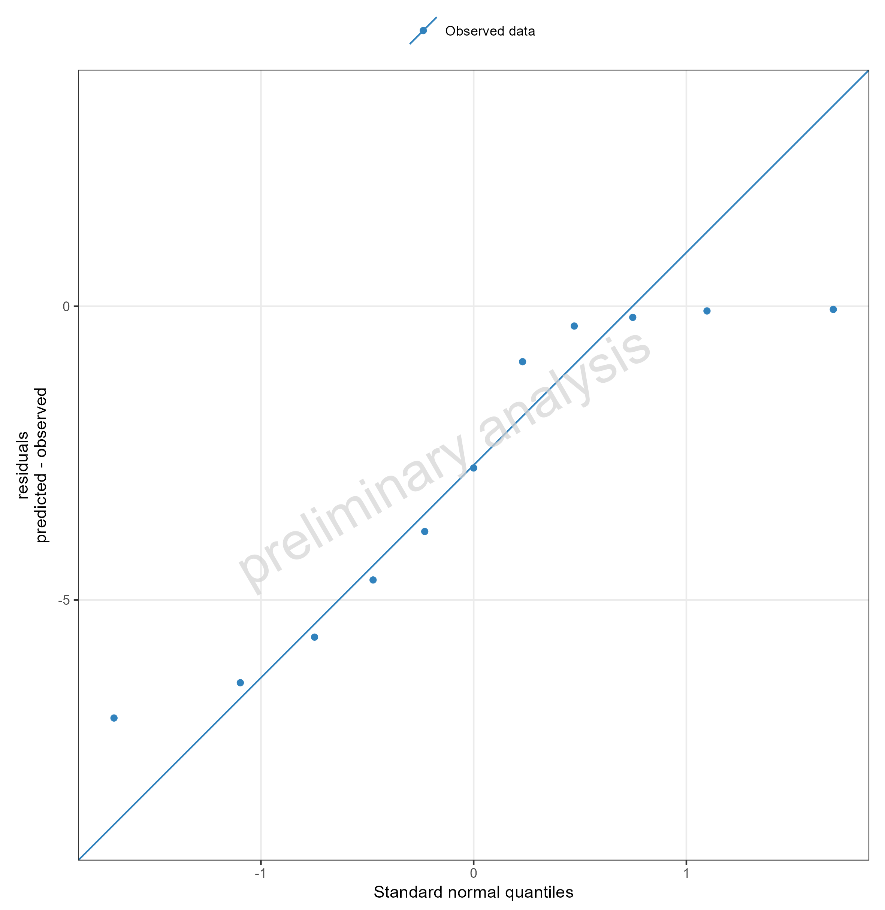
```
```{r}
#| output: asis
ospsuite.reportingframework::mdFootNote(subfolder = "Timeprofile", footNoteFile = "one_individual-gof-QQ-linear-total.footnote", footNoteCustomStyle = params$customStyles$FigureFootnote)
```
\newpage
  
```{r}
#| label: fig-one_individual-gof-QQ-log-total
#| fig-cap: "Simulated Residuals as quantile-quantile plot for drugX plasma concentration for simulation of an 1mg iv application for individual id 13 study 1234. DrugX was administered as a 1mg Iv application with an infusion time of 5 minutes."
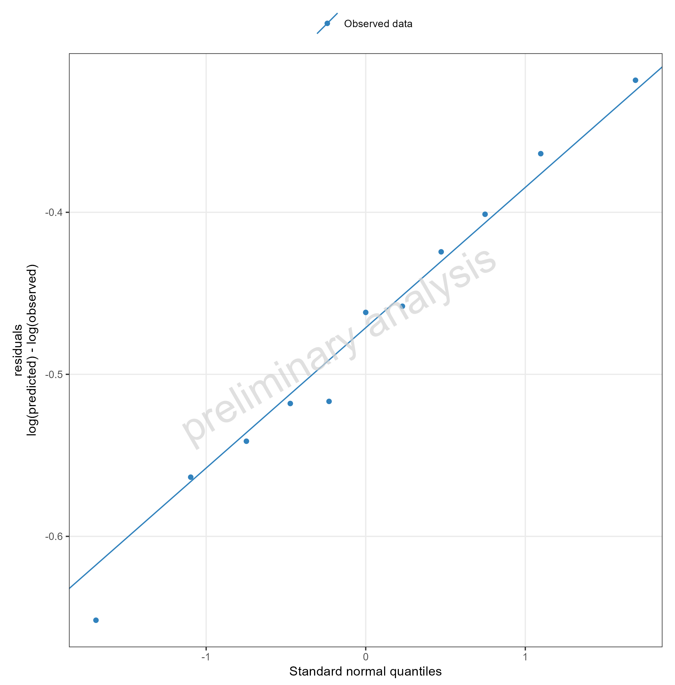
```
```{r}
#| output: asis
ospsuite.reportingframework::mdFootNote(subfolder = "Timeprofile", footNoteFile = "one_individual-gof-QQ-log-total.footnote", footNoteCustomStyle = params$customStyles$FigureFootnote)
```
\newpage
  
  
  
  
## Adding Virtual Twin Populations  
  
  
  
  
### filtered individual  
  
  
```{r}
#| label: fig-selected_individuals-1-TP-linear-total
#| fig-cap: "Simulated Concentration-time profiles for drugX metabolized by CYP3A4 and drugX plasma concentration for simulation of an 1mg iv application for individuals of study 1234 for subject I123413 (A), I123430 (B) and I123441 (C) on a linear y-scale. DrugX was administered as a 1mg Iv application with an infusion time of 5 minutes."
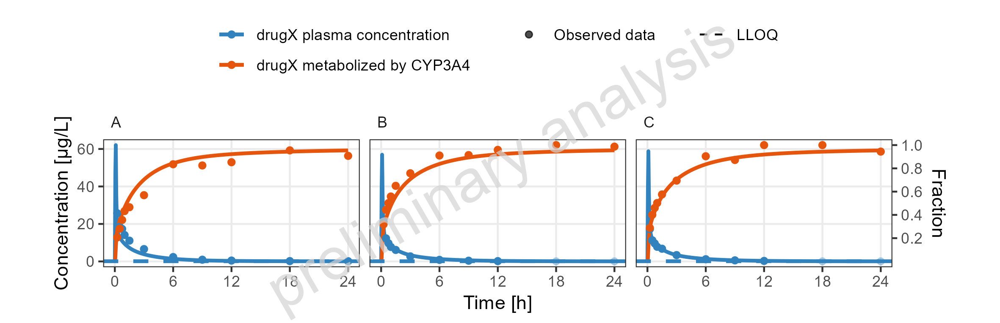
```
```{r}
#| output: asis
ospsuite.reportingframework::mdFootNote(subfolder = "Timeprofile", footNoteFile = "selected_individuals-1-TP-linear-total.footnote", footNoteCustomStyle = params$customStyles$FigureFootnote)
```
\newpage
  
```{r}
#| label: fig-selected_individuals-1-TP-log-total
#| fig-cap: "Simulated Concentration-time profiles for drugX metabolized by CYP3A4 and drugX plasma concentration for simulation of an 1mg iv application for individuals of study 1234 for subject I123413 (A), I123430 (B) and I123441 (C) on a logarithmic y-scale. DrugX was administered as a 1mg Iv application with an infusion time of 5 minutes."
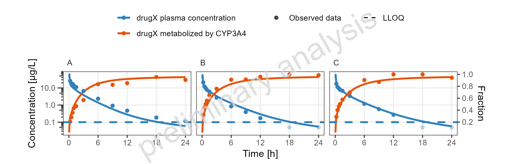
```
```{r}
#| output: asis
ospsuite.reportingframework::mdFootNote(subfolder = "Timeprofile", footNoteFile = "selected_individuals-1-TP-log-total.footnote", footNoteCustomStyle = params$customStyles$FigureFootnote)
```
\newpage
  
```{r}
#| label: fig-selected_individuals-2-TP-linear-total
#| fig-cap: "Simulated Concentration-time profiles for drugX metabolized by CYP3A4 and drugX plasma concentration for simulation of an 1mg iv application for individuals of study 1234 for subject I123450 (A), I123466 (B) and I123478 (C) on a linear y-scale. DrugX was administered as a 1mg Iv application with an infusion time of 5 minutes."
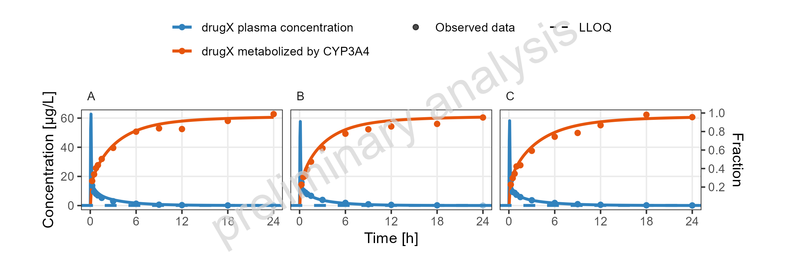
```
```{r}
#| output: asis
ospsuite.reportingframework::mdFootNote(subfolder = "Timeprofile", footNoteFile = "selected_individuals-2-TP-linear-total.footnote", footNoteCustomStyle = params$customStyles$FigureFootnote)
```
\newpage
  
```{r}
#| label: fig-selected_individuals-2-TP-log-total
#| fig-cap: "Simulated Concentration-time profiles for drugX metabolized by CYP3A4 and drugX plasma concentration for simulation of an 1mg iv application for individuals of study 1234 for subject I123450 (A), I123466 (B) and I123478 (C) on a logarithmic y-scale. DrugX was administered as a 1mg Iv application with an infusion time of 5 minutes."
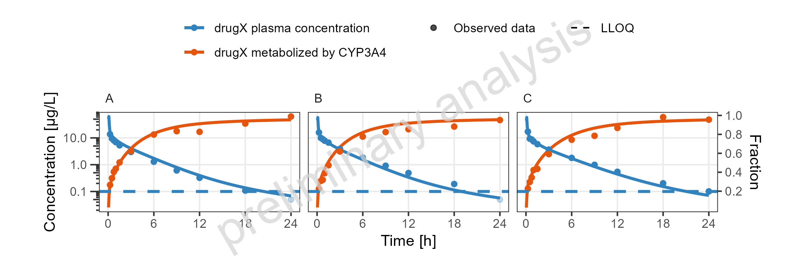
```
```{r}
#| output: asis
ospsuite.reportingframework::mdFootNote(subfolder = "Timeprofile", footNoteFile = "selected_individuals-2-TP-log-total.footnote", footNoteCustomStyle = params$customStyles$FigureFootnote)
```
\newpage
  
  
  
  
### shortcut for individual filter  
  
  
```{r}
#| label: fig-all_individuals-TP-linear-total
#| fig-cap: "Simulated Concentration-time profiles for drugX metabolized by CYP3A4 and drugX plasma concentration for simulation of an 1mg iv application for individuals of study 1234 for subject I123413 (A), I123430 (B), I123441 (C), I123450 (D), I123466 (E) and I123478 (F) on a linear y-scale. DrugX was administered as a 1mg Iv application with an infusion time of 5 minutes."
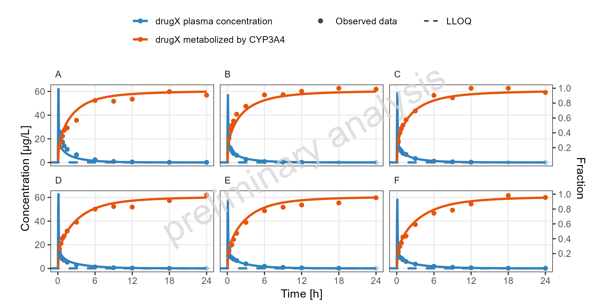
```
```{r}
#| output: asis
ospsuite.reportingframework::mdFootNote(subfolder = "Timeprofile", footNoteFile = "all_individuals-TP-linear-total.footnote", footNoteCustomStyle = params$customStyles$FigureFootnote)
```
\newpage
  
```{r}
#| label: fig-all_individuals-TP-log-total
#| fig-cap: "Simulated Concentration-time profiles for drugX metabolized by CYP3A4 and drugX plasma concentration for simulation of an 1mg iv application for individuals of study 1234 for subject I123413 (A), I123430 (B), I123441 (C), I123450 (D), I123466 (E) and I123478 (F) on a logarithmic y-scale. DrugX was administered as a 1mg Iv application with an infusion time of 5 minutes."
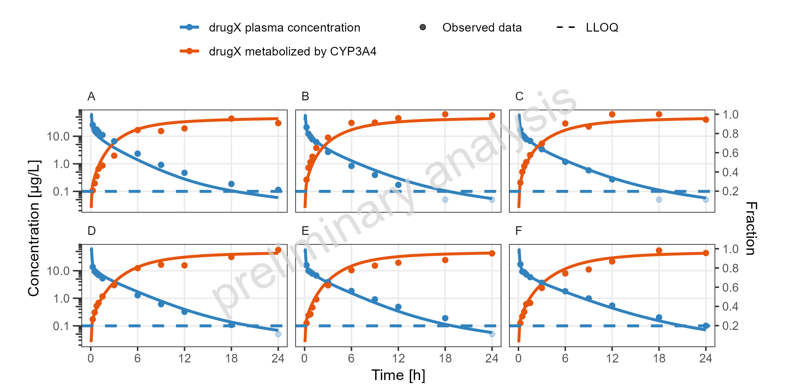
```
```{r}
#| output: asis
ospsuite.reportingframework::mdFootNote(subfolder = "Timeprofile", footNoteFile = "all_individuals-TP-log-total.footnote", footNoteCustomStyle = params$customStyles$FigureFootnote)
```
\newpage
  
```{r}
#| label: fig-all_individuals-gof-PvO-linear-total
#| fig-cap: "Simulated Predicted vs Observed for drugX plasma concentration for simulation of an 1mg iv application for individuals of study 1234 on a linear x and y-scale. DrugX was administered as a 1mg Iv application with an infusion time of 5 minutes."
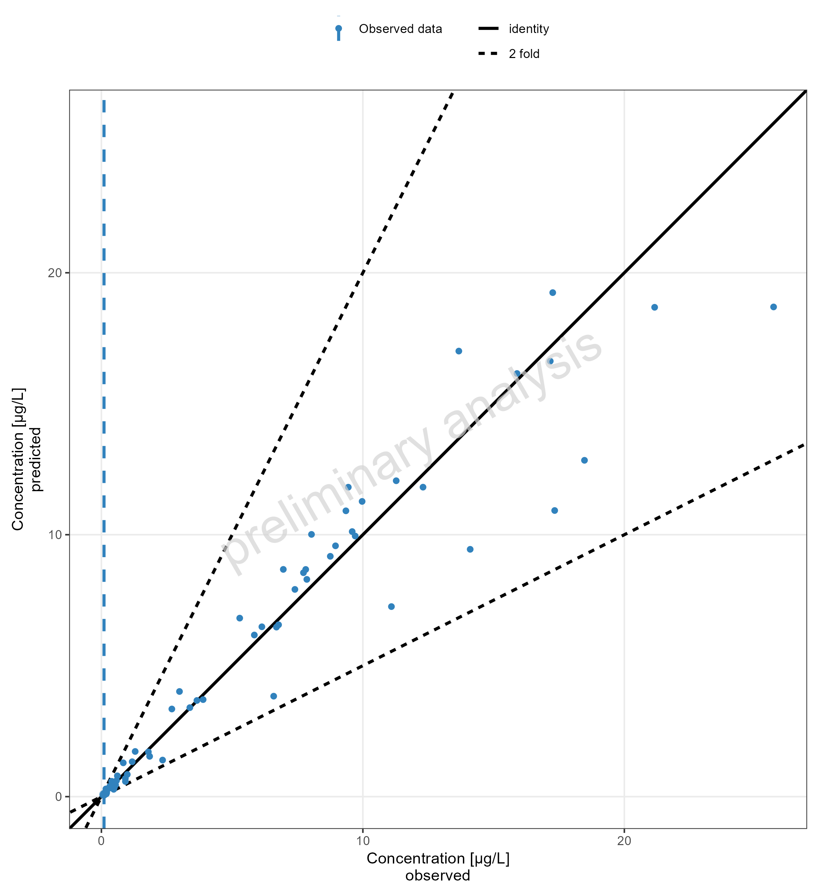
```
```{r}
#| output: asis
ospsuite.reportingframework::mdFootNote(subfolder = "Timeprofile", footNoteFile = "all_individuals-gof-PvO-linear-total.footnote", footNoteCustomStyle = params$customStyles$FigureFootnote)
```
\newpage
  
```{r}
#| label: fig-all_individuals-gof-PvO-log-total
#| fig-cap: "Simulated Predicted vs Observed for drugX plasma concentration for simulation of an 1mg iv application for individuals of study 1234 on a logarithmic x and y-scale. DrugX was administered as a 1mg Iv application with an infusion time of 5 minutes."
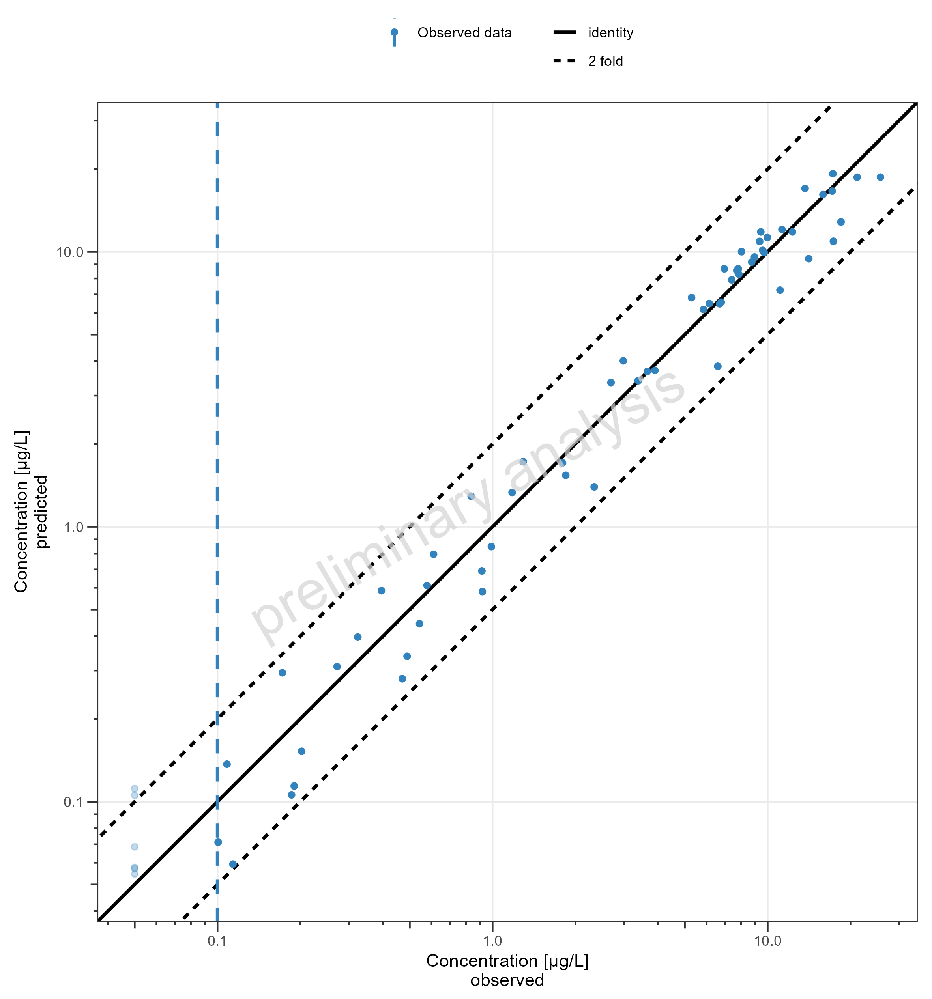
```
```{r}
#| output: asis
ospsuite.reportingframework::mdFootNote(subfolder = "Timeprofile", footNoteFile = "all_individuals-gof-PvO-log-total.footnote", footNoteCustomStyle = params$customStyles$FigureFootnote)
```
\newpage
  
```{r}
#| label: fig-all_individuals-gof-ResvT-linear-total
#| fig-cap: "Simulated Residuals vs time values for drugX plasma concentration for simulation of an 1mg iv application for individuals of study 1234. DrugX was administered as a 1mg Iv application with an infusion time of 5 minutes."
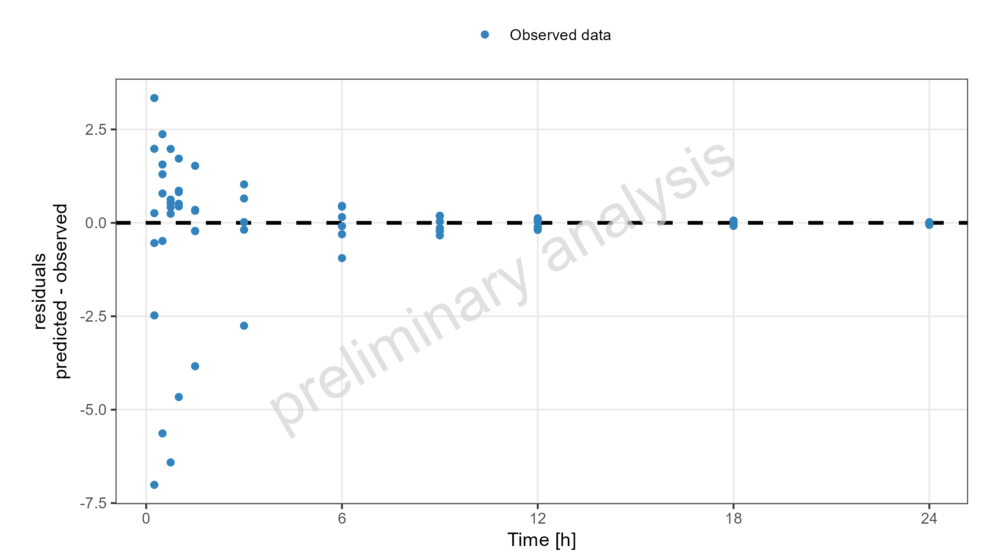
```
```{r}
#| output: asis
ospsuite.reportingframework::mdFootNote(subfolder = "Timeprofile", footNoteFile = "all_individuals-gof-ResvT-linear-total.footnote", footNoteCustomStyle = params$customStyles$FigureFootnote)
```
\newpage
  
```{r}
#| label: fig-all_individuals-gof-ResvT-log-total
#| fig-cap: "Simulated Residuals vs time values for drugX plasma concentration for simulation of an 1mg iv application for individuals of study 1234. DrugX was administered as a 1mg Iv application with an infusion time of 5 minutes."
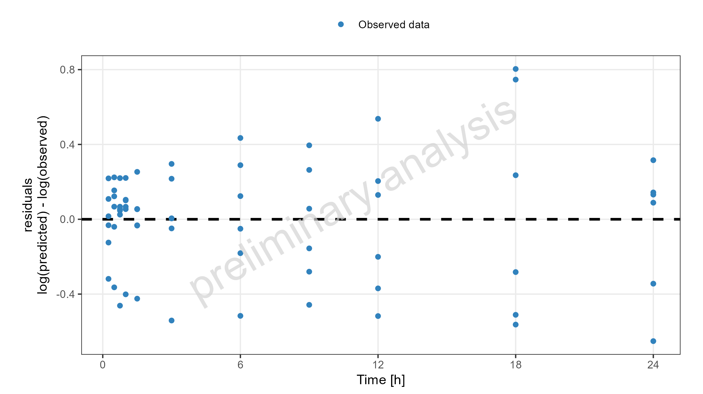
```
```{r}
#| output: asis
ospsuite.reportingframework::mdFootNote(subfolder = "Timeprofile", footNoteFile = "all_individuals-gof-ResvT-log-total.footnote", footNoteCustomStyle = params$customStyles$FigureFootnote)
```
\newpage
  
```{r}
#| label: fig-all_individuals-gof-ResvO-linear-total
#| fig-cap: "Simulated Residuals vs observed values for drugX plasma concentration for simulation of an 1mg iv application for individuals of study 1234. DrugX was administered as a 1mg Iv application with an infusion time of 5 minutes."
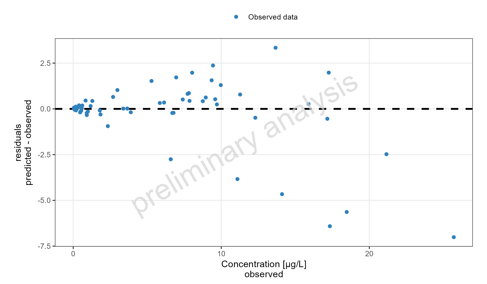
```
```{r}
#| output: asis
ospsuite.reportingframework::mdFootNote(subfolder = "Timeprofile", footNoteFile = "all_individuals-gof-ResvO-linear-total.footnote", footNoteCustomStyle = params$customStyles$FigureFootnote)
```
\newpage
  
```{r}
#| label: fig-all_individuals-gof-ResvO-log-total
#| fig-cap: "Simulated Residuals vs observed values for drugX plasma concentration for simulation of an 1mg iv application for individuals of study 1234. DrugX was administered as a 1mg Iv application with an infusion time of 5 minutes."
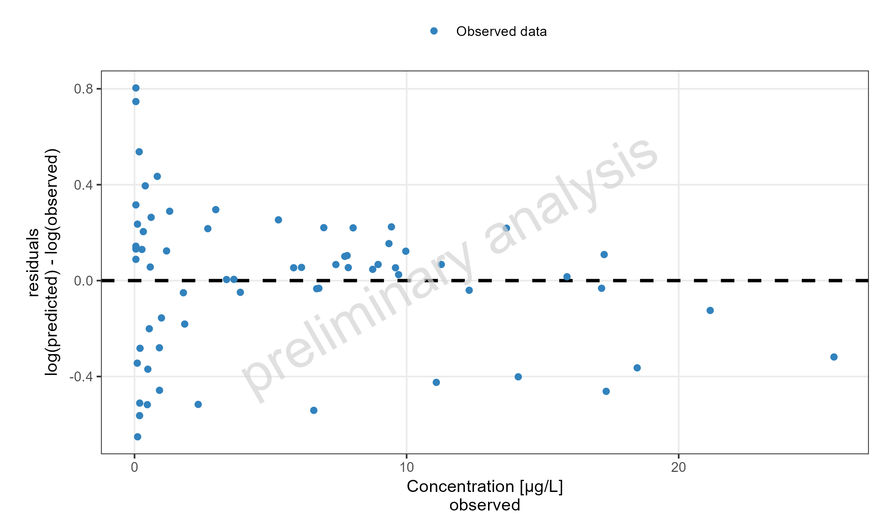
```
```{r}
#| output: asis
ospsuite.reportingframework::mdFootNote(subfolder = "Timeprofile", footNoteFile = "all_individuals-gof-ResvO-log-total.footnote", footNoteCustomStyle = params$customStyles$FigureFootnote)
```
\newpage
  
```{r}
#| label: fig-all_individuals-gof-ResH-linear-total
#| fig-cap: "Simulated Residuals distribution for drugX plasma concentration for simulation of an 1mg iv application for individuals of study 1234. DrugX was administered as a 1mg Iv application with an infusion time of 5 minutes."
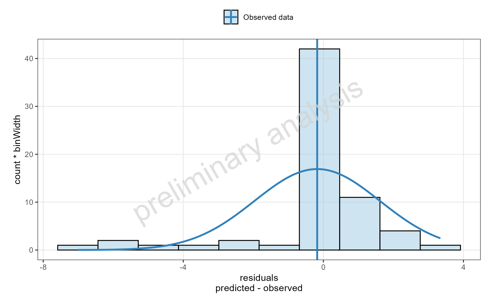
```
```{r}
#| output: asis
ospsuite.reportingframework::mdFootNote(subfolder = "Timeprofile", footNoteFile = "all_individuals-gof-ResH-linear-total.footnote", footNoteCustomStyle = params$customStyles$FigureFootnote)
```
\newpage
  
```{r}
#| label: fig-all_individuals-gof-ResH-log-total
#| fig-cap: "Simulated Residuals distribution for drugX plasma concentration for simulation of an 1mg iv application for individuals of study 1234. DrugX was administered as a 1mg Iv application with an infusion time of 5 minutes."
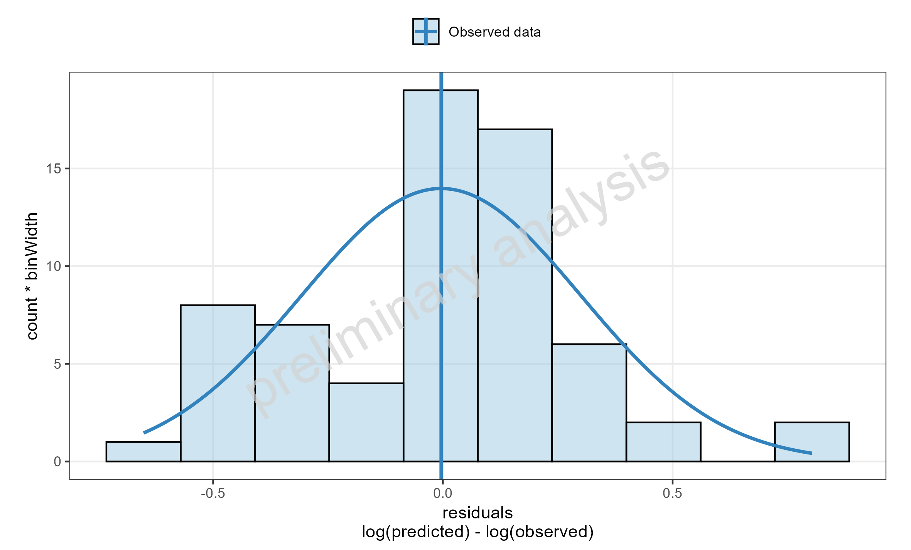
```
```{r}
#| output: asis
ospsuite.reportingframework::mdFootNote(subfolder = "Timeprofile", footNoteFile = "all_individuals-gof-ResH-log-total.footnote", footNoteCustomStyle = params$customStyles$FigureFootnote)
```
\newpage
  
```{r}
#| label: fig-all_individuals-gof-QQ-linear-total
#| fig-cap: "Simulated Residuals as quantile-quantile plot for drugX plasma concentration for simulation of an 1mg iv application for individuals of study 1234. DrugX was administered as a 1mg Iv application with an infusion time of 5 minutes."
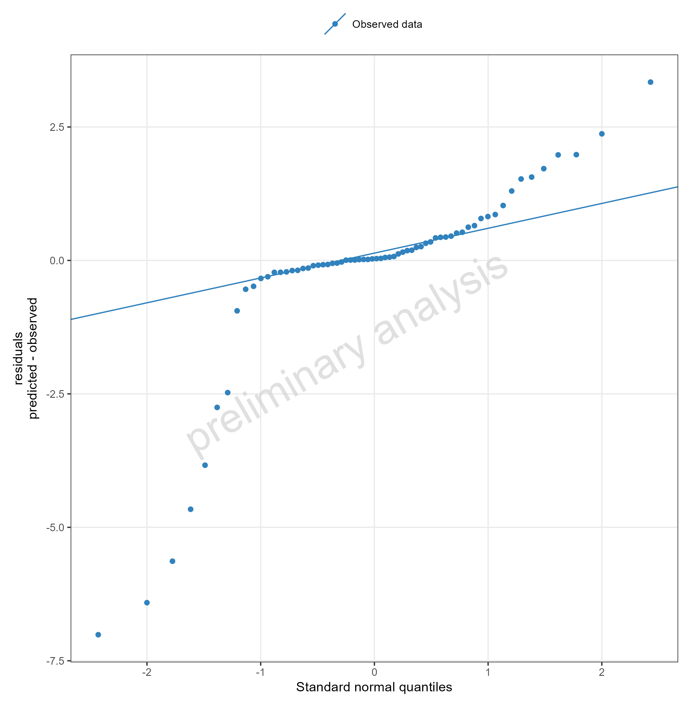
```
```{r}
#| output: asis
ospsuite.reportingframework::mdFootNote(subfolder = "Timeprofile", footNoteFile = "all_individuals-gof-QQ-linear-total.footnote", footNoteCustomStyle = params$customStyles$FigureFootnote)
```
\newpage
  
```{r}
#| label: fig-all_individuals-gof-QQ-log-total
#| fig-cap: "Simulated Residuals as quantile-quantile plot for drugX plasma concentration for simulation of an 1mg iv application for individuals of study 1234. DrugX was administered as a 1mg Iv application with an infusion time of 5 minutes."
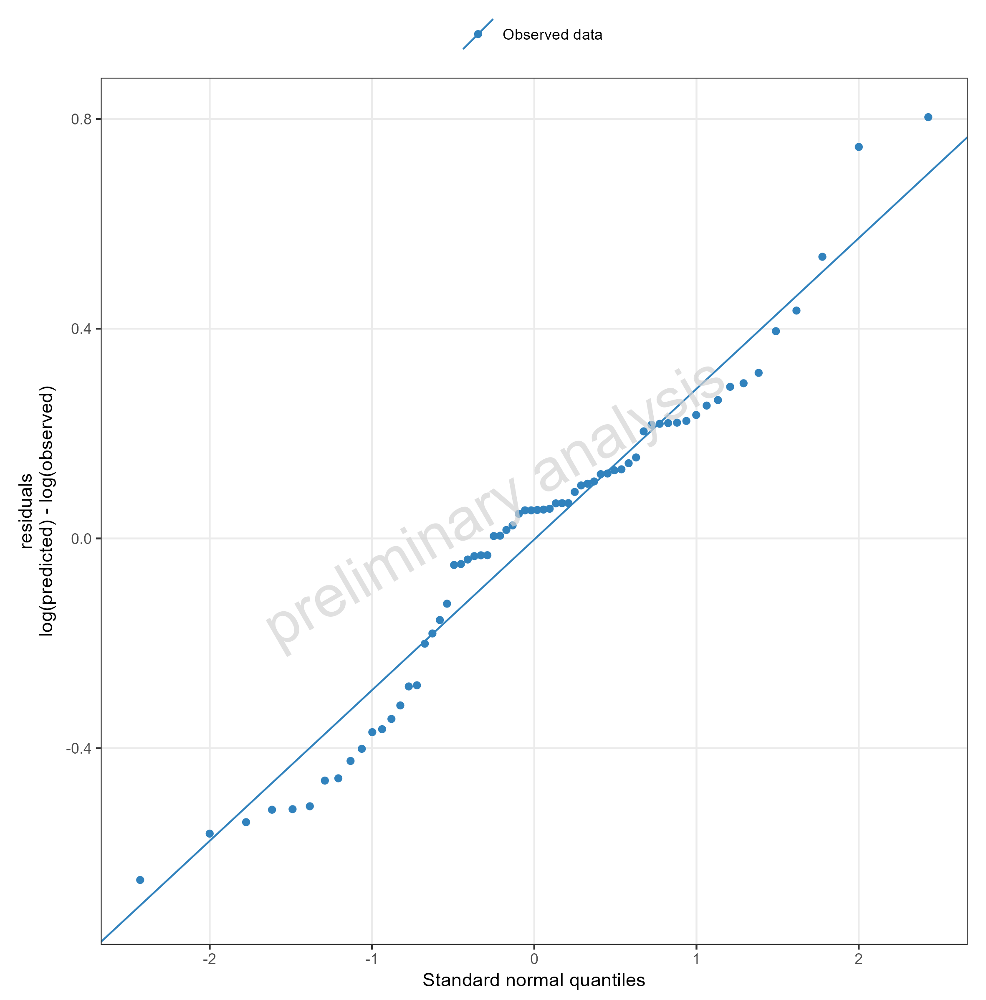
```
```{r}
#| output: asis
ospsuite.reportingframework::mdFootNote(subfolder = "Timeprofile", footNoteFile = "all_individuals-gof-QQ-log-total.footnote", footNoteCustomStyle = params$customStyles$FigureFootnote)
```
\newpage
  
  
  
  
## Adding Random Populations and use of aggregated data  
  
  
```{r}
#| label: fig-random_population-TP-linear-total
#| fig-cap: "Simulated Concentration-time profiles for drugX metabolized by CYP3A4 (B, E), drugX metabolized by CYP3A4 in liver (C, F) and drugX plasma concentration (A, D) for simulation of an 1mg iv application for an adult population (A, B, C) and simulation of an 5mg oral application for an adult population (D, E, F) on a linear y-scale."
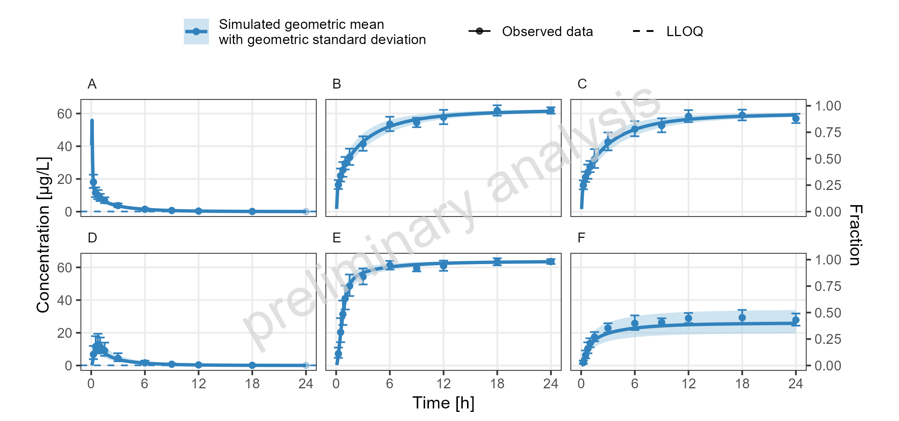
```
```{r}
#| output: asis
ospsuite.reportingframework::mdFootNote(subfolder = "Timeprofile", footNoteFile = "random_population-TP-linear-total.footnote", footNoteCustomStyle = params$customStyles$FigureFootnote)
```
\newpage
  
```{r}
#| label: fig-random_population-TP-log-total
#| fig-cap: "Simulated Concentration-time profiles for drugX metabolized by CYP3A4 (B, E), drugX metabolized by CYP3A4 in liver (C, F) and drugX plasma concentration (A, D) for simulation of an 1mg iv application for an adult population (A, B, C) and simulation of an 5mg oral application for an adult population (D, E, F) on a logarithmic y-scale."
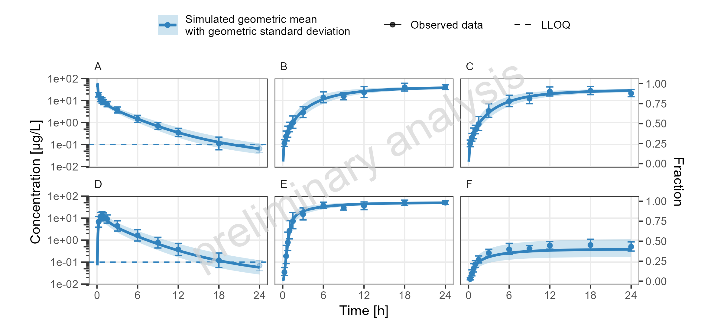
```
```{r}
#| output: asis
ospsuite.reportingframework::mdFootNote(subfolder = "Timeprofile", footNoteFile = "random_population-TP-log-total.footnote", footNoteCustomStyle = params$customStyles$FigureFootnote)
```
\newpage
  
  
  
  
## Adding Reference Populations  
  
  
```{r}
#| label: fig-reference-TP-linear-total
#| fig-cap: "Simulated Concentration-time profiles for drugX metabolized by CYP3A4 (B), drugX metabolized by CYP3A4 in liver (C) and drugX plasma concentration (A) for simulation of a 5mg oral administration vs 1mg iv simulation on a linear y-scale."
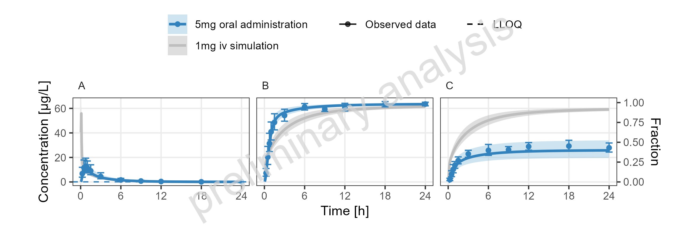
```
```{r}
#| output: asis
ospsuite.reportingframework::mdFootNote(subfolder = "Timeprofile", footNoteFile = "reference-TP-linear-total.footnote", footNoteCustomStyle = params$customStyles$FigureFootnote)
```
\newpage
  
```{r}
#| label: fig-reference-TP-log-total
#| fig-cap: "Simulated Concentration-time profiles for drugX metabolized by CYP3A4 (B), drugX metabolized by CYP3A4 in liver (C) and drugX plasma concentration (A) for simulation of a 5mg oral administration vs 1mg iv simulation on a logarithmic y-scale."
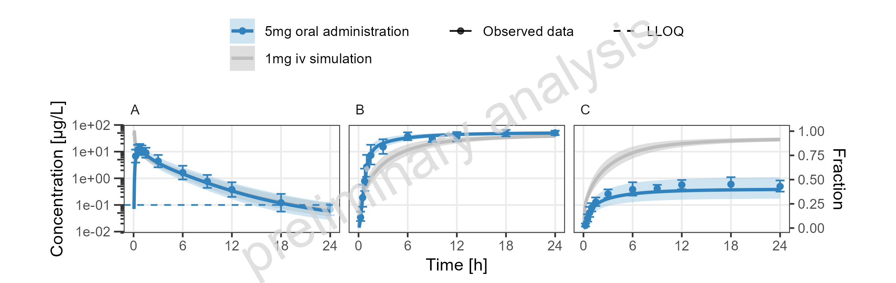
```
```{r}
#| output: asis
ospsuite.reportingframework::mdFootNote(subfolder = "Timeprofile", footNoteFile = "reference-TP-log-total.footnote", footNoteCustomStyle = params$customStyles$FigureFootnote)
```
\newpage
  
  
  
  
## Adding Plots with different Time Ranges  
  
  
```{r}
#| label: fig-timeranges-TP-linear-h0_6
#| fig-cap: "Simulated Concentration-time profiles for drugX metabolized by CYP3A4 (B), drugX metabolized by CYP3A4 in liver (C) and drugX plasma concentration (A) for simulation of an 1mg iv application for individual id 13 study 1234 on a linear y-scale Zoom on first 6 hours. DrugX was administered as a 1mg Iv application with an infusion time of 5 minutes."
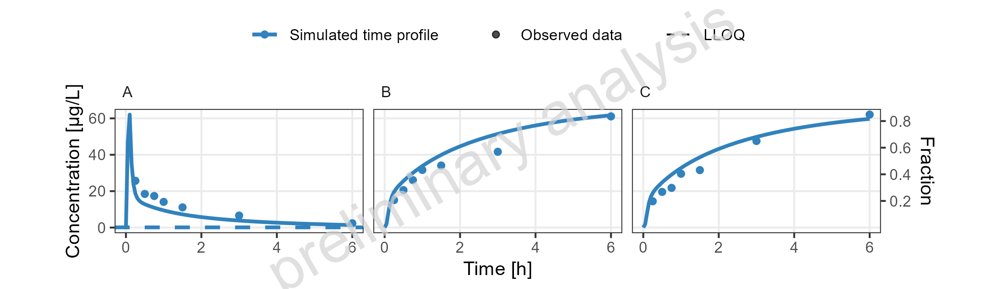
```
```{r}
#| output: asis
ospsuite.reportingframework::mdFootNote(subfolder = "Timeprofile", footNoteFile = "timeranges-TP-linear-h0_6.footnote", footNoteCustomStyle = params$customStyles$FigureFootnote)
```
\newpage
  
```{r}
#| label: fig-timeranges-TP-log-h0_6
#| fig-cap: "Simulated Concentration-time profiles for drugX metabolized by CYP3A4 (B), drugX metabolized by CYP3A4 in liver (C) and drugX plasma concentration (A) for simulation of an 1mg iv application for individual id 13 study 1234 on a logarithmic y-scale Zoom on first 6 hours. DrugX was administered as a 1mg Iv application with an infusion time of 5 minutes."
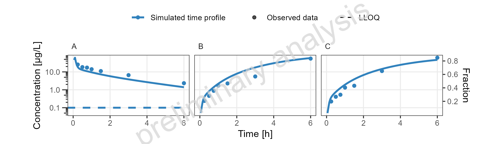
```
```{r}
#| output: asis
ospsuite.reportingframework::mdFootNote(subfolder = "Timeprofile", footNoteFile = "timeranges-TP-log-h0_6.footnote", footNoteCustomStyle = params$customStyles$FigureFootnote)
```
\newpage
  
```{r}
#| label: fig-timeranges-TP-linear-h6_24
#| fig-cap: "Simulated Concentration-time profiles for drugX metabolized by CYP3A4 (B), drugX metabolized by CYP3A4 in liver (C) and drugX plasma concentration (A) for simulation of an 1mg iv application for individual id 13 study 1234 on a linear y-scale Zoom on time range 6 to 24 hours. DrugX was administered as a 1mg Iv application with an infusion time of 5 minutes."
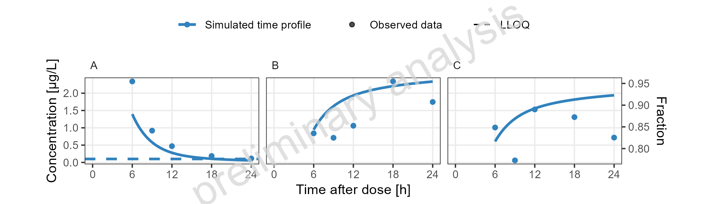
```
```{r}
#| output: asis
ospsuite.reportingframework::mdFootNote(subfolder = "Timeprofile", footNoteFile = "timeranges-TP-linear-h6_24.footnote", footNoteCustomStyle = params$customStyles$FigureFootnote)
```
\newpage
  
```{r}
#| label: fig-timeranges-TP-log-h6_24
#| fig-cap: "Simulated Concentration-time profiles for drugX metabolized by CYP3A4 (B), drugX metabolized by CYP3A4 in liver (C) and drugX plasma concentration (A) for simulation of an 1mg iv application for individual id 13 study 1234 on a logarithmic y-scale Zoom on time range 6 to 24 hours. DrugX was administered as a 1mg Iv application with an infusion time of 5 minutes."
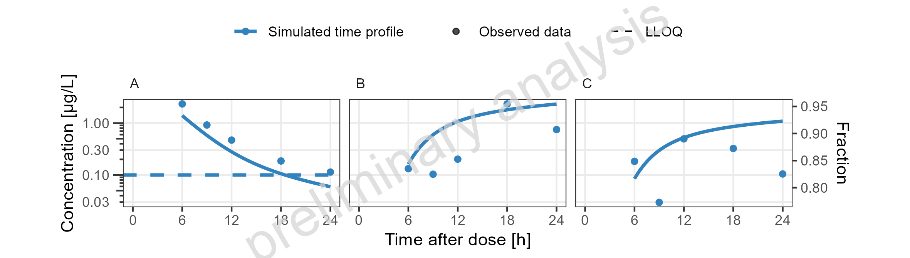
```
```{r}
#| output: asis
ospsuite.reportingframework::mdFootNote(subfolder = "Timeprofile", footNoteFile = "timeranges-TP-log-h6_24.footnote", footNoteCustomStyle = params$customStyles$FigureFootnote)
```
\newpage
  
```{r}
#| label: fig-timeranges-split-TP-linear-allTimeRanges
#| fig-cap: "Simulated Concentration-time profiles for drugX metabolized by CYP3A4 (C, D), drugX metabolized by CYP3A4 in liver (E, F) and drugX plasma concentration (A, B) for simulation of an 1mg iv application for individual id 13 study 1234 on a linear y-scale Zoom on first 6 hours (A, C, E) and Zoom on time range 6 to 24 hours (B, D, F). DrugX was administered as a 1mg Iv application with an infusion time of 5 minutes."
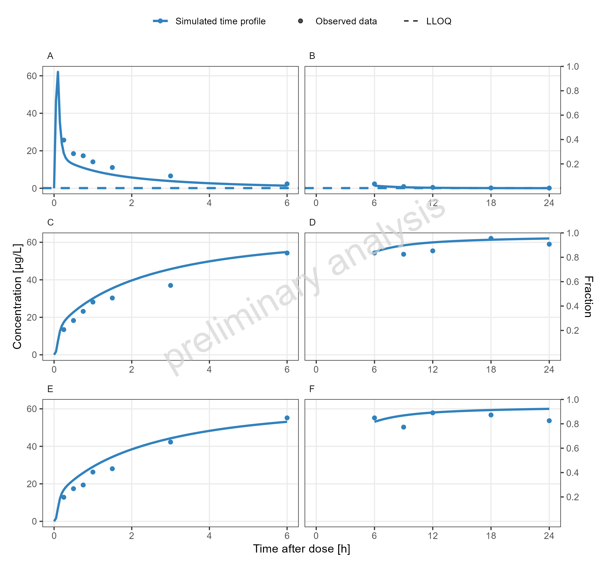
```
```{r}
#| output: asis
ospsuite.reportingframework::mdFootNote(subfolder = "Timeprofile", footNoteFile = "timeranges-split-TP-linear-allTimeRanges.footnote", footNoteCustomStyle = params$customStyles$FigureFootnote)
```
\newpage
  
```{r}
#| label: fig-timeranges-split-TP-log-allTimeRanges
#| fig-cap: "Simulated Concentration-time profiles for drugX metabolized by CYP3A4 (C, D), drugX metabolized by CYP3A4 in liver (E, F) and drugX plasma concentration (A, B) for simulation of an 1mg iv application for individual id 13 study 1234 on a logarithmic y-scale Zoom on first 6 hours (A, C, E) and Zoom on time range 6 to 24 hours (B, D, F). DrugX was administered as a 1mg Iv application with an infusion time of 5 minutes."
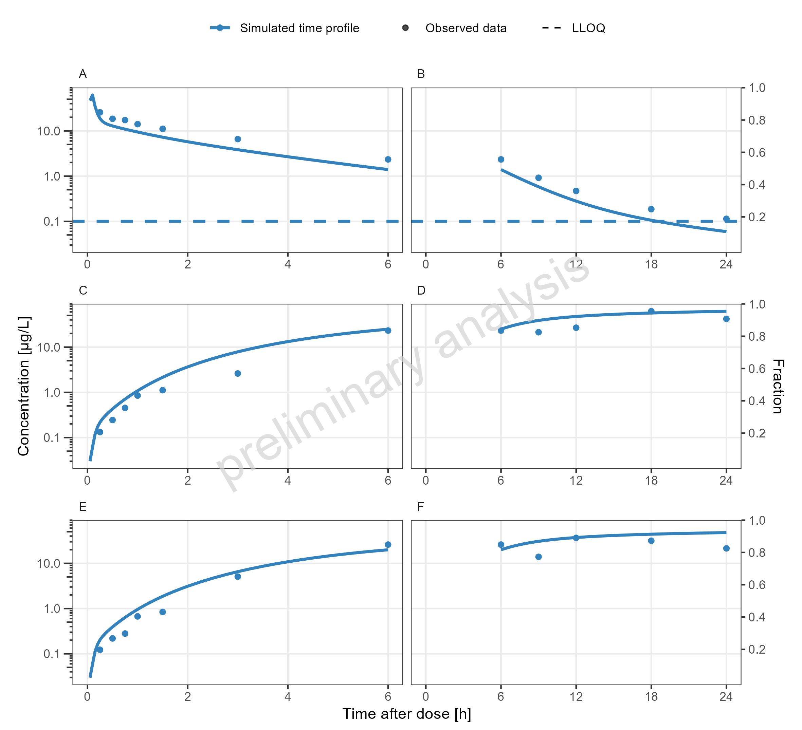
```
```{r}
#| output: asis
ospsuite.reportingframework::mdFootNote(subfolder = "Timeprofile", footNoteFile = "timeranges-split-TP-log-allTimeRanges.footnote", footNoteCustomStyle = params$customStyles$FigureFootnote)
```
\newpage
  
